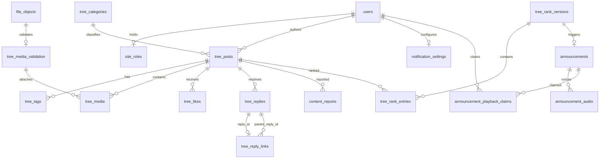

# Function3 数据表与事务边界

Function3新增迁移 `013_function3_tree.sql`、`014_function3_media_audio.sql`、`015_function3_speech_jobs.sql`、`016_function3_queue_indexes.sql`、`017_function3_delivery_failures.sql`，Phase35再新增 `018_tree_reply_links.sql`，不改已应用的旧迁移。数据库连接信息、密码、音频和模型不提交 Git。

日常环境复用原 `phase11 / 5432`，新功能在原库增加具名表。升级前备份并比较账号摘要；此次68个原账号保留。[启动、备份与停止](../ops/function3-runtime.md)解释日常入口与已有测试库的区别。

## 1. 新表分别是什么

| 表 | 类比与职责 | 关键约束 |
|---|---|---|
| `site_roles` | 站点管理员名册，与群角色独立 | 每用户一条 |
| `tree_categories` | 主题分类字典 | 名称唯一，停用后不允许新发布 |
| `tree_posts` | 果实主登记卡，正文、作者、可见状态、版本 | 作者+请求键唯一 |
| `tree_tags` | 果实标签 | 同果实同标签唯一 |
| `tree_media_validation` | 媒体实际解码合格证 | 每文件一条，保存实际类型/时长/派生路径 |
| `tree_media` | 把媒体挂到某枚果实上 | 关联位置与文件 ID |
| `tree_likes` | 有效点赞关系 | 每果实每用户最多一条 |
| `tree_replies` | 详情里的文字回复 | 作者+请求键唯一，删除为软删除 |
| `tree_reply_links` | 回复信封上的收件人，记录父评论 | reply_id唯一；两端外键；子ID大于父ID；业务层校验同果实 |
| `function3_outbox` | 提交后待发货单 | 类型+aggregate+版本唯一，状态/租约/重试次数 |
| `function3_delivery_failures` | 消费失败的运维登记，不保存正文 | Topic+Broker key 唯一，记录次数及恢复状态 |
| `function3_inbox` | 消费者已处理收据 | consumer+event_id 唯一 |
| `site_audit` | 站点操作原因和操作者流水 | 不作为可随意清理的缓存 |
| `content_reports` | 举报与处置状态 | 每用户每果实最多一条举报 |
| `tree_rank_versions` | 每 30 秒结算的一张榜单封面 | slot 唯一 |
| `tree_rank_entries` | 某版榜单的前十名 | 版本+名次唯一，版本+果实唯一 |
| `announcements` | 榜单换位生成的全站文字通知 | 每榜单版本最多一条，默认五分钟有效 |
| `announcement_audio` | 两种音色的任务与生成结果 | 公告+音色唯一，有限重试与租约 |
| `notification_settings` | 用户自己的声音开关和音色 | 用户唯一，默认关闭 |
| `announcement_playback_claims` | 多标签页共用的播报领取凭证 | 用户+公告唯一 |

## 2. 关系图

Outbox 与 Inbox 是逻辑事件链路，不以数据库外键假定消息只投递一次。旧 `outbox_events` 的聊天事件先搬入 `function3_outbox` 后才确认旧事件完成。

## 3. 必须一起提交的内容

1. 发布/点赞/回复/删除：业务变化与 Outbox。
2. 排名变化：榜单版本、前十条目、公告、公告事件和语音请求事件。
3. 消费语音请求：Inbox 与男女两条语音任务。
4. 语音成功：音频 ready 与 `announcement.audio.ready` 事件。
5. 管理员重放：恢复 pending 状态与操作原因审计。
6. 定向回复：正文、父回复关系与事件；同请求键必须具有同正文、同目标，不能重复写或悄悄改回复对象。

模型启用仍使用旧模型库自己的原子切换和激活审计；站点操作意图单独记录，不把两个存储调用假称为一个分布式事务。

## 4. 查询和维护注意事项

- 列表按独占 ID 游标分页，不使用越来越深的 OFFSET。
- `state='published'` 是树大小、列表、媒体访问与榜单的共同可见边界。
- 七日榜从单个 MVCC 查询取得有效互动，作者自身互动不计分。
- 数据库保留软删除记录、审计、Outbox/Inbox 和榜单历史；这些是持久数据，不是无限内存队列。
- 音频缓存有配额和过期清理。数据库的历史归档、磁盘告警和备份应由部署策略管理，不自动删除用户业务数据或审计。

表结构以迁移文件为准；应用不会偷偷执行迁移。仅隔离测试脚本能初始化固定 `_test` 库。

迁移 017 还为未完成语音任务的领取/过期扫描增加部分索引。失败投递与 Inbox 分开：失败事务回滚后独立登记，成功重投后标记 resolved；数据库完全不可用时依靠 Broker 的 NACK 重投，不能声称本地失败记录也一定写入成功。

迁移024追加`conversation_preferences`，与成员建立联合外键，并增加公开用户前缀/活动消息游标索引，详见[表说明与事务边界](phase43-47-chat-workspace.md)。
