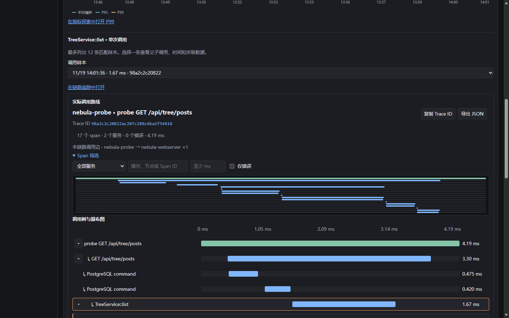
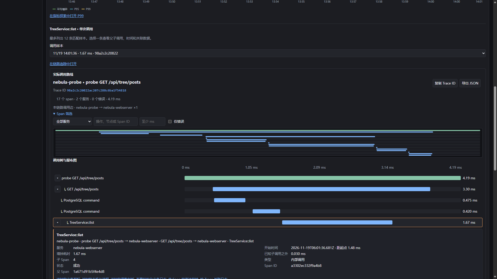
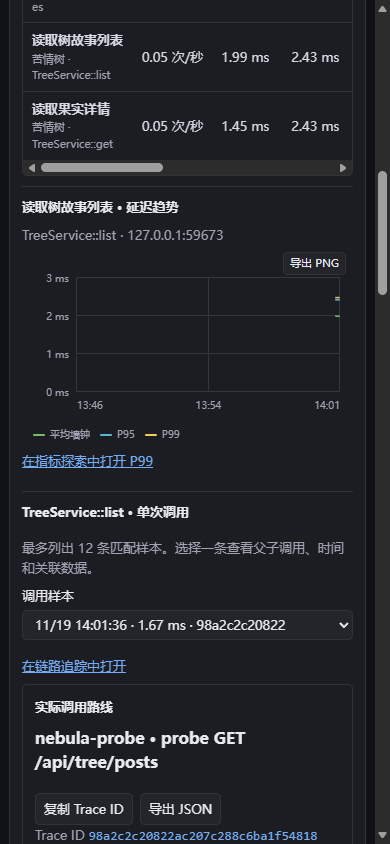

# 2026-11-19 业务埋点验收导出

这是本轮选定的公开验收导出，不是全部运行日志。没有账号密码、运维 Token、数据库文件或用户内容。运行中的日志、趋势和本机 Trace 仍按七天策略清理；这份导出单独留存用于复核。

- [汇总与范围](summary.json)：二进制、实际功能开关、测试、真实请求、监控累计与增量、浏览器及限制。
- [长任务桶之前的三轮](before-long-buckets.json)：早期候选的测量，不能替代最终版本。
- [长任务桶候选未通过的三轮](long-buckets-failed.json)：保留一对 ACK P99 超过 20% 的原判定。
- [该候选的十对 A/A](aa-ten-pairs.json)：同一二进制、空迁移夹具和配置；每次 1,200 条成功 ACK，未删除异常值。样本波动较大，不是置信区间。
- [最终候选三轮开关对照](candidate.json)：各对 ACK P99 与 `/fast` 中位数数值门槛通过；不据此声称性能提升。
- [导出摘要](sha256.json)：JSON 与截图的 SHA-256。

最终候选随后修复了同步取消的 Trace 显示；因此十对 A/A 的二进制摘要与最终候选不同。汇总明确保存两个摘要，不能把前一候选的校准当作后一候选的完整校准。

[验收说明与结论](../../../observability/validation.md#2026-11-19-跨业务埋点) · [埋点讲义](../../../observability/business-instrumentation.md)
