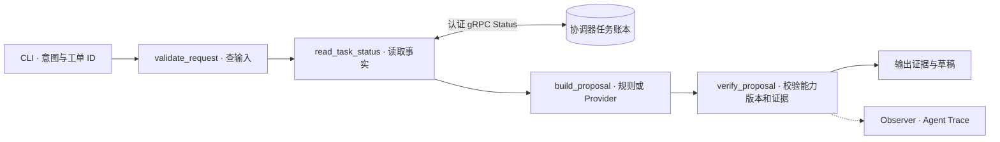
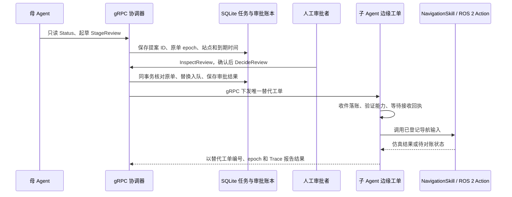

# 用 NEBULA 学母 Agent、工具与 Skill

这次练习从一张车队工单开始。你给母 Agent 一个工单编号，它沿着四个 DAG 节点读取状态、生成候选建议并复核证据。模拟重排草稿可进入人工审批，批准后交给已有边缘导航接口。同一次 Trace 能连接草稿、审批和执行。默认入口使用规则规划器，可通过 Python 适配器连接已安装的本地 Ollama。

## 一、先理解四个角色

1. **工单**记录任务事实。协调器的账本保存 `taskId`、当前阶段、`epoch` 和原任务的 `traceId`。`epoch` 是协调器用来核对后续回执的代号，工单入队时已分配。
2. **Skill**声明系统可做的一种操作。`fleet.get_task_status@1` 查询事实，`fleet.propose_sim_reschedule@1` 生成模拟重排草稿。`@1` 对应接口版本。知道版本，调用者才知道输入、输出和行为如何解释。
3. **Agent**组织证据和建议。可以把它当成负责查账本、标出风险并写建议的值班员。每份建议带证据编号。规划器可换，复核规则由系统掌握。
4. **DAG**负责节点何时执行。`read_task_status` 成功后，`build_proposal` 才能读取完整快照。读取遇到权限拒绝时，后续两步跳过，Observer 留下拒绝原因。

## 二、沿一次执行读代码



按入口、编排和领域规则的顺序阅读，遇到 gRPC 或超时问题再追到适配器。 [命令行入口](../../backend/agent/program/FleetAgentCli/FleetAgentCli.cpp) · [Agent 工作流](../../backend/agent/application/FleetAgent/FleetAgent.cpp) · [提案规则](../../backend/agent/domain/FleetProposal/FleetProposal.cpp) · [gRPC 读取](../../backend/agent/infrastructure/FleetStatusGrpc/FleetStatusGrpc.cpp)

这段 C++ 展示一个测试用的调用形状。`reader` 由调用方提供，类型为 `TaskEvidenceReader` 的实现，测试中用固定数据替换 gRPC。`RunOptions` 提供独立的 `runId` 和取消信号，Trace ID 由执行器生成。

```cpp
using namespace nebula;
agent::FleetAgent runner(reader);
const agent::Request request{agent::Intent::simulateReschedule, {"demo-queued"}};
const auto answer = runner.run(request, {.runId = "lesson-first-proposal"});
```

`proposal` 有值表示草稿通过本轮复核。候选提案只携带 Skill ID、版本和引用的工单 ID。若继续走审批，协调器从账本重新读取原单，并核对现场状态有没有变化。

## 三、亲手跑两遍

### 1. 跑离线用例

在项目根目录执行，使用已安装的 C++20 工具链。

```powershell
python -B scripts/project/cpp_systems.py --build-dir build/agent-learning --config Debug
ctest --test-dir build/agent-learning -C Debug -R '^nebula_agent_contract$' -V
```

输出会包含固定案例数。挑三组测试读断言，分别验证未知能力直接拒绝、证据源明确不可用时最多重读一次，以及模拟 Provider 不可用而证据有效时使用规则。再检查同一份证据下，错误版本和凭空添加的工单编号如何被拒绝。 [离线案例](../../tests/cpp_systems/AgentContract/AgentContract.cpp)

### 2. 跑真实 gRPC 查询与 Observer

复用车队验收使用的 gRPC SDK 和隔离协调器。先启动协调器，按 C++ 指南配置 `NEBULA_FLEET_OPERATOR_TOKEN`，保留一个尚未连接的模拟边缘，从而留下排队工单。当前 lab 凭据具有协调器操作者权限，保持在终端环境中。 [车队启动与认证](../ops/validation/cpp-systems.md#二启动本机演示)

```bash
python3 -B scripts/project/cpp_systems.py --build-dir build/agent-grpc --with-grpc
FLEET_BIN=build/agent-grpc/fleet/transport/grpc
AGENT_BIN=build/agent-grpc/agent/nebula_fleet_agent
read -r -p '输入隔离协调器打印的 READY 地址 ' FLEET_ENDPOINT
"$FLEET_BIN/nebula_fleet_ctl" "$FLEET_ENDPOINT" submit demo-queued alpha
"$AGENT_BIN" --events "$FLEET_ENDPOINT" propose demo-queued 2>agent-events.jsonl
"$FLEET_BIN/nebula_fleet_ctl" "$FLEET_ENDPOINT" status demo-queued
```

`FLEET_ENDPOINT` 使用隔离协调器打印的 `127.0.0.1:端口`。Windows 可使用已有 SDK 的 `--prefix`，二进制扩展名为 `.exe`。遇到 MinGW 或 `protoc` 的中文路径限制时，使用 C++ 复现文档中的 ASCII 路径方案。建议输出的 `evidence[0].traceId` 指向原工单，最外层 `traceId` 指向这次 Agent 运行。自动化进程用例还会复现一张 `uncertain` 工单并验证 `review`。`review` 接受至多三个已知 ID，需要由调用者选择要分析的时间窗和工单。

将 `agent-events.jsonl` 按车队流程导入隔离 Observer，使用最外层 Trace ID 找到 `read_task_status` 和 `verify_proposal`。事件保留节点、状态、尝试与错误码。证据 ID、任务 Trace、模型候选和令牌只在各自使用路径内流转。 [Observer 导入流程](../ops/validation/cpp-systems-cross-vm.md)

## 四、动手自检

1. 使用进程用例 `held` 和 `crash-executing`，分别比较 `queued` 与 `uncertain`。试着解释为何前者可生成模拟重排草稿，后者适合先核对旧执行结果。
2. 把离线测试中 Provider 提议的 `version` 从 `1` 改到 `2`。从失败原因反推 Skill 注册表检查了哪些字段。
3. 把 Provider 的等待时间延长至超出节点总时限。观察工作槽为什么要等适配器真正退出，再尝试用 `stop_token` 提前结束等待。
4. 说清两个 Trace 的用途。用 Agent Trace 解释为何提出建议，用原工单 Trace 查它走到哪一段。

这一层适合做值班诊断、工具编排与人工审核。它依赖可靠的证据源和明晰的技能契约。实时控制仍由设备侧负责。下一课练习 Skill 的 effect 与对账语义。 [M02 v1 Skill 合同](../roadmap/embodied-systems/skills/README.md) · [M01 指导](../roadmap/embodied-systems/m01-agent.md)

## 五、提案原型的验收记录

Windows Debug 3/3，Release 含 gRPC 4/4。Agent 合同覆盖 32 个固定案例，修正超时测试的临界唤醒后连续复跑 12 次。真实进程用例覆盖操作者查询、机器人凭据被拒、提案后原工单状态不变，以及 Observer 重放后仍只有同一批 17 条事件。Linux 原生 TSan 2/2 属于 Agent 之前的标签。 [提案原型验收](../evidence/agent/20261123/summary.json) · [C++ 基线](../ops/validation/cpp-systems.md)

## 六、从提案到 ROS 边界



**默认流程。** 协调器用新增的 `--agent-sim` 明确开启隔离审批。普通操作端通过 `nebula_fleet_ctl` 提交演示工单。三个 Agent 凭据由协调器环境接收，互不相同。运行终端按职责只放所需变量。 [启动配置与原有角色](../ops/validation/cpp-systems.md#二启动本机演示)

| 终端角色 | 所需变量 | 可做的事 |
|---|---|---|
| 查状态和起草 | `NEBULA_FLEET_AGENT_READ_TOKEN`、`NEBULA_FLEET_AGENT_DRAFT_TOKEN` | `Status` 读取事实，`StageReview` 保存模拟草稿 |
| 人工审批 | `NEBULA_FLEET_AGENT_REVIEW_TOKEN` | `inspect`、`approve`、`reject` |
| 操作者 | `NEBULA_FLEET_OPERATOR_TOKEN` | 车队现有 `submit` 和 `status` |
| 机器人边缘 | `NEBULA_FLEET_ROBOT_TOKEN` | 此设备的 gRPC 工单交换 |

**一次手动演练。** 使用隔离运行目录和账本。`BIN`、`AGENT_BIN`、`ADDR` 取编译产物及隔离协调器 `READY` 输出。暂时不启动能领 alpha 工单的边缘，确保原单处于 `queued`。下面四段分别在相应角色的终端执行。

```bash
# 协调器终端，除运营和机器人令牌外设置三个 Agent 角色令牌
"$BIN/nebula_fleet_coordinator" 127.0.0.1:0 fleet.sqlite --agent-sim alpha 1 LAB_EDGE_A beta 2 LAB_EDGE_B

# 操作者终端
"$BIN/nebula_fleet_ctl" "$ADDR" submit lesson-approval alpha

# 起草终端
"$AGENT_BIN" --events "$ADDR" stage lesson-approval 2>stage.jsonl

# 审批终端，输入上一条输出中的 proposalId
read -r -p '提案 ID ' PROPOSAL_ID
"$AGENT_BIN" "$ADDR" inspect "$PROPOSAL_ID"
"$AGENT_BIN" --events "$ADDR" approve "$PROPOSAL_ID" 2>approve.jsonl
"$AGENT_BIN" "$ADDR" approve "$PROPOSAL_ID"
```

两个 `approve` 返回同一个 `replacementTaskId`。在起草时固定 `sourceEpoch` 和站点，窗口为 300 秒。若原单先被机器人领取，审批将返回 `stale`；若操作者明确拒绝，则保留 `rejected`。已批准的原单以 `failed` 和 `agent_superseded` 记录退出原因，便于兼容旧状态枚举；复盘工具会把这种业务替换排除。Trace 可交给 Observer 复核。 [审批事务](../../backend/fleet/infrastructure/SqliteFleetLedger/SimulationReviewSql.cpp)

启动实验边缘时选软件导航参数 `5`，或者复用 Ubuntu_ros 的 `nav2` 装配及独立 DDS 仿真环境。结果上报处的工单编号是替代工单 ID。边缘工单在真正进入 `NavigationSkill::navigate` 前先检查准备度和站点能力。本轮用软件模拟边缘验收母子交接，在既有 ROS 适配器调用边界停止。 [边缘工作流](../../backend/fleet/application/TaskWorkflow/TaskWorkflow.cpp) · [既有 ROS 2 仿真与跨机复跑](../ops/validation/cpp-systems-cross-vm.md)

**接本地模型。** Ollama 已运行并列出模型时，再把实际模型名传给 Python 适配器。适配器只访问 `127.0.0.1:端口`，取得候选后交给 C++ 重新读取与校验；模型离线或超时会使用规则，格式错误和伪造引用终止起草。`--events` 将各阶段归到同一 Trace，只发送有界技术字段。先用 HTTP 夹具验证这些边界，再评估真实模型的候选通过率、P95 时延和 Token 数。 [Ollama 接口](https://docs.ollama.com/capabilities/structured-outputs) · [Python 适配源码](../../tools/agent/ollama_planner.py)

```bash
python3 -B -m tools.agent.ollama_planner --agent "$AGENT_BIN" --endpoint "$ADDR" \
  --model "$EXISTING_MODEL" --timeout 45 --events stage lesson-approval 2>model.jsonl
```

在学习审批恢复时先理解 `proposalId` 对应不可变草稿，再用 LangGraph 的 `thread_id` 和检查点做对照。 [LangGraph 实验](langgraph-nebula-lab.md)

**本次验证。** Windows Debug 3/3，Release 含 gRPC 6/6。协调器重启与并发确认只产生一张替代工单，边缘账本显示一次启动。Observer 查回同一 Trace 的 49 条起草、审批和执行事件，重放后仍为 49 条。模型适配通过五种本机 HTTP 测试，真实 Ollama 推理和 Ubuntu_ros 的新增审批链路待复验。 [审批与交接证据](../evidence/agent/20261123/approval-handoff.json)

## 七、用真实模型做对照

在已有 Qwen2.5-0.5B INT4 和 ONNX Runtime GenAI 的 Linux 环境运行。使用隔离 Release 构建产物，填写现有 Python 环境和本地模型目录。脚本启动临时协调器和模拟边缘，以 gRPC 查出的排队、完成、待对账工单做输入，仅返回分类和候选核验结果。 [评测脚本](../../examples/agent/onnx_planner_eval.py) · [ONNX Runtime GenAI Python 接口](https://onnxruntime.ai/docs/genai/api/python.html)

```bash
"$EXISTING_ONNX_PYTHON" -B examples/agent/onnx_planner_eval.py \
  --build build/m07-release --model "$EXISTING_QWEN_INT4_DIR"
```

| 结果 | CentOS 这次测量 |
|---|---:|
| 固定分类题 | 24 |
| 规则命中 | 24 |
| 真实模型命中 | 13 |
| 模型格式错误 | 0 |
| C++ 核验接受的候选 | 8 |
| 模型采样 P50 / P95 | 1.16 秒 / 1.50 秒 |

模型先输出 A、B 或 C，再由脚本构造有界候选，C++ 按同一批已认证工单重查和复核。这是小模型的定向分类评估。当前耗时超过在线规划节点的 200 ms Provider 预算，规则仍是默认。从报告里选一条分类答错的样本，先看事实，再看合约为何拒绝。另选一条被模型判断成无建议的案例，说明为何生成模型的漏报不能用核验解决。 [M00–M07 测试与故障复验](../ops/validation/m00-m07.md)
