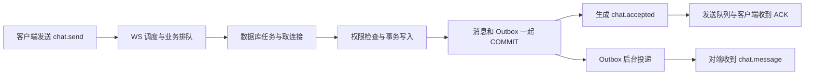

# NEBULA 实战学习：性能定位与故障恢复

目标：你已经认识 Reactor、协程、WebSocket、SSE 和 HTTP/2。接下来练习的是：**遇到变慢或故障时，自己找证据、做最小修改、证明修改有效。** 本计划可以直接复制到 Obsidian。按课推进，练习和自检通过后，由你决定是否进入下一课。每课约 45–90 分钟。

## 第一部分：给我自己看的学习与实验计划

### 1. 先把一条消息的账算清楚

把发消息想成寄快递：柜台接单、仓库入账、派车、收件人签收，是四个不同时间点。



- **持久化 ACK**：服务端确认这条消息已经落入事务，或同一幂等键以前已成功。对方离线也可以得到这个结果。对方收到、已读另有事件。
- **幂等键**：像汇款的业务流水号。超时后查不到回执，就带原编号重试。换编号相当于再下一个订单。重连后换的是连接，发送意图与消息编号不变。
- **P99**：把延迟按从快到慢排，靠近最慢 1% 边界的值。P99 变化时先看样本数、最慢几条的分段和错误数。某轮 100 次里多一条极慢请求，就可能使 P99 明显变化。
- **A/A**：同一程序、配置、数据和负载测两遍，像先拿同一个砝码检查秤是否稳定。**A/B** 才是只换一个变量后评估收益。
- **RTO / RPO**：恢复可用花多久 / 丢掉了多早以来的数据。一次故障演练可以说“观察到 X 毫秒恢复，已确认的一条消息保留”；无法推出全站恢复 SLA、所有写入零丢失。
- **线程边界**：Reactor 管网络就绪，业务执行器排任务，数据库连接池借连接；三处都可能排队。TCP 读写变快，也不能让 PostgreSQL 持有的锁自动释放。

### 2. 三周学习清单

| 课 | 学习与实验 | 交作业的标准 |
|---|---|---|
| 1 · 基线 | 从干净目录验证 Linux 业务档。记提交、二进制摘要、迁移、CPU、编译类型和可选功能。分别请求 /fast 和聊天 API。 | 能用自己的话解释为什么 /fast 很快仍可能聊天慢；能指出证据文件。 |
| 2 · 消息链路 | 从 `Phase11Realtime` 查 `chat.send`，顺着 `ChatService`、`PostgresStore::Transaction` 和 Outbox 追踪一次发送。对照前端待确认状态。 | 画出入站、排队、事务、ACK 和对端通知；标出哪两个动作共用同一事务。 |
| 3 · 统计与 A/A | 固定二进制、负载、并发和预热。练习从 Python 列表算 P50/P95/P99。正式校准用至少十对 A/A，每轮至少 1,000 条成功聊天 ACK，记 /fast 和业务错误，保留全部轮次。 | 交原始分布、成对变动范围和重复步骤。数据噪声超门槛时不开展 A/B 优化宣称。 |
| 4 · 容量曲线 | 先跑 1/4/16 并发工作端，随后依据资源预算逐档加并发；每档预热后持续观测，给出稳定窗口。观察吞吐、错误、ACK P99、CPU、连接数、RSS 与队列。 | 能区分工作端、TCP 连接、请求到达率和在途任务；指出可能拐点和需要补测的区间。 |
| 5 · 分段追尾 | 关闭采样拿对照，再单独打开采样。按服务端消息 ID 对齐最慢 1% 的客户端 RTT 和服务端各段；和同轮数据库执行器指标对照。 | 给出两条竞争假设，能说哪条被数据弱化、哪条仍需测；不把两个 P99 相减当作分段 P99。 |
| 6 · PostgreSQL | 用临时库做 `EXPLAIN (ANALYZE, BUFFERS)`，检查会话列表、历史、Outbox 典型查询。对比估计与实际行数、扫描、排序和等待；针对一条 SQL 改一个因素。 | 提交执行计划前后和数据规模，解释索引成本；`ANALYZE` 会实际执行语句，写语句只在临时库练习。 |
| 7 · 数据库故障 | 跑隔离的 `faults`。先终止这个临时库的连接，再观察 /health/live、错误响应和何时恢复。另开一次实验，受控持有临时测试表的锁来区分连接断开和执行等待。 | 能解释为什么修连接池不等于重跑事务，记下恢复用时、失败请求和一次写入证据。 |
| 8 · 进程故障 | 临时进程先返回持久化 ACK，再被杀死；重启后用相同消息编号发送并查历史。进阶：用测试替身或受控暂停点模拟“提交后、ACK 前断开”，与本版演练分开记录。 | 证明只写一行、消息 ID 不变；明确 ACK 前后崩溃覆盖了哪种，哪些状态仍不确定。 |
| 9 · 背压和依赖 | 设计慢接收端、消息队列断开、AI Worker 失败三个独立实验。先明确聊天、通知、AI 各自允许的退化；对照 Outbox 积压、超时、队列与重放。 | 交每个故障的预期、观察、回退；只有在本轮实际启用的可选依赖才记为已验证。 |
| 10 · 定向读源码 | 只读能回答当前假设的模块。NGINX 看 epoll 事件交给谁和何时延迟处理；Muduo 看唤醒和待执行任务；Asio 看 strand 如何串行回调，Beast 看异步写入的对象与缓冲区寿命。 | 对照 NEBULA 画一张小图，列出一项能验证的借鉴和一项不适用的原因。 |
| 11 · 最小 A/B | 按证据选一个应用层改动：SQL/索引、任务/连接预算或 Outbox 工作批次。先定相同负载、成功标准和回退方法，再跑三轮以上。 | 同时报告正确性、吞吐、P99、错误和资源，A/A 波动大于收益时标为证据不足。 |
| 12 · 复盘与长跑 | 写一份故障报告和性能报告。先小流量长跑，逐步到有日志和存储上限的 24 小时测试；验证进程退出、积压和内存趋势。 | 别人按文档能重复；每条结论附证据、环境和未覆盖事项。 |

### 3. 如何根据看到的现象决定下一步

| 观察 | 优先查 | 目前不能下的结论 |
|---|---|---|
| 取连接段明显增长 | 连接池占用/超时、慢事务持有连接多久、连接重建次数 | 直接加连接就能提高性能 |
| 取连接快，但 COMMIT 之前时间增长 | SQL 计划、行锁、会话内竞争、数据库执行时间 | 这一段全是 SQL 时间 |
| COMMIT 段明显增长 | 持久化 I/O、WAL 等待、虚拟机存储抖动，核对数据库等待指标 | 关闭持久化可以作为等价优化 |
| RTT 很高，服务端 ACK 就绪短 | 入口/执行器排队、输出调度、客户端调度、传输；用同一消息 ID 缩小范围 | 两者差值就是网卡耗时 |
| ACK 快，对端通知慢 | Outbox 状态、投递轮询/唤醒、消费者重试、接收方队列 | 已持久化消息丢了 |
| /fast 和聊天都慢 | 先排共享 CPU、VM 抢占、客户端或测量环境；再看固定核心路径 | 立刻替换 Reactor 或协议库 |

排障顺序：确认故障范围 → 找到第一个异常边界 → 用受控实验复现 → 检查降级和恢复 → 用同配置重测。数据库断连后，先区分“还没发 SQL”“SQL 执行失败”“COMMIT 结果未知”。修复可复用连接；写入是否发生由同键重试与数据库记录来判断。

### 4. 实验模板（复制到每节课的日记）

- [ ] 问题：……
- [ ] 当前假设及能推翻它的观察：……
- [ ] 提交、构建、迁移、线程、数据规模、实验模式：……
- [ ] 对照、实验改了什么、样本数及预热：……
- [ ] 证据：吞吐、P50/P95/P99、错误、资源、慢样本/等待……
- [ ] 结论：观察到……；推测……；仍无法区分……
- [ ] 回退与安全边界：只操作本轮临时数据库和进程；不用日常 18090、原业务库或真实用户资料注入故障。
- [ ] 用我自己的话复述：……

### 5. 在当前项目从哪里开始

| 关注点 | 在项目里搜索 |
|---|---|
| ACK 语义与 WebSocket 适配 | `Phase11Realtime::registerHandlers`、`chat.accepted` |
| 线程排队与观测 | `BoundedExecutor`、`BusinessMetricsFormatter` |
| PostgreSQL 连接和提交 | `PostgresConnectionPool::acquire`、`PostgresStore::Transaction` |
| 单条消息的分段采样 | `ChatAckTrace`、`WEB_CHAT_ACK_TRACE_LIMIT` |
| 临时库、测试与复现 | `scripts/project/reproduce.py`、`scripts/function3/validation/function32_lab.py` |
| 混合压测与历史证据 | `benchmarks/function3_mixed.py`、Phase49、Function3.2 发布说明 |

阅读顺序建议：先按业务链跑通一条消息，再有目的地读源码。学习 NGINX 和 Boost 有价值，现阶段没有证据表明换库会解决本项目的 ACK 尾延迟。

- [PostgreSQL：Using EXPLAIN](https://www.postgresql.org/docs/current/using-explain.html)
- [NGINX：epoll 事件模块源码](https://github.com/nginx/nginx/blob/master/src/event/modules/ngx_epoll_module.c)
- [Muduo：EventLoop 源码](https://github.com/chenshuo/muduo/blob/master/muduo/net/EventLoop.cc)
- [Boost.Asio：strand 的串行回调规则](https://www.boost.org/doc/libs/latest/doc/html/boost_asio/overview/core/strands.html)

## 第二部分：以后发给助教的提示词

任选一段复制到新会话，在方括号里填写本次课程或现象。可以附上上一课记录，不必重讲已经掌握的协议基础。

### 提示词 A · 性能定位与优化

```text
你是我的 NEBULA C++ 项目性能助教。带我学习第 [课号] 课，现象是 [指标/业务]，已有证据是 [报告或日志]。

我已经熟悉 WebSocket 基础、Reactor、SSE、HTTP/2。先读取当前代码和已验证报告，给出文件与函数名，区分当前结果、历史结果和假设。围绕“现象 → 时间线 → 两个竞争假设 → 可推翻的实验 → 证据 → 一项最小改动 → 对照验收”讲解。先用生活类比讲清一个新概念；小型统计练习用 Python，线程、对象寿命与背压示例用 C++。

每次只讲一个关键点。给我能在临时环境运行的命令，并解释关键参数、预期输出和异常分支；不凭猜测宣称瓶颈或收益。谈 P99 需报告样本数、错误、预热和同配置对照。对齐单条请求后再比较分段；不要把两个分位数相减当作网络延迟。把 /fast、持久化 ACK、投递与已读分开。

保持 backend/server 不变，不重启我的日常服务，不碰原业务库，不下载新依赖。先让我复述原因、指出一个反例并完成一项练习。给出我的理解评价和下一课建议，然后等我决定是否继续。
```

### 提示词 B · 故障处理与恢复

```text
你是我的 NEBULA 故障演练助教。这次学 [连接终止 / 进程崩溃 / ACK 不确定 / 慢客户端 / Outbox 积压]。我已有基础网络知识，请从真实业务路径和一次可控故障入手。

先讲这类故障对发送者、接收者和后台投递的不同影响。让我先预测健康探针、错误返回、事务、已持久化消息、客户端重试和恢复状态，再指导我在本课脚本自己启动的实例上注入一个故障。写清资源归属、终止条件、回退步骤、测试用户、相关日志以及最早需要关注的指标。不要对日常服务、原库或宿主机注入故障。

用同一个 client_message_id 验证重试；核对消息行数、返回的服务器 ID、历史和可观察的投递结果。区分失败、结果未知、已提交、已投递和已读。分别写观察到的恢复时间和数据核对范围，不把单次结果称为全站 SLA。没有故障注入点或没跑实验就明确说未覆盖。

最后给我一题解释“连接恢复为何不等于事务可以自动重放”，评价我的复述，指出适用场景和下一条演练，并停下来等我继续。
```
