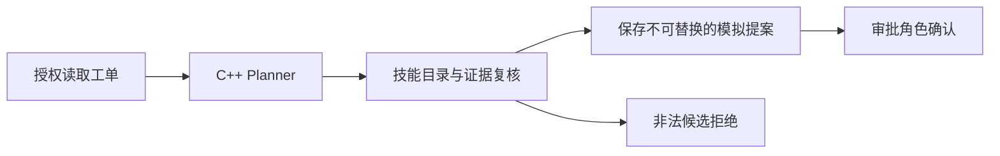

# v0.4 Fleet Agent 与 DAG 实操

## 1. 从一个模型建议走到人工审批

- **Tool 负责读数据。** 从三个只读入口理解数据怎么进 Agent。`fleet.get_task_status` 查一单，`fleet.list_tasks` 按 `epoch` 游标翻页，`fleet.query_evidence` 给出状态、结果、traceId 和是否待对账。gRPC 在读数据前校验调用凭据。
- **Planner 给候选。** C++ 复用已有的 Ollama HTTP Provider。模型只接收当前工单允许的摘要，返回技能名、版本和它使用的证据编号。Ollama 的传输走流式接口，候选在后台凑齐后解析。 [Ollama Chat API](https://docs.ollama.com/api/chat)
- **规则复核候选。** `findSkill` 检查登记的版本和效果。`allowedProposal` 再根据真实证据算出允许的候选。两项都通过，服务才返回可提交的提案。`IDatabase`、`ITransaction` 和 `PostgresStore` 不参与工具注册。
- **人工审批有自己的角色。** 用草稿凭据登记提案，用审批凭据确认后才会生成模拟替代工单。只读凭据无法派发任务。网络超时可回退到规则，已经收到的非法候选会拒绝。



试着把合法的候选换成 `unknown.skill`。在合约测试中，它会经过真实 HTTP 适配器，到达 C++ 校验并返回 `proposal_rejected`。把版本的字符串改成数字，检查是否在更前面的解析层返回 `provider_malformed`。 [Ollama 适配器](../../backend/agent/infrastructure/OllamaProposalProvider/OllamaProposalProvider.cpp) · [证据复核](../../backend/agent/application/FleetAgent/FleetAgent.cpp)

## 2. 理解会话与压缩

Fleet 的历史记录只存已验证的任务编号。一次保留最近六轮，更旧的轮次压缩为最多三个去重编号。没有显式任务参数时，服务优先从最近轮次取候选，再补摘要。取出的每个编号还会重新通过 gRPC 校验。换一个会话号后，读取的是另一个窗口。

你可以把它想成一个工单索引卡片。卡片帮助你想起上一次看的工单，实时状态要回到原系统查。这个思路与网页助手的“近期窗口、旧对话摘要、带入当前上下文”一致。网站的私人对话与个人记忆仍在原入口处理，Fleet 的后端会话记录以工单证据为粒度。

## 3. 理解租约与迟到写入

租约像一张有有效期的工牌。Worker A 领到节点时，数据库记录这张工牌的持有人、过期时刻和第几次尝试。A 暂停后，B 可在过期时重新领取适合重试的节点。B 拿到的是新尝试号，原来的业务幂等键仍然相同。

```cpp
auto leased = queue.claim(runId, graph, "worker-b", 1500ms);
if (leased) {
    auto output = executeBounded(*leased);
    const bool accepted = queue.finish(*leased, output);
    // accepted 为 false 表示当前租约已失效，不能用迟到结果推进下游。
}
```

- **领取**用 `FOR UPDATE SKIP LOCKED`。两个 Worker 同时检查同一行，拿到行锁的 Worker 当次领取。
- **完成**按运行、节点、所有者、尝试号和数据库到期时间验证。旧 Worker 即使已经算出结果，完成请求也会被拒绝。
- **未知外部副作用**保留为 `uncertain`。先核查权威服务是否已经提交，再人工对账。当前模拟提案可使用 `reconcile`，它读取真实审批账本并核对原草稿身份。
- **Observer**把同一运行的多次尝试画在甘特图上。高亮取执行耗时最长的依赖链，权重来自同一节点实际记录的各次尝试。队列等待和中间间隔仍可在时间轴观察。 [租约 SQL](../../backend/systems/PostgresWorkflowQueue/schema.sql) · [PostgreSQL 行锁](https://www.postgresql.org/docs/current/sql-select.html#SQL-FOR-UPDATE-SHARE)

## 4. 自测题

1. Worker A 的外部操作已经提交，进程却来不及写检查点。为何单靠一个超时重试次数无法决定该不该再次执行？
2. A 的幂等键没变，B 却拿到了不同的尝试号。这两个编号分别防什么错误？
3. 甘特图看到执行链耗时 8 毫秒，运行持续了 600 毫秒。该从排队、租约回收还是节点执行去定位？

[构建、复跑与证据](../ops/validation/v04-fleet-reproduction.md)
