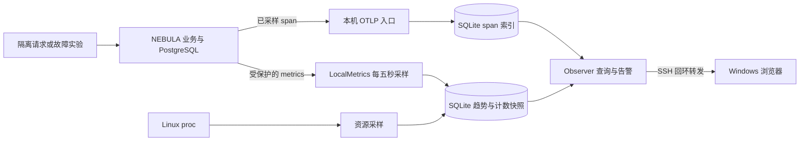
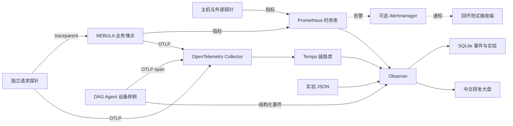
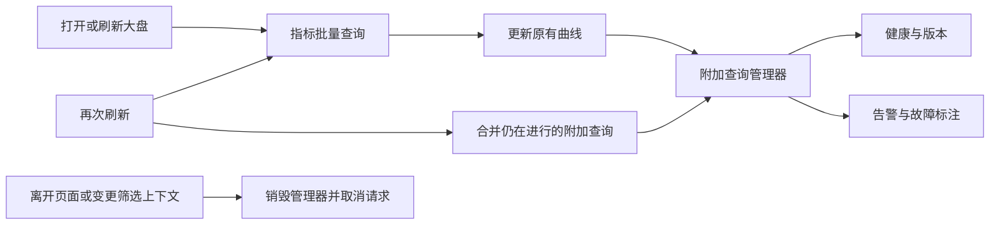

# 架构、指标与事件契约

2026-11-20 更新。`metrics` 档由 Prometheus 抓取 NEBULA、主机、探针和 Observer，本机 TraceIndex 接收 OTLP。`full` 档走 Collector 与 Tempo，已在两实例隔离实验中验证中断恢复和可选本机告警。HTTP 路由委托独立指标、Trace、实验查询服务。Prometheus 固定面板批次限 24、执行线程 4、任务槽 8、总等待预算 3 秒，局部错误保留不可用状态。[查询组件调用图](../roadmap/project-review-implementation-2026-11-19.md#2-组件与责任) · [完整档实测](validation.md#双实例实时投递与告警验收)

## 运行拓扑

轻量档直接在 Linux 隔离机采集，经过 SSH 隧道访问。服务目标读取采样时保留的原始计数器，现有图表读取按周期生成的趋势点和直方图桶。

下面是完整档的组件边界。部署和验证到哪一步，以[验收记录](validation.md)为准。

## 实现边界

Observer 用 Python 的 HTTP 服务和 SQLite 组织本地采样与查询，浏览器端使用原生 JavaScript 和 SVG。内置历史窗口从 SQLite 取旧区间，从内存读取最近六小时的已解码样本。两段按明确时间边界拼接。返回较大的查询结果时，HTTP 根据浏览器声明协商 gzip。

内置总览和业务性能保留原来的数值卡、健康状态和 SVG 路径，刷新时更新数据和坐标。当附加告警、版本或标记请求未完成时，主曲线仍可先显示。自定义仪表盘复用当页控件，同一轮相同数据源、表达式和筛选的查询共享请求，面板按完成顺序更新。[查询与无闪烁验收](validation.md#查询速度与自动刷新)

| 层 | 职责与入口 |
|---|---|
| C++ 业务埋点 | 请求分类、阶段时延、直方图与有界 span 导出；通信核心按原职责收发。[Telemetry](../../backend/application/observability/Telemetry/Telemetry.cpp) · [ChatAckTrace](../../backend/application/observability/ChatAckTrace/ChatAckTrace.h) |
| 数据源适配 | 抓取、解析、采样周期、端到端超时和外部数据源代理。[LocalMetrics](../../tools/observability/observer/local_metrics.py) · [Prometheus/Tempo](../../tools/observability/observer/sources.py) · [数据源工作区](../../tools/observability/observer/source_monitor.py) |
| 领域统计 | 根据原始计数核对覆盖、计算 SLI、预算和双窗口判定。可用独立样本验证这一层。[service_levels.py](../../tools/observability/observer/service_levels.py) |
| 空白指标诊断 | 根据请求窗口内的采样、指标族、调用速率和采集 HTTP 状态解释空结果。[measurement_quality.py](../../tools/observability/observer/measurement_quality.py) |
| 存储 | 核验事件、限制保留期、SQLite 事务写入并按时间查询。[Store](../../tools/observability/observer/store.py) · [TraceIndex](../../tools/observability/observer/local_traces.py) |
| 查询与视图 | HTTP 校验窗口与筛选，将查询交给适配器；浏览器据此展现状态、数量、诊断入口。[Observer 路由](../../tools/observability/observer/server.py) · [SLO 视图](../../frontend/observability/reliability.js) · [Span 视图](../../frontend/observability/trace_details.js) |

跨组件关联使用实例、Unix 时间和 Trace ID。固定时间窗可重复查询保留期内的数据。指标是整体分布，采样 span 是代表性明细，实验报告另存负载及环境指纹。

## 业务操作目录与异步生命周期

新增 26 个固定操作覆盖账号、聊天、神树、排名、AI/RAG、语音、文件与社区数据库。C++ enum、指标名称、Observer 查询和前端目录共同读取 `OperationCatalog.def`，不再各自维护四个聊天函数的重复列表。业务 HTTP 入口只记录已注册模板，复用原有聊天 span，结束时只计一次响应。

同步计时随作用域结束；异步生成跟随最终回调，以原子终态处理取消和完成竞争。AI 准备及私人分派传递有限 `traceparent`，DetachedSpan 不在回调线程恢复其他线程的 TLS。直方图补足至 300 秒的有限桶。具体计量边界、错误口径和没有覆盖的路径见[业务埋点讲义](business-instrumentation.md)。

指标中的操作和结果是有限标签；正文、原始 URL、SQL、用户名和私有模型输入不入遥测。七天留存与有界导出机制继续沿用，通信核心不变。

## 内置面板的实时刷新

浏览器先按同一时间窗批量读取指标，再把结果交给已有面板。视图、事务和实例筛选相同时，`dashboard.js` 复用面板控制器，`chart.js` 更新坐标范围、曲线和故障标线。图例按指标及标签定位，按钮及隐藏状态沿用当前选择。悬停游标在新采样上重新计算读数。[面板实现](../../frontend/observability/dashboard.js) · [图表实现](../../frontend/observability/chart.js)

切换视图或筛选时，工作区终止上一轮请求。迟到的结果须通过请求版本及取消状态检查后才可用于渲染。旧图表的 ResizeObserver 和共享游标订阅随视图销毁而释放。拖选、固定窗口和检查抽屉保留显式的暂停行为；查询错误时清除该面板的旧曲线，恢复后再创建图表。[工作区生命周期](../../frontend/observability/workspace.js)

## 空白指标与查询失败

本机采样把本次指标接口状态及实际收到的耗时指标族写入同一条快照。查询按原时间窗取数，仅在没有有效数值时附加 `diagnostic`，包含 `reason`、`message`、`guide` 和 `sampleAt`。单面板与批量查询使用同一判定函数。历史快照缺少这些字段时返回通用提示。

| 原因 | 依据 |
| --- | --- |
| `missing_metric` | 成功抓取的快照中没有目标耗时指标族 |
| `missing_function` / `missing_outcomes` | 当前目标没有某个目录函数，或旧版本缺少完成结果指标；不能显示成零 |
| `no_traffic` | 有效采样记录的对应调用速率均为零 |
| `scrape_denied` / `scrape_failed` | 指标接口返回 401/403，或本次抓取失败 |
| `stale` | 末端样本超出三倍有效查询步长，至少允许 15 秒 |
| `warming` | 已收到指标族，尚未形成所需耗时区间 |
| `expired` / `no_samples` | 已超出保留期，或所选窗口没有足够的有效观测 |

浏览器共享查询读取器保留请求失败原因，在总览、业务、函数和指标目录显示相应提示。读取超时为八秒，切换页面使用独立的取消信号；超时结束和主动取消分别处理。[查询读取器](../../frontend/observability/series.js) · [查询适配器](../../tools/observability/observer/local_metrics.py)

## 信号字典

| 信号 | 范围和单位 |
|---|---|
| 外部存活、业务就绪、抓取状态 | 独立探针分别请求 live、ready，Prometheus 自己生成 up。应用返回 503 和采集器连不上分别显示。 |
| HTTP 请求量 | 现有 counter，转成每秒速率。含抓取和健康探测。 |
| 业务 HTTP 5xx | 共享业务适配器完成时，按状态大类累计。五分钟内该范围的 5xx 增量与同一计数器的总响应增量求比。 |
| 会话/历史延迟 | handler 开始到响应就绪，用固定路由名的秒级直方图。 |
| 延迟趋势 | 五分钟直方图计算平均、P50、P90、P95、P99。无样本留空，P99 采用桶内估算。 |
| 网络与线程 | 网络为主机非回环网卡的收发速率。线程数是隔离 NEBULA 进程的 `/proc/<pid>/status`。 |
| 失败分类 | 鉴权、来源、限流、数据库、Outbox 各自计数。跨种类有重叠，不能充当全站 HTTP 失败率。 |
| 聊天处理 | 固定 `stage` 的秒级直方图。排队从入队到 worker 简单计时，取连接从开始获取到租约就绪。提交前和 ACK 就绪是从 handler 开始的累计值。COMMIT 只计成功抵达的事务段。客户端 RTT 单独记录。 |
| SQL trace | PostgreSQL 客户端调用时间。span 名固定，不记录 SQL、参数、正文和凭据。时间长度用单调时钟计算。 |
| 设备统计 | 每个允许来源和相机或 IMU 流的最新降采样窗口。帧序号、设备会话、命令编号放事件中。 |

## 页面查询与生命周期

总览和业务性能页分开管理指标与附加信息。`dashboard.js` 完成指标批量查询后立即更新曲线；`dashboard_queries.js` 独立管理采集状态、告警、版本和故障标注。后者不进入指标首屏的等待条件。

- 指标刷新与附加请求各有取消边界。常规五秒刷新不会不断取消一个尚未完成的八秒附加请求；同类请求同时最多一个，总览最多四个。
- 附加请求沿用统一请求层的八秒超时。页面切换、组件销毁后即使返回迟到结果，也不能改变新页面。
- 失败只影响对应区域，告警失败不能显示成“没有告警”。用户可只重试失败项目，不重查指标或重建图表。
- 放大单个面板时不查询隐藏的状态、告警和版本；故障标注仍按当前窗口过滤并异步叠加。
- 显示加载、查询失败和未知状态，不把未返回数据当作零。已有曲线、图例与游标在附加信息更新时保留。

实现见[请求生命周期](../../frontend/observability/dashboard_queries.js)、[界面装配](../../frontend/observability/dashboard.js)。受控慢源及真实采样验证见[验收记录](validation.md#2026-11-19-附加查询隔离与首图显示)。这项调整不改变业务接口、直方图口径或七天保留策略。

## 服务目标与采集质量

`GET /api/v1/service-levels?from=<Unix秒>&to=<Unix秒>` 返回所选窗口的达标量和未达标量、6 小时滚动预算、两组消耗速度、窗口覆盖与采集状态。轻量档在 `metric_samples.values_json` 附加少量整数计数和采样进程标识，沿用原 SQLite 留存，旧记录仍可查看趋势。

| 目标 | 分子与分母 |
|---|---|
| 业务 HTTP 非 5xx 比例 ≥99% | `nebula_business_http_responses_total` 的 1xx–4xx 增量除以所有状态大类增量。客户端错误仍计入非 5xx。 |
| 会话列表 ≤80 ms 的比例 ≥99% | `nebula_http_handler_seconds_bucket{route="conversations",le="0.08"}` 的增量除以该路由的 `_count` 增量。 |
| WebSocket 聊天 ACK ≤40 ms 就绪的比例 ≥99% | `nebula_chat_stage_seconds_bucket{stage="ack_ready",le="0.04"}` 的增量除以该阶段的 `_count` 增量，范围限业务端就绪样本。 |

窗口按同一实例和采样进程匹配首尾计数，并检查每对相邻读数。明确断采、指标缺失、计数器回退、实例更替和不一致的桶切断计算；返回末段的实际样本量与覆盖时长。覆盖缺口容忍总计两个采样周期，前提是相邻样本连续且窗口末端仍新鲜。覆盖完整且至少 20 个事件才判定，零事件显示「没有请求」。短窗与长窗都达到阈值才显示超速。预算评估需要覆盖完整六小时。采集质量另报 `live`、`ready`、抓取、SQLite 保存与应用侧已导出、丢弃、队列满，保留零读数和缺测的区别。

HTTP 5xx 下钻按实际 HTTP 状态筛选已采到的 span。延迟下钻按入口 span 的墙钟找候选，需展开后核对函数、事务和 SQL。所有这些视图复用当前窗口，Trace 采样决定明细能见度。

## 事件写入与查询

`POST /ingest/v1/events` 以 Bearer 认证，接收 JSON 数组，最多 256 条和 256 KiB。来源、是否模拟和允许类别来自服务端凭据文件。`schemaVersion=1`、`eventId`、`eventType`、`occurredAt` 和 `fields` 必填。时间和帧序号使用十进制字符串。DAG 和 Agent 带 32 个小写十六进制字符的 `traceId`，节点尝试再带 16 个字符的 `spanId`。来源内同 ID 重发去重，内容冲突返回 409 并回滚整批。非法结构返回 400，超量返回 413，存储暂时无法接纳返回 503。查询限制 7 天，事件以时间和数据库序号作为稳定游标。

- DAG 事件为 `dag.run`、`dag.edge`、`dag.node`。节点尝试和依赖边独立编码，多个前置 span 用链接表达。
- Agent 事件为 `agent.plan`、`agent.skill`、`agent.memory`、`agent.decision`、`agent.evaluation`。技能按调用及尝试统计，Token 未上报连同缺失字段数量显示。回放仅使用合成夹具。
- 设备事件为 `device.window`、`device.command`、`device.safety` 和 `device.recording`。按设备会话分组，记录源时间、接收时间、窗口序号及对齐质量。MCAP 预留记录编号。真实控制链路和原始媒体需要独立接入。
- 实验事件为 `experiment.marker`。导入记录包含运行身份、配置/负载/夹具摘要、UTC 窗口和指标。

实现的完整字段白名单以 `tools/observability/observer/events.py` 为准。浏览器访问 `/api/v1/` 下的目录、版本、概览、趋势、告警、实验详情与比较、标线、事件和 trace 查询。默认回环监听，由 SSH 访问边界保护读接口。事件发布凭据须在可信进程使用。后续跨主机接入按可信传输与来源认证扩展。

`GET /api/v1/series?panel=http_p99&from=<Unix秒>&to=<Unix秒>` 按目录中的固定指标查询，最多八条序列，并返回查询耗时、步长和是否截断。点位以 Unix 秒表示，缺失值为 `null`。轻量档直接读取指标与 Linux 状态，五秒采样，以 SQLite 最多保留七天，按请求步长返回桶末观测。每秒速率在尚未填满窗口时使用已观测间隔。真实指标档由 Prometheus 求值并保留其查询步长。两档统计实现不同，比较实验应使用同一档。

轻量隔离档的 `POST /v1/traces` 接收本机的 NEBULA 业务与探针 OTLP JSON，固定服务、操作与字段，限制批次并按 trace 与 span ID 去重。受信 Python 运行入口用 `POST /ingest/v1/function-traces`，Bearer 身份绑定服务名，保留线程 CPU 耗时。存储排除请求体、未登记的 span 属性和凭据。链路搜索使用 `GET /api/v1/traces` 的时间窗、操作、关键字、耗时和错误筛选，随后按 ID 下钻。生产环境使用认证采集端点。轻量端点的信任边界仅为受信 Linux 隔离机上的本机进程。

`GET /api/v1/traces?function=完整函数名` 匹配 NEBULA 业务函数 span，返回 Trace ID 和命中的 Span ID。函数页通过它读取样本，并复用链路详情。会话与历史 HTTP 请求可携带 `traceparent`，WebSocket 则在数据库执行器上按需采样每条发送命令。业务函数标记为内部调用，libpq 标记为客户端。SQLite 增量保留 span 类型及 HTTP 状态码，已有记录中缺失的数据按未知展示。

HTTP 入站有有效 `traceparent` 时沿用上游的采样位；上游已采样的请求保留服务、函数和 SQL 父子关系。缺少有效上游时使用本地每工作线程采样。未抽中的请求只留入口计时，返回 5xx 或发生异常展开时补记入口 span，无子 span。日志等级只控制写出的内容。Observer 的「采集质量」将采样跳过、补记失败入口与网络导出失败、队列满分别计数，旧实例没有新计数时显示既有采集数据。

经典延迟桶五分钟差值写入本机 SQLite 的 `histogram_windows`，与其他采样共用七天保留。批量查询最多接收 24 个已登记面板，同窗普通指标只分桶一次，同窗函数分位数共享一次桶读取。维护任务按分钟清理过期数据，较早的数据每五分钟保留一次观测。轻量 Explore 对登记桶执行受限的 `histogram_quantile`，完整 PromQL 在接入的外部 Prometheus 上执行。变量作用域区分 BC、APP、INSTANCE。版本化仪表盘由本机文件确认并写入工作区，使用文件名生成稳定 ID，导入更新保留手工创建的仪表盘。

## 日志与查询编辑器

业务日志位于 `backend/application/observability/BusinessLog`，通过既有遥测有界队列异步输出。HTTP 与 WS 的共用错误适配器提供稳定错误类型、源码和关联标识；通信核心日志宏保持冻结。Observer 的 `DiagnosticLogger` 统一监控请求失败与后台错误，`LogTail` 仅读取显式配置的结构化来源，`LogStore` 完成去重、七天清理和有界分页。已校验 OTLP 根跨度的派生日志单列为 `nebula-traces`，不与 C++ 主动日志混淆。

日志页与链路详情通过同一 Trace ID 和时间窗互跳。多查询编辑器按行维护数据源与表达式；本机执行受限的直方图查询，外部 Prometheus 负责完整 PromQL。详见[字段、容量、七天轮转和学习步骤](logging.md)。函数页显示真实监控目标与 `nebula_function_seconds` 的采集状态，避免把隔离版耗时当成原日常服务的数据。

## 主机与函数观测

`observer/linux_resources.py` 读取 Linux 资源计数器。每份采样先读取显式配置的服务根进程，按 PID 和启动时间核验身份，然后读取可见子进程与根进程线程。每次最多 32 个进程，每个根进程最多 48 个线程。五秒采样时最多留 960 个时间点，最近 12 点保留逻辑 CPU 和线程详情，旧点保留汇总。浏览器通过 `GET /api/v1/resources` 查看同一时窗的历史和最近采样，通过 `GET /api/v1/resources/reports/{id}` 读取独立实验结果。报告最多保存 24 份，每份限 2 MiB。

业务层固定名称直方图计量四个 ChatService 函数的执行墙钟。外部 Pyroscope 返回采样火焰图，外部 Jaeger 返回跨进程 span。三个时间口径分别解释业务耗时、样本归因和请求链路。内核、绑核、离线剖析的证据与复现方式见[资源排障手册](resources.md)。

[OTLP 数据模型](https://opentelemetry.io/docs/specs/otlp/) · [Trace Context](https://www.w3.org/TR/trace-context/) · [Tempo 查询 API](https://grafana.com/docs/tempo/latest/api_docs/)
