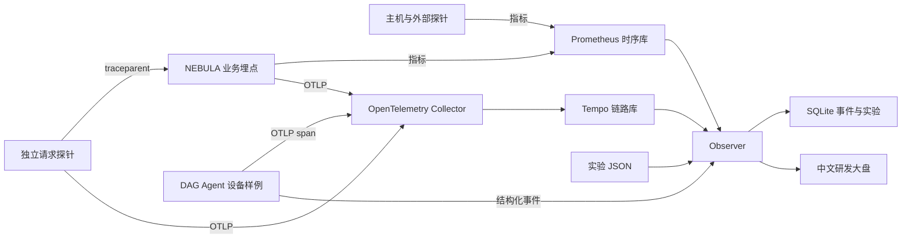

# 架构、指标与事件契约

| 信号 | 范围和单位 |
|---|---|
| 外部存活、业务就绪、抓取状态 | 独立探针分别请求 live、ready，Prometheus 自己生成 up。应用返回 503 和采集器连不上分别显示。 |
| HTTP 请求量 | 现有 counter，转成每秒速率。含抓取和健康探测。 |
| 会话/历史延迟 | handler 开始到响应就绪，用固定路由名的秒级直方图。 |
| 聊天处理 | 固定 `stage` 的秒级直方图。排队从入队到 worker 简单计时，取连接从开始获取到租约就绪。提交前和 ACK 就绪是从 handler 开始的累计值。COMMIT 只计成功抵达的事务段。客户端 RTT 单独记录。 |
| SQL trace | PostgreSQL 客户端调用时间。span 名固定，不记录 SQL、参数、正文和凭据。时间长度用单调时钟计算。 |
| 设备统计 | 每个允许来源和相机或 IMU 流的最新降采样窗口。帧序号、设备会话、命令编号放事件中。 |

## 事件写入与查询

`POST /ingest/v1/events` 以 Bearer 认证，接收 JSON 数组，最多 256 条和 256 KiB。来源、是否模拟和允许类别来自服务端凭据文件。`schemaVersion=1`、`eventId`、`eventType`、`occurredAt` 和 `fields` 必填。时间和帧序号使用十进制字符串。DAG 和 Agent 带 32 个小写十六进制字符的 `traceId`，节点尝试再带 16 个字符的 `spanId`。来源内同 ID 重发去重，内容冲突返回 409 并回滚整批。非法结构返回 400，超量返回 413，存储暂时无法接纳返回 503。查询限制 7 天，事件以时间和数据库序号作为稳定游标。

- DAG 事件为 `dag.run`、`dag.edge`、`dag.node`。节点尝试和依赖边独立编码，多个前置 span 用链接表达。
- Agent 事件为 `agent.plan`、`agent.skill`、`agent.memory`、`agent.decision`、`agent.evaluation`。技能按调用及尝试统计，Token 未上报连同缺失字段数量显示。回放仅使用合成夹具。
- 设备事件为 `device.window`、`device.command`、`device.safety` 和 `device.recording`。按设备会话分组，记录源时间、接收时间、窗口序号及对齐质量。MCAP 预留记录编号。真实控制链路和原始媒体需要独立接入。
- 实验事件为 `experiment.marker`。导入记录包含运行身份、配置/负载/夹具摘要、UTC 窗口和指标。

实现的完整字段白名单以 `tools/observability/observer/events.py` 为准。浏览器访问 `/api/v1/` 下的目录、版本、概览、趋势、告警、实验详情与比较、标线、事件和 trace 查询。默认回环监听，由 SSH 访问边界保护读接口。事件发布凭据须在可信进程使用。后续跨主机接入按可信传输与来源认证扩展。

[OTLP 数据模型](https://opentelemetry.io/docs/specs/otlp/) · [Trace Context](https://www.w3.org/TR/trace-context/) · [Tempo 查询 API](https://grafana.com/docs/tempo/latest/api_docs/)
