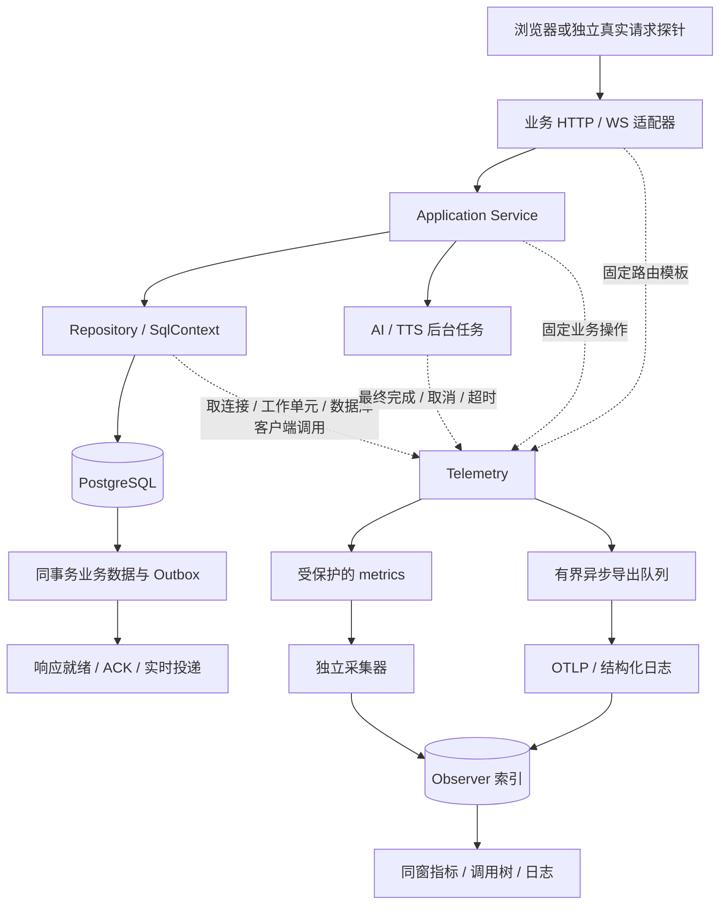

# 业务埋点：从请求到函数、数据库与异步任务

更新：2026-11-19。本轮参照 OpenTelemetry Demo 的分层追踪与 Prometheus 的有限标签实践，扩展现有采集链路。没有修改 `backend/server/`，没有新增依赖，没有向原业务库写入测试数据。实际构建、浏览器与测量证据见[验证记录](validation.md#2026-11-19-跨业务埋点)。下一轮全项目建议另见[待评审意见](../roadmap/project-review-2026-11-19.md)。

## 1. 先理解三种信号

可以把请求想成一个包裹：

1. **指标是每个站点的统计表**：经过多少次、现在处理几件、通常花多久。它不保存每件包裹的详情。
2. **Trace 是一次运输的过站扫描**：记录这一次请求进入业务、取数据库连接、执行语句的顺序和时间。通过 `traceId` 把扫描串起来。
3. **日志是固定格式的异常说明**：记录哪个组件、什么错误类别、代码位置和关联编号。我们不拆包裹，不记录聊天正文、模型提示词、凭据或私人记忆。

因此“CPU 有曲线”不代表“已经知道某个业务函数花了多久”。函数需要明确的测量边界；CPU、堆分配、syscall 和调度还需要对应的[资源与剖析实验](resources.md)。

这里的“墙钟时间”是函数进门到出门经过的时间，包含函数内部的等待；CPU 时间是线程实际工作的时间。函数进门前的业务排队另有阶段计时，不能凭函数耗时把它补算出来。

## 2. 代码和数据如何连接



`PostgreSQL command` 是客户端对数据库调用的墙钟时间。PostgreSQL 本身没有在本轮部署服务端 Trace Agent，不能把这一段称为数据库内部函数追踪。Outbox 的持久化、发布和客户端 ACK 仍沿用各自原有口径，不能用 MQ 确认替代聊天 ACK。

| 组件 | 职责 |
| --- | --- |
| [OperationCatalog](../../backend/application/observability/catalog/OperationCatalog.def) | 29 个固定操作的唯一目录；同时生成 C++ 名称和 Observer 的查询、筛选元数据。 |
| [BusinessOperation](../../backend/application/observability/operations/BusinessOperation.h) | 同步作用域的计时、完成结果、执行中数量；异常展开时记录失败。内部已捕获的失败需要显式 `fail()`。 |
| [AsyncBusinessOperation](../../backend/application/observability/operations/BusinessOperation.cpp) | 跟随一次已接纳任务，跨线程只能完成一次；取消和回调竞争时不重复计数。 |
| [DetachedSpan](../../backend/application/observability/tracing/DetachedSpan.h) | 异步 Trace 生命周期，不把线程局部上下文对象悬挂到另一个线程。 |
| [BusinessHttpObservation](../../backend/application/modules/shared/transport/BusinessHttpObservation/BusinessHttpObservation.h) | 在业务层读取已注册路由模板，结束时记录状态；旧聊天入口保留自己的 span，避免双计。 |
| [Observer 目录读取器](../../tools/observability/observer/contracts/operation_catalog.py) | 严格读取公共目录和路由契约；发布包必须带上 `.def` 和公共路由 JSON。 |
| [函数视图](../../frontend/observability/function_performance.js) | 按业务域筛选、查看平均/P95/P99、失败速率与执行中数量，并打开真实调用链。 |

业务层依赖统一遥测接口，不依赖 Observer 的 HTTP 会话、SQLite 或图表类型。通信核心仍只负责它原有的连接与协议工作。

## 3. 29 个测量边界

| 业务域 | 操作 | 边界和限制 |
| --- | --- | --- |
| 聊天（4） | `conversations`、`history`、`historyBefore`、`sendMessage` | 服务调用到返回/异常；数据库和等待计入墙钟。已有阶段计时继续保留。 |
| 账号（2） | `registerUser`、`login` | 实际账号服务调用，包含密码计算和持久化；不记录用户名、密码、Session。 |
| 神树（7） | `list`、`get`、`publish`、`like`、`reply`、`replies`、`remove` | 列表、详情、发布、点赞、回复、回复列表与删除；权限拒绝也会结束调用并计为业务错误。 |
| 排名（1） | `settle` | 一轮榜单事务结算；后台调用可独立成链，不把所有时间归入某个用户请求。 |
| AI / RAG（8） | 文档索引、授权检索、聊天 AI 准备、准备审计 / 历史 / RAG、私人任务分派、逻辑生成 | 准备审计按三次实际写入计数，返回 false 或异常都计失败；历史为有界读取；RAG 未配置不伪造样本。准备/分派只计各自工作阶段；逻辑生成由 ResilientModelProvider 跟随最终回调，包含内部重试与回退。 |
| 语音（2） | `runOne`、`preview` | `runOne` 在拿到任务后开始，不把空轮询计成合成；失败标记不因被捕获而丢失。 |
| 文件（2） | `completeUpload`、`download` | 上传完成及校验；下载只计授权和对象定位，**不计整个网络传输**。 |
| 社区数据库（3） | `SqlContext::acquire`、`execute`、`transact` | 取连接、参数化执行与结果装配、事务工作单元；执行内部另有数据库客户端 span。 |

聊天历史仓储、PostgreSQL COMMIT 和 ACK 分段仍有原有测量；这里的三个 `SqlContext` 操作主要覆盖社区模块，**不代表每个数据库仓储都已增加同样的函数指标**。授权失败发生在服务调用之前时，会有入口拒绝记录，但不会伪造后续业务函数调用。

ResilientModelProvider 覆盖经该包装器接纳的逻辑生成。绕过它的独立 Provider/Worker 入口不能凭此声称已覆盖。真实 ONNX/TTS 模型质量、Token 成本和模型内部算子耗时不属于本轮替身测试的结论。

### Function3.7 准备阶段细分

固定函数名 `AiChatService::prepareAudit`、`AiChatService::prepareHistory`、`AiChatService::prepareRag` 分别覆盖准备阶段审计写入、最多 64 条历史读取、可选 RAG 检索；沿用现有调用次数、结果、执行中和耗时直方图，无新增用户 / 模型标签。
审计计时包含排队快照、提示词摘要、模型选择三次同步写入，不包含异步首片段和终态写入。
当前 `token` 事件与旧审计 `outputTokens` 实际是非空流式文本片段计数，**不是分词器 token 数**，不得据此导出 token/s。分词器指标、Provider 排队和加载指标仍待实现及真实验证。
这些源码改动和新增 C++ 断言尚未通过 Linux 完整构建、线上问答或 `/metrics` 验收；历史证据仍保持原来的 26 项，不回写旧结果。

## 4. 指标、结果和分位数

| 指标 | 类型与含义 |
| --- | --- |
| `nebula_function_seconds_bucket / _sum / _count` | 秒级经典直方图；完成时计一次，包含成功、失败、取消和超时。 |
| `nebula_function_calls_total{function,outcome}` | 已结束次数，固定结果为 `success`、`error`、`cancelled`、`timeout`。 |
| `nebula_function_in_flight{function}` | 已进入、尚未结束的数量；不是线程数、队列长度或历史总量。 |

目录和标签均固定，不用用户 ID、消息 ID、果实 ID、文件路径、SQL、模型输入或任意 URL 作为标签。注册路由约 117 个 API 模板供 Trace 筛选；例如保留 `GET /api/tree/posts/:post`，不保留实际资源编号和查询内容。

同一个函数的完成计数是**调用次数**，不是去重后的业务写入行数。幂等重试可能完成多次调用但只写一行；需要结合 ACK、幂等键和数据库核对。嵌套函数的耗时有包含关系，不能直接相加当端到端耗时。

直方图保留原有亚毫秒到 5 秒桶，增加 10、30、60、120、300 秒区间和 `+Inf`，让长 AI/语音任务不直接落进 5 秒以上的无限桶。P95/P99 是桶内估计；低样本或大量超过最高有限桶时，需展开桶分布和单次 Trace，不能当作精确实测值。

示例：

```promql
# 神树列表的五分钟墙钟 P99，单位转为毫秒
1000 * histogram_quantile(0.99,
  sum by (instance, le) (
    rate(nebula_function_seconds_bucket{function="TreeService::list"}[5m])
  )
)

# 逻辑生成仍在进行的任务
nebula_function_in_flight{function="ResilientModelProvider::generation"}

# 单看超时，不把正常取消混入失败
sum by (instance) (
  rate(nebula_function_calls_total{function="ResilientModelProvider::generation",outcome="timeout"}[5m])
)
```

函数表中的“失败速率”读取 `error`，包括业务拒绝和异常；超时、取消分别保留在结果计数器中，不等同 HTTP 5xx。轻量档支持固定面板与约定的直方图表达式；任意完整 PromQL 请接真实 Prometheus，不将轻量求值器称为完整 PromQL 引擎。

## 5. 线程、取消与背压

1. 同步 `BusinessOperation` 随作用域结束。在作用域内部捕获异常并恢复时，需要根据业务结果显式选择失败或取消。
2. 异步计时在任务被接纳、向其他线程发布之前启动；原子终态只允许一个竞争者记录完成。析构未完成任务记为取消。同步准备任务主动取消时，Trace 状态保持未标注，不伪装成成功；取消原因由固定结果计数器区分。
3. 将有限的 W3C `traceparent` 传入 AI 准备/私人分派任务；任务线程建立自己的作用域。生成本身使用 DetachedSpan，回调不会在错误线程恢复旧的线程本地状态（TLS：每个线程自己的临时上下文，这里不是 HTTPS 加密协议）。
4. 业务线程仅做计时、固定原子计数和有界队列入队；网络导出在后台进行。Collector/Observer 中断、超时、队列满会限时重试或丢弃并计数，不阻塞业务等待监控恢复。
5. 指标默认关闭，使用既有 `WEB_OBSERVABILITY=1` 开启。OTLP 地址、HTTP/WS 采样和日志级别仍由既有配置控制；业务日志有自己的开关，关闭函数指标不等于删除所有日志。

HTTP 入口按配置抽样，失败可补根 span；后台任务独立成链。某个函数有直方图但没有 span，可能是未抽中、任务尚未完成、队列丢弃或数据过期，不能因此判定业务没执行。计数器与采样链路应交叉核对。

## 6. 在页面确认数据来自哪里

1. 打开“函数与内核剖析”，先核对**当前目标端口**和 `26 / 26` 能力状态。
2. 选择业务域，区分“当前服务没有该埋点”“已提供但窗口无调用”“采集失败”。正常的执行中零值应显示为零。
3. 实际执行对应业务，至少等待两次五秒采样。看趋势后点“看调用链”，展开父子调用和数据库客户端段。
4. 日志用同一 Trace ID 和时间窗互跳。`nebula-traces` 是从 span 派生的记录，不能与主动业务日志混称为两份独立证据。
5. 模型没有调用时保留空白分位数，不用伪造曲线补齐面板。

本轮隔离验证入口为 [18797 函数页](http://127.0.0.1:18797/?view=profiles)，需保持对应 SSH 转发和限时实验进程。它使用合成账号/内容和真实服务器、数据库调用。原 18090 的上一版启用记录在[日常部署文档](daily-rollout.md)；本轮新业务程序是否启用，以该记录与状态页的明确结论为准。

## 7. 如何复验与增加一个埋点

本轮真实验证脚本：[business_probes_live.py](../../tests/observability/business_probes_live.py)。它只接受已有隔离实验目录，拒绝日常 18090/18791，创建合成账号与故事，核对匿名指标拒绝、运维采集、权限错误、直方图、执行中归零及两个完整跨进程 Trace。账号密码只留进程内存，正文金丝雀用于检查日志/Trace 不泄露内容。

```bash
# 在已安装依赖的 Linux、现有隔离源码目录执行
python3 tests/observability/business_probes_live.py \
  --run-dir /home/pikachu/phase11-data/function3/observer-live-20261117/probes26 \
  --output build-function3/business-probes-live.json
```

增加业务测量时：先选公开业务边界，在同名组件目录中使用统一接口；向固定目录加一项，更新相应测试和口径说明。不要给每次循环、每条 SQL、每个 Token 都新建 span；不要用运行时参数命名。同步业务用作用域，异步业务选择唯一终态，最后验证取消、重复回调、关闭模式、脱敏和开销。

本轮 Release、Debug/UBSan 专项、真实服务、浏览器和三轮开销对照分别列证，不用某一项替代其他项。完整工程 TSan、24 小时长稳、真实云语音和多机生产后端仍单列，历史 ACK 性能未达标记录保留。

模型回调与取消还可用[独立 OTLP 接收测试](../../tests/observability/model_probes_wire.py)复验：指定 `--binary` 为本轮构建的 `phase11_ai_resilience_tests`，`--scope-binary` 为 `function3_business_observability_contract`，再指定 `--output` 保存结果。它使用脚本化 Provider，验证真实回环传输、延后完成、唯一 span、取消状态和有限字段，不声称实际模型质量或进程退出时队列完全冲刷。

## 8. 保留与参考

日志、函数趋势与本机 Trace 索引按当前七天策略滚动清理；自行导出的 PNG、CSV、JSON 或验收证据按独立用途留存。新埋点没有新增无限日志文件、私有输入快照或永久数据库表。

- [OpenTelemetry Demo](https://github.com/open-telemetry/opentelemetry-demo) 和 [C++ Currency 服务](https://opentelemetry.io/docs/demo/services/currency/)：学习入口、业务与依赖分层以及上下文传播。
- [Prometheus 埋点实践](https://prometheus.io/docs/practices/instrumentation/)：学习有限标签、Counter、Gauge 和 Histogram 的分工。
- [GenAI Span 语义约定](https://github.com/open-telemetry/semantic-conventions-genai/blob/main/docs/gen-ai/gen-ai-spans.md)：学习模型遥测的数据边界；本项目不采集提示词和回答正文。
- [Jaeger](https://github.com/jaegertracing/jaeger) 与 [Pyroscope](https://github.com/grafana/pyroscope)：区分调用链与持续剖析，二者不能互相替代。

[返回可观测性目录](README.md)

## 9. Token-ID 与执行器指标（2026-11-27）

`GenerationCompletion::usage` 是可选分词器测量，由实际 token ID 计数，不把流式文本片段、字节或审计 `outputTokens` 当作 tokenizer token。
ONNX Provider 记录每个生成 ID，包括未产生非空文本片段的 ID。模型加载、Provider 队列等待分别计时；首 token 时钟从 AppendTokenSequences 前开始，包含预填充，不含模型加载、Tokenizer 编码或队列等待。
`decode_tokens_per_second` 用首个 ID 之后的 token 数除以对应墙钟，包含调度 / sink 开销；单个输出 ID 不伪造 decode rate。它不是纯算子吞吐，也不能代替端到端首字时间。

固定 Prometheus 指标包括：

- `webserver_phase11_ai_tokenizer_generations_total` / `_invalid_measurements_total` / `_output_tokens_total`。
- `webserver_phase11_ai_decode_tokens_total`、`_decode_seconds_total`、`_decode_tokens_per_second` 直方图。
- `webserver_phase11_ai_model_load_seconds`、`_provider_queue_wait_seconds`、`_tokenizer_first_token_seconds` 直方图。
- `webserver_phase11_ai_db_executor_*`：专用准备 / 审计 / 完成入库执行器；默认 2 个线程、32 个待执行任务，与普通聊天池分离。
- `webserver_phase11_ai_provider_executor_*`：有测量能力的 Provider 线程池 active / queued / capacity / workers / queue_high_watermark / measured_pools。gRPC 端表示主服务中的 RPC 池，不冒充远端 Worker 推理队列；无能力的 Provider 保持缺测，不增加 measured_pools。

usage 经版本化、有界、严格校验的 gRPC trailing metadata 回传，不修改冻结 proto；旧 Worker 不回传时保留缺测，不从片段数补值。
成功且非取消、非停止、非超限、非空输出的模型完成仅聚合一次；随后入库失败用业务终态另计，不回滚已经完成的模型工作。

Linux 隔离四组 C++ 契约连续三轮通过，涵盖 token 数与片段数不同、metadata 往返、缺测、无效值、重复完成、队列聚合、同指针去重、普通数据库池阻塞而 AI 可继续，以及取消 / 超时 / 最新 64 条上下文。
这些是合成契约与真实 gRPC 传输验证，不是实际 Qwen/Phi-3 吞吐、线上 `/metrics` 或模型质量结论。目录迁移后的扩大回归另记。
