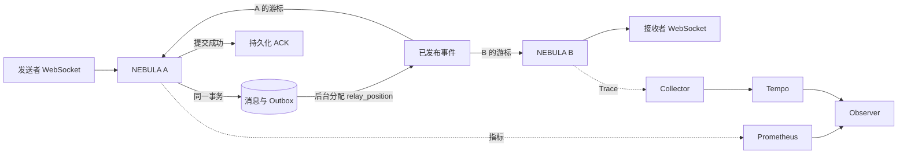

# 双实例聊天与真实遥测验收

这组实验在一台 Linux 虚拟机运行两个 NEBULA 进程，A、B 共用一次性 PostgreSQL。它覆盖跨进程实时投递、故障后补读与重复请求去重。跨机器断网和数据库高可用属于下一轮验收。[双实例路线](../roadmap/gateway-and-reliability-next-2026-11-19.md)

## 1. 消息怎么跨进程



1. 业务事务同时写消息和 Outbox。客户端 ACK 表示持久化已提交。接收者在线收到与 ACK 分别验证。
2. 迁移 025 为已有 `outbox_events` 增加 `relay_position`、部分唯一索引及序列。后台发布阶段用事务级 advisory lock 串行分配并提交位置。数据库在原事务开始时就可能分出原始事件 ID，因此迟提交的小 ID 也会拿到新的投递位置。
3. 每个进程独立读取游标之后的批次。一次投递失败保留该节点的游标，另一节点可以继续。节点退出后旧连接失效，客户端按原有会话序号加载历史。数据库是消息、序号和幂等键的权威来源。
4. 双进程模式显式开启 `WEB_PHASE11_REALTIME_RELAY=1`。该配置用于同一隔离库中的所有参与节点。站点内容和语音的 RocketMQ 验收仍走原单独路径；启用此聊天方案时入口会拒绝同时启用旧的 RocketMQ 聊天 Outbox 路径。[中继应用服务](../../backend/application/modules/chat/application/RealtimeRelay/RealtimeRelay.cpp) · [迁移 025](../../backend/application/storage/postgres/migrations/025_realtime_outbox_relay.sql)

## 2. 启动与演练

先按[原生构建说明](../ops/validation/native-delivery.md)创建包含迁移 025、PostgreSQL 和 libcurl 的测试二进制。下面是 11 月 20 日完整验收使用的参数组合，在 Linux 项目根目录运行。只检查跨实例聊天和真实指标时可用 `--profile metrics`，Trace 由实验 Observer 保存。

```bash
DUAL_RUN="$HOME/phase11-data/function3/obs-dual-$(date -u +%Y%m%dT%H%M%SZ)"
python3 -m tools.observability.isolated_dual --profile full --with-alertmanager \
  --dependencies "$HOME/phase11-deps/observability" \
  --postgres-prefix "$HOME/phase11-deps/postgresql/18.6" \
  --binary "$PWD/build/repro-native/webserver" --work-dir "$DUAL_RUN"
```

入口使用 Linux 现有 `unshare`、`ip`、`setpriv`。实验网络仅含 `lo`，也就是实验内部的 `127.0.0.1`。入口先验证它和宿主是两个网络命名空间，并确认实验连不上宿主回环探测端口。网络创建或探测失败时，在启动数据库和业务前退出。实验端口仅供同一命名空间里的探针使用，结束后在宿主直接读取文件报告。[Linux 网络命名空间说明](https://man7.org/linux/man-pages/man7/network_namespaces.7.html)

脚本使用一个新目录和一套临时 PostgreSQL 集群。PostgreSQL 只在临时目录创建 Unix 套接字。故障注入前会核验实验进程的网络命名空间与归属，并通过 pidfd 操作具体进程。脚本在最后一条持久化 ACK 后结束 A，让 B 完成在线交付和历史恢复，然后停止本轮监控及数据库。

短时验收限制监控数据总量为 384 MiB。启动前还需 1 GiB 预留空间，运行中定期检查，接近任一上限就停止这次实验。

- `$DUAL_RUN/isolation.json` 记录两侧命名空间、网卡和宿主回环探测结果。
- `$DUAL_RUN/lab/exports/dual-chat.json` 记录 B 的交付、同键重试、实际数据库行数、ACK 样本和链路查询。短验收的 P95 只描述当前测试窗口。
- `$DUAL_RUN/lab-console.log` 与 `$DUAL_RUN/lab/` 下的组件日志用于启动诊断。[隔离入口](../../tools/observability/isolated_dual.py) · [验收入口](../../tools/observability/verify_dual_chat.py)

成功标记为 `DUAL_ACCEPTANCE_PASSED=full`，在脚本回收本轮进程后输出。按报告中的 A/B 实例身份、故障前后状态和数据库行数判断结果。[11 月 20 日实测](validation.md#双实例实时投递与告警验收)

## 3. Collector、Tempo 与测试通知

- `--profile full` 启用 Collector 和单进程 Tempo。C++ 使用 OTLP HTTP，Collector 的批次、队列和重试时间都有上限，Tempo 数据另限 256 MiB，实验时序和链路沿用七天策略。Prometheus 同时抓取 Collector 和 Tempo 自身的指标。完整档会暂停这次实验的 Collector，检查业务响应、导出丢弃计数与恢复后的真实链路。
- 启动加 `--with-alertmanager`，接通实验回环上的测试接收端。验收会暂停 A，等待 `NebulaUnreachable` 的触发通知，确认 B 就绪，再恢复 A 并等待恢复通知。接收端只保存最近 128 个清洗后的批次。
- A/B 的 Prometheus `instance` 与 OTLP 的 `service.instance.id` 对齐为 `nebula-a`、`nebula-b`，Observer 日志来源使用同样的标识。规则按实例评估。「服务目标」按选中的实例读取真实 Prometheus 原始样本，遇到抓取失败或进程重启时截断连续窗口。图上的缺测、零请求和低流量仍各自显示。
- 在已有获批依赖的 Linux 环境，用 `python3 -m tools.observability.install_pipeline --help` 查制品获取入口。它核对官方摘要、实际版本与预算。[完整遥测档](setup.md#完整遥测档)

## 4. 告警口径

| 规则 | 实验初始条件 |
|---|---|
| HTTP 5xx | 最近 5 分钟至少 100 个业务响应，比例超过 5% 并持续 1 分钟 |
| 数据库 P99 | 最近 5 分钟至少 200 笔数据库操作，P99 超过 250 ms 并持续 2 分钟 |
| 实时投递积压 | 发布循环观察到的最老待投递事件超过 15 秒并持续 1 分钟。空队列为零，数据库读取异常期间指标缺测 |
| Trace 丢弃 | 5 分钟内丢弃计数有增量并持续 30 秒。与业务 ACK 计数独立 |

数据库历史最大值保留在诊断目录。`verify_alert_policy` 使用 Prometheus 自身规则测试器验证低流量抑制、P99 样本门槛、积压恢复与丢弃窗口到期。实验阈值写在规则中，可用真实负载和用户影响重新校准。[告警策略源码](../../tools/observability/observer/alerts/alert_policy.py) · [当前验收结果](validation.md#双实例实时投递与告警验收)
