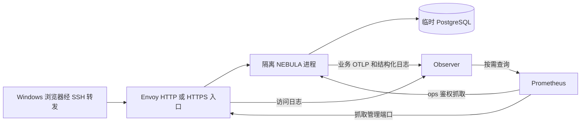

# Envoy 网关隔离实验

Envoy 1.40.2 已在 Linux 研途隔离站通过 HTTP 代理实测。本文的实验另建一次性 PostgreSQL，并覆盖 TLS、长连接、入口指标、链路和故障恢复。双上游实验还会核对健康摘除及消息重放。[网关证据](validation.md#envoy-入口网关隔离验收) · [研途发布记录](../ops/runtime/nebula-yantu-community.md#本次结果) · [实施路线](../roadmap/gateway-and-reliability-next-2026-11-19.md)

## 1. 组件和信号



| 组件 | 职责 |
|---|---|
| [Envoy 配置](../../config/gateway/envoy.json)和[启动适配](../../tools/observability/gateway.py) | 仅本机监听，管理端口只提供就绪和 Prometheus 指标。使用普通启动参数时代理一个上游。双实例实验对两个上游轮询、主动检查就绪，并关闭全部不健康时向故障实例转发的行为。支持带明确证书的 HTTPS 和本地 Wasm |
| [隔离监控入口](../../tools/observability/lab.py) | 负责进程、临时库、采集配置、端口、目录预算及关闭顺序 |
| [入口日志采集器](../../tools/observability/observer/gateway_logs.py) | 有界读取和白名单校验。汇总访问结果与普通 HTTP 耗时，索引入口错误和带业务 Trace 的记录 |
| [HTTP 业务采样](../../backend/application/transport/http/BusinessHttpObservation/BusinessHttpObservation.h) | 在隔离实验开关启用且业务请求已采样时，将 Trace ID 写入业务响应头，供入口日志关联 |
| [C++ 建连计时](../../tools/observability/gateway_plugins/StreamHandshake/StreamHandshakeWasm.cpp) | 可选的 HTTP Wasm 插件，在 WS `101` 和 SSE `200` 且媒体类型正确时各记一次响应头耗时。插件不访问文件、业务库或请求正文 |
| [黑盒验收](../../tools/observability/verify_gateway.py) | 握手、浏览器来源检查、ACK/重复重发、SSE 补发、文件上传与 Range、入口日志、真实指标及可选上游超时演练 |

入口只代理声明的页面、API、WS、SSE 和诊断路由。业务 `/metrics` 由 Prometheus 带 `ops` 凭据直接抓取，入口访问该路径返回 403。`/ws` 单独开启 WebSocket 升级。`/ws` 和 `/events` 不设整条流完成超时，保留 90 秒空闲上限。普通代理请求默认 15 秒，文件路由 45 秒，文件配额仍由业务校验。登录和注册路由各用本地令牌桶。代理清理客户端传入的来源和重试控制头，初版不配置写请求自动重试。[Upgrade](https://www.envoyproxy.io/docs/envoy/latest/configuration/http/http_conn_man/upgrade) · [超时](https://www.envoyproxy.io/docs/envoy/latest/faq/configuration/timeouts)

## 2. 测试版本启动

在 Linux 源码目录运行以下命令。两轮采用独立网络命名空间、独立临时库和合成账号，运行结束后关闭本轮进程。`BINARY` 指向已验收的业务构建，`curl` 需支持 HTTP/2。单上游脚本生成临时本机证书，并验证实际 HTTP/2 请求。双上游按业务 Trace 确认两侧都接到请求，待故障侧被摘除后，经网关用原键重试消息。[单上游脚本](../../tools/observability/isolated_gateway.py) · [双上游脚本](../../tools/observability/isolated_dual.py) · [Envoy 主动健康检查](https://www.envoyproxy.io/docs/envoy/latest/intro/arch_overview/upstream/health_checking)

```bash
LAB="$HOME/phase11-data/function3/envoy-$(date -u +%Y%m%dT%H%M%SZ)"
ENVOY="$HOME/phase11-deps/gateway/envoy-1.40.2/envoy"
BINARY="$PWD/build/repro-native/webserver"
DEPS="$HOME/phase11-deps"
python3 -m tools.observability.isolated_gateway \
  --work-dir "$LAB/single" --binary "$BINARY" --gateway-envoy "$ENVOY" \
  --postgres-prefix "$DEPS/postgresql/18.6" --dependencies "$DEPS/observability"
python3 -m tools.observability.isolated_dual \
  --work-dir "$LAB/dual" --binary "$BINARY" --gateway-envoy "$ENVOY" \
  --postgres-prefix "$DEPS/postgresql/18.6" --dependencies "$DEPS/observability"
```

### 手动查看大盘

这组命令用于已拿到获批 Envoy 制品、并用当前源码完成业务构建之后。先按[原生交付](../ops/validation/native-delivery.md)构建含 PostgreSQL 与 libcurl 的程序。`--gateway-envoy` 指向已存在的可执行文件。脚本启动前会执行 Envoy 原生配置校验。该实验使用独立库和端口，放在可信虚拟机上。上游业务进程继续采用现有的监听行为，入口与管理端口在本机回环地址。

```bash
LAB="$HOME/phase11-data/function3/envoy-$(date -u +%Y%m%dT%H%M%SZ)"
ENVOY="$HOME/phase11-deps/gateway/envoy-1.40.2/envoy"
BINARY="$PWD/build/repro-native/webserver"
printf '%s\n' "$LAB"
python3 -m tools.observability.lab --profile metrics \
  --work-dir "$LAB" --binary "$BINARY" \
  --postgres-prefix "$HOME/phase11-deps/postgresql/18.6" \
  --dependencies "$HOME/phase11-deps/observability" \
  --gateway-envoy "$ENVOY" --gateway-port 18105 --gateway-admin-port 19107 \
  --observer-port 18799 --prometheus-port 19092 --node-port 19102 --probe-port 18794 \
  --http-trace-every 1 --ws-trace-every 1 --duration 7200
```

Windows PowerShell 建立转发。用一个新的隐私浏览窗口避免日常页面的 Cookie 混入临时库账号。手动实验使用 `18105`，研途隔离站使用 `18095`。实验 Observer 为 `18799`。

```powershell
& "$env:WINDIR\System32\OpenSSH\ssh.exe" -N -o ExitOnForwardFailure=yes `
  -L 127.0.0.1:18105:127.0.0.1:18105 `
  -L 127.0.0.1:18799:127.0.0.1:18799 pikachu@192.168.239.135
```

HTTPS 使用自己的隔离证书和私钥。新开运行目录，在启动参数加 `--gateway-https-port 18445 --gateway-cert /绝对路径/证书 --gateway-key /绝对路径/私钥`。证书 SAN 覆盖 `127.0.0.1`，私钥限制为本人可读。验收脚本传 `--ca /绝对路径/证书`，保留证书及主机名校验。配置 HTTPS 后业务 Cookie 带 `Secure`，HTTP 路径用于健康检查与端口诊断。

用带 HTTP/2 支持的现有 curl，在 Linux 实验环境另测实际协商协议。将 `LAB_CERT` 指向该隔离证书。结果需要同时显示 `http=2` 和 `status=200`，若只协商到 HTTP/1.1，继续核对证书、ALPN 和客户端能力。

```bash
curl --http2 --cacert "$LAB_CERT" --fail --silent --show-error \
  --output /dev/null --write-out 'http=%{http_version} status=%{http_code}\n' \
  https://127.0.0.1:18445/health/ready
```

## 3. 从请求走到业务和数据库

另一个 Linux 终端将 `LAB` 指向刚才打印的绝对路径。故障选项会暂时暂停该实验所属的 NEBULA 进程，脚本用 `finally` 恢复，随后检查业务就绪。

```bash
python3 -m tools.observability.verify_gateway --run-dir "$LAB" \
  --exercise-upstream-fault --output "$LAB/exports/gateway-validation.json"
```

1. 在「自定义仪表盘」打开「NEBULA · 入口网关」。分别查看 Envoy 活动连接数、入口完成请求速率、上游连接、响应头、完整响应和入口总耗时。直方图需要抓取后的真实调用，刚启动等两个抓取周期。
2. 在「日志工作台」选 `nebula-gateway`。用报告中的 `requestId` 找入口记录。转发到上游的响应保留上游状态。上游超时由入口生成 504，不附加上游状态。连接复用或失败时，对应阶段可能缺测。
3. 对有 `traceId` 的会话读取，点击「查看调用链」，检查 HTTP、业务函数与 PostgreSQL 分段。此处关联的是同一请求的入口日志与业务 Trace。接入 Envoy 原生 span 需要单独验收 Collector/Tempo 路径。
4. WS 持久化 ACK 和 SSE 首条就绪事件分别用黑盒测量。入口普通 HTTP 指标排除长连接。验收时分开保存明文 HTTP/1.1、HTTPS ALPN 协商及实际 HTTP/2 请求的证据。在带模型环境另测 AI 首 Token、逐块输出和取消。

入口日志只写固定路由、请求 ID、状态、有限耗时与业务 Trace ID。日志索引执行七天保留。实验网关文件上限为 128 MiB，`metrics` 档全目录上限 512 MiB，单次运行最多 24 小时。启动新实验时清理已停止且已过期的受管遥测。需要长期保存的图、CSV 和报告放在 `exports`。结束时按 `Ctrl+C` 停止本轮进程；需要清理旧目录时先用[七天保留命令](ack-diagnosis.md#4-七天保留和停止)预览。

## 4. C++ 插件对照

`StreamHandshake` 的业务无关计时逻辑用原生 C++ 测试。编译 Envoy 模块需单独获批的 Emscripten 与 Proxy-Wasm C++ SDK；`--emxx` 指向 `em++`，`--sdk` 指向含官方 `proxy_wasm_intrinsics` 源码的目录。产物在加载前以 SHA-256 固定，运行器只使用这一份本地文件。[Proxy-Wasm SDK](https://github.com/proxy-wasm/proxy-wasm-cpp-sdk) · [Envoy Wasm](https://www.envoyproxy.io/docs/envoy/latest/intro/arch_overview/advanced/wasm)

```bash
python3 -m tools.observability.gateway_plugins.StreamHandshake.build_wasm \
  --emxx "$EMXX" --sdk "$SDK" --output "$PWD/build/nebula-stream-probe.wasm"
sha256sum "$PWD/build/nebula-stream-probe.wasm"
```

启动参数加 `--gateway-wasm "$PWD/build/nebula-stream-probe.wasm" --gateway-wasm-sha256 "$WASM_SHA256"`。黑盒验收等待 `nebula_websocket_handshake_ms` 和 `nebula_sse_handshake_ms` 的实际样本。普通 HTTP、WS ACK、SSE 首条事件和 CPU/RSS 各自记录，三轮交替比较原生代理与开启插件。原生测试结果与真实 Envoy 验收在[验证记录](validation.md#envoy-入口网关隔离验收)分别登记。

插件只计建连响应头耗时。验收需保存 Envoy、C++ SDK、Emscripten 和 Wasm 摘要，分别检查配置加载与运行时插件故障。运行时故障用当前的 `FAIL_OPEN` 配置验证代理仍可转发，加载阶段失败则以原生配置校验结果定位。[Wasm 过滤器配置](https://www.envoyproxy.io/docs/envoy/latest/configuration/http/http_filters/wasm_filter)
