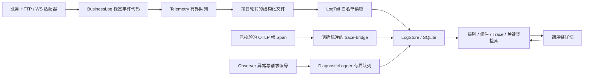

# 结构化日志、查询编辑器与函数耗时

## 先认清监控目标

18791 监控日常 18090；18793 监控隔离测试实例。两者共用界面，数据来自不同进程。原 18090 二进制没有导出 `nebula_function_seconds`，因此 CPU 和 HTTP 速率有数据，函数 P99 仍然为空。连接新版本、启用 `WEB_OBSERVABILITY=1`，再执行相应业务后，才能显示函数墙钟。目录、代码或面板存在本身不会生成测量数据。

「函数与内核剖析」先读取 `/api/v1/instrumentation`，显示目标地址、指标族和实际采集状态。缺少指标时，配置了 `--related-observer` 的日常入口提供隔离版直达链接；界面明确标注该数据不代表原目标。缺少调用、采集失败、鉴权失败和历史过期分别显示，不补造零毫秒。

## 日志如何进入工作台



业务日志可以理解成固定格式的检修单：事件代码说明发生了什么，源码位置说明从哪里发出，Trace ID 把同一次请求的检修单串在一起。它不是把 `exception.what()` 原封不动打印出来。统一 HTTP 错误适配器和 WebSocket 业务命令入口记录已分类的拒绝或失败；Observer 将参数拒绝、数据源失败、存储失败及未处理异常归为稳定代码。响应头 `X-Observer-Request-ID` 可用于核对监控服务报错。

| 字段 | 约束与含义 |
| --- | --- |
| `schemaVersion`、`recordId` | 版本 1；来源内唯一 ID，相同内容重试幂等，不同内容返回 409 |
| `timeUnixNano`、`level` | 纳秒十进制字符串；TRACE、DEBUG、INFO、WARN、ERROR、FATAL |
| `component`、`code` | 明确组件与登记的稳定事件代码；中文消息由代码映射 |
| `operation`、`errorCode` | 已登记的规范化操作与错误类型，不接受原始 URL、正文或 SQL |
| `traceId`、`spanId` | 可选的真实调用关联；未采样请求可能没有 Trace ID |
| `durationUs`、`status` | 可选的微秒墙钟和 HTTP 状态；没有观测时保持缺失 |
| `sourceFile`、`sourceLine` | 项目相对文件与行号，外部 Python 模块只保留文件名；源码位置不是任意文件读取入口 |
| `errorType` | 可选的登记异常类型，如 ValueError；不记录异常消息原文 |
| `processId`、`threadId`、`requestId` | 进程、线程与监控请求关联；不保存用户凭据 |

代码见 [C++ BusinessLog](../../backend/application/observability/BusinessLog/BusinessLog.h)、[日志存储](../../tools/observability/observer/log_store.py)、[有界队列与文件采集](../../tools/observability/observer/structured_logging.py)及[日志界面](../../frontend/observability/logs.js)。核心 `backend/server/` 的原日志宏、协议与 Reactor 保持冻结。旧版自由文本不会作为结构化日志直接导入。显式配置的旧文件只接收 `NEBULA_LOG` JSON 行，其余内容忽略。

`nebula-traces / trace-bridge` 是由已校验根 Span 派生的完成记录，来源单列。它可以为旧埋点版提供日志到 Trace 的联动，不等同于程序主动发出的错误日志。新 C++ 日志来源为 `nebula-webserver`，带真实源码及进程线程信息。

## 使用与容量

1. 打开「日志工作台」，按级别、组件、中文消息或事件代码筛选；关键词也能查询响应头中的请求编号，Trace ID 可直接粘贴到专用框。
2. 「实时跟随」每两秒查询，已有表格和行按 ID 更新。切换筛选会取消旧查询；页面退出会停止跟随。
3. 「加载更早日志」暂停跟随，并沿原时间窗分页。每页最多 200 条，当前界面最多 400 条，避免无限 DOM。
4. 「查看调用链」跳到同一 Trace；Span 详情的「查看结构化业务日志」反向查询同一时段。
5. 「导出当前日志 JSON」保存当前已加载结果及时间范围，不表示导出了全部历史。已配置 Loki 时，也可选对应数据源执行 LogQL；未安装 Loki 的环境不宣称完成真实 Loki 接入。

**保留最近七天。** SQLite 采用滚动七天截止边界，每分钟后台清理，不占查询线程；另有最多 20,000 条记录的容量限制。C++ 与 Observer 自有文本日志按 UTC 日轮转，最多保留今日及前六天，每天最多 8 MiB。文件清理只处理指定目录下对应前缀的自有日志，不递归删除，也不碰其他业务文件。目录采集器持续清理旧 C++ 日文件，即使业务处于空闲。启用额外控制台副本时，该副本由调用它的终端或进程管理器管理。

Python 日志队列最多 512 条；C++ 日志复用既有上限 1,024 的遥测队列。满载时拒绝并计数，日志故障不改变业务成功或失败结果。工作台显示队列丢弃、文件拒收、最近清理时间。SQL、聊天正文、密码、Token、原始异常文本与私有提示词不在接入契约中。

C++ 日志写入、丢弃和队列满使用独立 `nebula_business_log_*_total` 计数，可在指标目录查询。文件配额导致的日志丢弃不会计入 Trace 导出失败，避免错误归因。

| 接口 | 行为 |
| --- | --- |
| `POST /ingest/v1/logs` | 本机受信来源批次；独立 `log` 凭据域；每批最多 256 条、256 KiB |
| `GET /api/v1/logs` | `from/to`、`source/level/component/q/trace`、`limit/cursor`；稳定逆序分页 |
| `GET /api/v1/instrumentation` | 同时间窗实际抓取的指标族及目标状态 |

独立来源的凭据由服务端私有 `producers.json` 绑定；事件发布凭据不能发布日志，日志凭据不能发布业务事件。保持回环监听和既有 SSH 访问边界，不把此开发入口直接开放公网。

文件采集先逐条校验，再按最多 128 条写入同一事务，避免逐行提交造成额外开销。Observer 异常记录保留异常类型和出错源码行，不保存异常原文。重启隔离环境时，目标服务就绪后原子发布 `session.json`，再让 Observer 开始提供健康接口，防止读取旧端口或半份配置。

## 配置

```bash
# 业务配置；目录位于当前隔离运行目录，由启动器传入
export WEB_BUSINESS_LOG_LEVEL=warn
export WEB_BUSINESS_LOG_DIRECTORY=/home/pikachu/phase11-data/function3/observer-live-20261117/load/structured-logs
```

`WEB_BUSINESS_LOG_LEVEL` 支持六种级别与 `off`，未指定时兼容 `WEB_OBSERVABILITY_LOG`，两者都没有时默认 `warn`。追踪采样仍由原 HTTP/WS 采样选项控制，日志等级不会让所有请求自动生成完整调用链。

Observer 的 `serve` 可使用以下选项。原有数据库、端口和凭据参数继续沿用；不要在已占用端口重复启动。

构建配置也要核对：隔离精简版可能只包含 PostgreSQL、认证与 HTTP，日常版则启用 gRPC、ONNX、RocketMQ 和 TTS。先在独立目录按原配置构建并验收，再经授权启用，不能仅因聊天冒烟通过便直接替换完整服务。本轮完整配置通过 117 项回归，另 1 项 Redis 跳过；2026-11-19 经明确批准已启用到日常 18090。[原库验收、启动与回退](daily-rollout.md)

```text
--log-directory /绝对路径/observer-structured-logs
--log-input-directory nebula-webserver=/绝对路径/业务structured-logs
--log-file legacy-business=/绝对路径/旧服务控制台.log
--related-observer http://127.0.0.1:18793
```

自有 Observer 日志默认放在遥测 SQLite 旁的 `structured-logs`。`--log-console` 仅按需开启控制台副本。文件采集只读取显式指定的来源与路径，不自动扫描整个系统。

## 对照图片使用查询编辑器

查询行以 A–D 标识，支持数据源选择、Builder/Code、复制、显隐、删除和逐行/全部运行。Builder 可选择 HTTP、函数或聊天阶段，指定标签与 P50/P95/P99；Code 可输入表达式。图例支持 `{{function}}` 等标签占位符，Options 包含结果格式、步长和 Range/Instant。

- 本机执行登记直方图表达式，实际单位为秒。Instant 取所选窗口最后一个真实有效样本，保留其时间，不将它冒充为窗口结束时新发生的观测。
- 外部 Prometheus 执行完整 PromQL，包括截图中的分子/分母、标签与正则筛选；Instant 调 `/api/v1/query`，Range 调 `/api/v1/query_range`。没有该外部服务时不能凭界面生成其指标。
- 一次最多四条查询，每条最多 1,024 字符；步长与点数有上限，单条查询失败不会伪装为成功。图表、表格和原始桶有不同能力；外部结果只有已计算分位数时，不伪造直方图桶。

## 自检与学习

先用隔离服务执行会话列表、历史向前/向后读取和消息发送，再看四个函数的耗时。然后发起一条预期被拒绝的请求：核对状态、业务日志源码、Trace 和 Span，最后从日志返回链路，区分鉴权拒绝与真正 5xx。测试入口为 [Observer 契约](../../tests/project/test_observability.py)、[C++ 日志契约](../../tests/observability/BusinessLogContract/BusinessLogContract.cpp)和[真实浏览器检查](../../tests/project/observer_logging_browser.cjs)。[验收结果](validation.md)单列实际运行情况，不用模拟样本代替真实数据。
