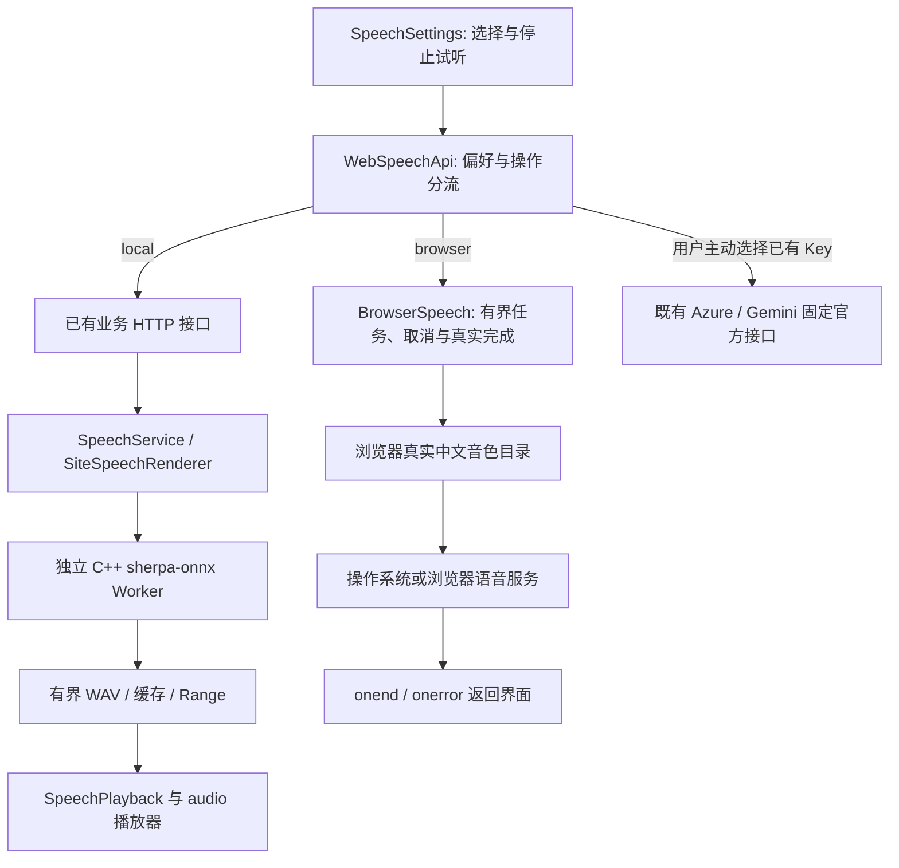

# 免绑卡语音：本地 Kokoro 与浏览器中文朗读

更新：2026-11-05。用户取消 Azure 开通路线，要求替换旧语音代理并清理无用接入。本轮不申请云账号、不绑定付款方式、不安装依赖、不下载模型。

## 1. 选择与实际边界

|方案|用途与成本|本项目决定|
|---|---|---|
|[sherpa-onnx](https://github.com/k2-fsa/sherpa-onnx) + 已安装 Kokoro 中文模型|服务器 CPU 本地合成，没有按字符计费；仍消耗自己的 CPU、内存和磁盘|继续作为默认语音及全站公告引擎，复用既有 C++ Worker|
|[speak-tts](https://github.com/tom-s/speak-tts) 所示的浏览器 Speech Synthesis 路线|调用操作系统/浏览器现成音色，无应用 Key、无新增模型；音色取决于设备|借鉴其异步音色发现与真实播放完成思路，用独立原生组件实现，不安装其旧 npm 包|
|[Kokoro-FastAPI](https://github.com/remsky/Kokoro-FastAPI)|同类本地模型的额外 API 服务，需单独运行 Python/容器等环境|已有 C++ 合成服务足够，不再重复安装一套|
|[edge-tts](https://github.com/rany2/edge-tts)|第三方维护的在线客户端，依赖上游非正式协议及网络；仓库也记录过上游端点修复|未安装，不把它作为稳定、无限次数的云 API 承诺，也不重试此前被拒绝的第三方签名认证路径|
|Azure / Gemini 自有 Key|用户自选云 API，受服务商套餐与账号约束|保留既有可选能力，不默认选择或自动调用，不再要求为正常使用申请 Azure|

浏览器朗读是新增的个人试听选项，**不把浏览器声音保存成 WAV，不替换站点管理员的公告配置**。全站男女公告继续使用已有 Kokoro 音频、缓存和播放权去重；“声音与通知→试听当前音色”可以直接检查。

“免云接口费用”不等于运行服务器零成本，也不代表新方案一定比所有云音色更自然。御姐、少年感属于听感目标，需实际试听比较，不以成功事件代替主观验收。

## 2. 页面使用

1. 登录后点击顶部“♫ 语音设置”。默认选择“服务器 Kokoro · 免 Key”，可选男女预置与语速，再点击“试听当前音色”。首次模型加载可能较慢，随后使用现有缓存。
2. 想换设备声音时，选择“浏览器设备朗读 · 免 Key”，点击“获取设备中文音色”。这里只展示浏览器真实返回的中文音色，不伪造晓墨等可用列表，也不自动下载安装包。
3. 选择声音、语速和音调，再点击试听。只有播放结束事件到达才显示“播放结束”；可以随时点击“停止试听”。更换设置、关闭窗口或切换账号会取消旧任务，迟到的旧事件不能覆盖新试听。
4. “本机”音色由设备合成；“在线”音色可能由浏览器供应商处理文本。此差别来自 [localService](https://developer.mozilla.org/en-US/docs/Web/API/SpeechSynthesisVoice/localService)，不将在线音色宣传为离线隐私能力。
5. 没有设备中文音色、浏览器不支持或播放失败时，页面明确提示选择 Kokoro；不会悄悄申请云账号或转用收费接口。设备试听直接出声，不出现假的下载播放器。

本轮新路径不需要用户提供任何 Key。已有 Key 的用户仍可显式选择原云服务；Key 继续遵循页面内存、Windows DPAPI、Linux 私有文件三种独立边界。

## 3. 组件与调用图

|文件|职责|
|---|---|
|[BrowserSpeech.js](../../../frontend/phase11/speech/BrowserSpeech/BrowserSpeech.js)|等待异步音色、过滤和去重、256 个目录上限、单个活动朗读、2,000 字与120秒限制、取消/超时/真实结束|
|[WebSpeechApi.js](../../../frontend/phase11/speech/WebSpeechApi/WebSpeechApi.js)|免费默认值、设备与服务端分流、账号隔离、旧代理偏好清理；设备试听不发应用网络请求|
|[SpeechSettings.js](../../../frontend/phase11/shared/SpeechSettings/SpeechSettings.js)|设备中文目录、实际目标、停止按钮、迟到任务保护、免费说明；站点/Windows原生隐藏不支持的设备模式|
|[SpeechPlayback.js](../../../frontend/phase11/shared/SpeechPlayback/SpeechPlayback.js)|保留 PCM WAV 校验、HTTP/2 Range 与手动播放；已删除仅被旧代理使用的 MP3 转 WAV 分支|
|[SherpaSpeechWorker.cpp](../../../backend/ai/speech/infrastructure/SherpaSpeechWorker/SherpaSpeechWorker.cpp)|复用的本地语音推理，不改通信核心或原数据库|
|[browser_speech.test.mjs](../../../tests/function3/frontend/browser_speech.test.mjs)|异步目录、无声音、真实结束、取消/替换、超时、设备设置分流与迁移契约|

## 4. 清理清单

- 删除兼容代理下拉选项、地址输入框、请求构造、错误处理和压缩音频转码辅助函数。
- 删除旧的代理专题文档，当前说明统一放在本文；公共导航、架构说明和目录同步更新。
- 当前站点首次进入设置时，清理该站点所有 `nebula.speech.profile:*` 中的停用代理地址，停用的 Provider 回到 `local`；不删除账号、主题、聊天、私人文件或仍有效的云 Key。
- 为清除历史配置保留最小迁移判断，测试中保留旧数据样本；它们不能发起代理请求，不能作为复活旧通道的入口。
- 没有安装过原 Worker，不声称卸载了不存在的服务。依赖目录核查、实际删除范围、部署版本与测试结果见本轮验收记录。
- 历史验收证据保留原样；原库、模型、正常依赖、备份和其他人的未提交工作不属于本轮删除范围。

## 5. 验收方法

执行项目 `source` 检查与新增设备语音契约；浏览器分别验证目录、实际结束、停止、切换、无 Key 页面与移动布局。本地 Worker 继续用真实 WAV 播放检查。设备差异与音色主观质量单独记录，不把替身音频当成真实设备声音。

服务器合成、Wave校验、站点 Key 权限等既有说明见[语音配置与播放](speech-settings-and-playback.md)。没有重跑全服务器 C++ Release/Debug/Sanitizer 或性能矩阵时，不宣称这些矩阵或 QPS 已改善。

本轮[历史验收摘要](../validation/function3.1.md#历史补丁)已保存：74项前端、23项工程契约、41项发布包测试通过；现已部署18090，实际设备Natural晓晓/云希播放结束，既有Linux Worker男女声生成有效WAV。
