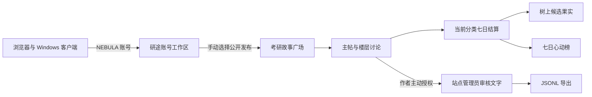
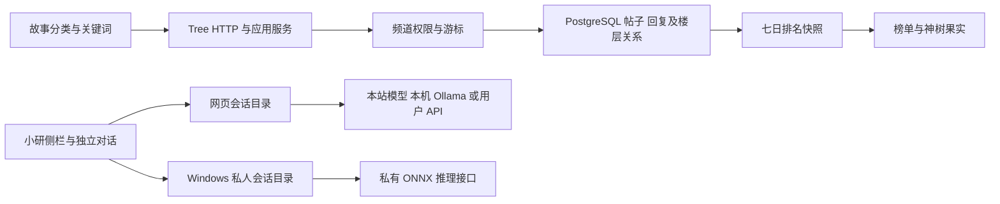

# NEBULA 研途接入与故事广场改造

研途现在嵌在 NEBULA 的「研途」页里。网页和 Windows 客户端使用同一个 NEBULA 账号，读取同一套账号学习库。其他人可以用自己的账号开始一套空工作区，学习内容按账号分开。考研故事广场、分类七日榜与训练语料审核继续沿用社区业务。

最新的产品改动见[故事广场、七日心动榜与小研](#故事广场七日心动榜与小研)。

## 启动与使用

Windows 通过 SSH 转发打开 [新版 NEBULA](http://127.0.0.1:18095/phase11/)，使用日常 `18090` 的原账号和密码登录，再点顶栏「研途」。配置了同一站点的 Windows 客户端也加载相同界面。已有的日常聊天、联系人和社区记录来自同一个 `phase11` 业务库。

| 操作 | 入口 |
|---|---|
| 打开学习库 | 在 Windows 客户端或网页进入顶栏「研途」。首次打开时使用当前账号的新学习库 |
| 调整资料下载目录 | 研途工具栏「下载位置」，或「个人主页 → 设置 → 研途」。文件夹授权属于当前设备，另一台设备可以选自己的目录 |
| 继续学习 | 计划、计时、资料库、笔记、错题、导图、复习卡、练习、模考与择校使用原研途界面。在线会自动保存到当前账号，另一端轮询更新 |
| 参与考研讨论 | 「研途 → 考研故事广场」。发布器默认选择站内公开的树频道，提交前显示发布范围 |
| 查看领域果实 | 在树页选择「领域」。同一选择用于故事列表、树上果实和七日榜 |
| 管理帖子训练资格 | 打开已公开的本人文字帖子，点击「AI 训练授权」可授权或撤回 |
| 审核与导出 | 站点管理员打开「管理中心 → 训练语料审核」，另填脱敏文本，再导出当前游标的审核数据 |

跨设备同步覆盖新账号工作区中的版本化记录和已经上传的附件。浏览器草稿、下载目录与设备密钥各自在本设备保存。断网时，已打开的界面会将待提交操作留在按账号区分的浏览器缓存。重新访问需要有效的 NEBULA 会话。

## 在服务端开启账号研途

使用与现有 NEBULA 相同的站点地址。Envoy 将 `/api/study/` 转到本机研途服务，聊天、WS、SSE 和其余 API 继续走原 NEBULA 上游。研途服务仅监听回环，并通过固定上游的 `/api/me` 核验登录及 CSRF。在已有网关部署中可以合并生成的 `study` 路由及 `nebula_study` 上游。

### 网关配置入口

端口和 TLS 从 Linux 的 `LabRunner` 启动参数配置。启动器根据 [Envoy 模板](../../../config/gateway/envoy.json)生成 `<工作目录>/envoy.json`，启动前调用 Envoy 做配置校验。Observer 网关面板用于查看请求、状态码、延迟和日志。

| 要调整的内容 | 配置入口 |
|---|---|
| 网关的回环 HTTP 端口 | `--gateway-port`。日常入口使用 `18095` |
| 应用和研途上游 | 日常模式固定使用 `--upstream-port 18090`。研途进程由 `--study-port` 指定，日常使用 `18772` |
| 域名和 HTTPS | `--https-port`、`--listen`、`--certificate`、`--private-key`、`--public-origin` |
| Windows 私人推理上游 | `--upstream-tls-port`、`--upstream-tls-ca`、`--upstream-tls-name`。三项与网关的 HTTPS 监听配套，并指向当前业务的同一个实例 |
| 路由、限流和代理超时 | [Envoy 模板](../../../config/gateway/envoy.json)、[网关生成器](../../../tools/observability/gateway.py)和[研途路由生成器](../../../backend/study/AccountWorkspace/GatewayConfig.py) |

在 Linux 源码目录用 `python3 -B -m backend.study.AccountWorkspace.LabRunner --help` 查看参数。参数或路由变更先用独立工作目录、空闲端口和 `--check-only` 验证。恢复既有部署时，`--resume` 会根据启动参数重新生成配置并核对原 `envoy.json`。

### 小研路由与资源映射

| 入口 | Envoy 目标或结果 |
|---|---|
| `/phase11/assistant/`、`/phase11/shared/PersonalAgent/`、`/phase11/shared/AgentRuntime/` | 启用网页快照后交给研途托管。无末尾斜杠的助手地址返回 307，并携带原查询参数 |
| `/api/ai/web/models`、`/api/ai/web/generations` 及任务路径 | NEBULA 业务上游。模型列表、生成、查询和取消分别沿用业务鉴权 |
| `/api/ai/private/*` | HTTP 返回 403。HTTPS 配置可验证的 TLS 上游后由同一 NEBULA 实例鉴权，HTTPS 缺上游时返回 503 |
| `/api/local/*` | 回环客户端处理本机接口。Linux 网关对同名路径返回 404 |
| `/api/study/*` | 研途工作区服务 |

NEBULA 私人推理按实际 TLS 连接判断。HTTPS 监听启用上游 TLS 后，登录、业务 API 与 WebSocket 也走对应的 TLS 实例。上游仅配置固定回环端口，使用现有证书链并核对精确 DNS 名或 IP SAN。NEBULA 的 Origin 配置需要包含 Windows 客户端访问网关时使用的 HTTPS 来源。[Envoy TLS 上游](https://www.envoyproxy.io/docs/envoy/latest/start/quick-start/securing)

隔离启动检查会对照小研页面、资源清单、压缩模块和 DAG 脚本的实际响应字节，并验证模型目录和本机接口的可达边界。日常网关仍按现有部署记录确认版本，生成的新配置使用新的工作目录进行切换。

### Function3.3 首次绑定与切号

1. 在启用了研途的网关中登录任一 NEBULA 注册账号，打开「研途」。`GET /api/study/session` 使用当前会话核验账号，返回十进制 `accountId`、稳定作用域和同源工作区路径。响应标记 `Cache-Control: no-store`。
2. 账号在首次打开时取得工作区。已有账号按原作用域找到原数据。复制工作区地址给另一账号时，服务端仍核验当前身份。账号切换时，页面移除旧工作区，并重新确认账号和路径对应后再打开。
3. 在 Windows 客户端用「研途 → 切换账号」或「个人主页 → 设置 → 切换账号」。填写目标账号信息后，返回原模块。可重复登录旧账号读取原工作区。其他已打开的客户端页面会重新核验会话。

Windows Companion 使用 TLS。使用隔离业务上游时，可让 `LabRunner` 同时提供回环 HTTP 预览和新的 TLS 入口。例如下列命令假定 Linux 网卡的地址是 `192.168.239.135`，证书包含该地址，`18445`、`18096`、`18773` 和 `19098` 均为空闲端口。

```bash
python3 -B -m backend.study.AccountWorkspace.LabRunner \
  --envoy "$ENVOY" --upstream-port 18094 --gateway-port 18096 \
  --study-port 18773 --admin-port 19098 --https-port 18445 \
  --listen 192.168.239.135 --public-origin https://192.168.239.135:18445 \
  --certificate "$CERTIFICATE" --private-key "$PRIVATE_KEY" \
  --upstream-tls-port 18444 --upstream-tls-ca "$UPSTREAM_CERTIFICATE" \
  --upstream-tls-name 192.168.239.135 \
  --work-dir "$HOME/phase11-data/function3/yantu-tls-$(date -u +%Y%m%dT%H%M%SZ)"
```

在 Windows 的项目目录中用受信证书启动客户端。若使用学习证书，将本人核验过的 SHA-256 填到 `--certificate-sha256`。私人目录选择 Windows 上为本次客户端准备的绝对路径。

```powershell
& 'build-client/release/nebula_companion.exe' --server 192.168.239.135 --tls-port 18445 --frontend 'frontend/phase11' --data-dir "$env:LOCALAPPDATA\NEBULA\function33-test"
```

以上端口用于隔离联调。原站的账号合并、已有部署和回退记录见下方。[客户端构建参数](phase36-41-local-preview.md) · [本轮测试](../../releases/function3.3.md)

### 本轮隔离部署包

已在 Windows 生成 `build-function3/nebula-yantu-code-only.tar.gz` 和同名 `.sha256` 校验文件。压缩包按允许清单收录研途服务、网关配置和前端静态资源，共 626 个文件。打包器逐个核对路径和 SHA-256，并检查初始院校目录、预置学习记录和邮件配置为空。原主机资料、备份、数据库和凭据留在本机。[打包及校验代码](../../../backend/study/AccountWorkspace/ReleaseBundle.py)

在 Linux 收到包后，先用 `sha256sum -c nebula-yantu-code-only.tar.gz.sha256` 验证，再解包到新的发布目录。下面的命令在该发布目录内运行。`ENVOY` 应指向 Linux 上已有的可执行文件，`18094` 指向已启动的隔离 NEBULA 实例。

```bash
python3 -B -m backend.study.AccountWorkspace.LabRunner \
  --envoy "$ENVOY" --upstream-port 18094 \
  --work-dir "$HOME/phase11-data/function3/yantu-verify-$(date -u +%Y%m%dT%H%M%SZ)" \
  --check-only
```

隔离启动器为研途创建空账号库，从快照提供新版 `/phase11/` 页面，认证和其他业务仍交给隔离 NEBULA 上游。`--check-only` 验证健康、研途页面和匿名认证，随后回收本次启动的研途及 Envoy。需要保留隔离入口进行跨设备验收时，用新的工作目录启动，并去掉该参数。[隔离启动器](../../../backend/study/AccountWorkspace/LabRunner.py)

### 从 Windows 访问新版入口

新版站点通过现有 SSH 连接转发 `18095`。同一条连接可转发 Linux 上的 `18791` 监控页面。

```powershell
$ssh = Join-Path $env:WINDIR 'System32\OpenSSH\ssh.exe'
& $ssh -o ExitOnForwardFailure=yes -N -L 127.0.0.1:18095:127.0.0.1:18095 -L 127.0.0.1:18791:127.0.0.1:18791 pikachu@192.168.239.135
```

保持 SSH 转发窗口打开，即可访问[研途](http://127.0.0.1:18095/phase11/study/)和 [Observer](http://127.0.0.1:18791/)。`18090` 与 `18095` 已同步小研及新版社区。研途账号工作区通过 `18095` 开启。[日常直连](http://192.168.239.135:18090/phase11/) · [研途网关](http://127.0.0.1:18095/phase11/)

### 账号与数据归属

2026-11-21 完成账号合并。日常站与 `18095` 网关共用 `phase11`。此前 `18095` 使用 `function3_runtime_test`，两库各自分配账号 ID。研途从服务端核验当前账号 ID，并从与 `phase11` 绑定的持久化工作区读取学习数据。

日常管理员可在「管理中心 → 用户与权限」查阅日常账号。两库的核对清单通过[只读盘点脚本](../../../scripts/function3/runtime/audit_accounts.py)生成，字段包括登录名、显示名、角色和数据数量。本机清单存放于 `build-function3/nebula-accounts/`，该目录由 Git 忽略。

两库盘点结果为日常库 68 个账号、隔离库 357 个账号。两份 PostgreSQL 备份已在 Linux 用户目录保存，并核对摘要与归档目录。唯一同名账号经本人确认，保留日常账号和凭据，将隔离库的 3 条树下回复映射到该账号。隔离账号库继续保留，验收、压测和演示账号不批量迁入日常站。

原帖均为隔离站的故障演练夹具。经核对作者、发帖键及回复关系，将获准迁移的回复收录到原账号「个人主页 → 全部动态」中的「迁回的树下回复」。原文、时间和作者已保留，只有本人能查看。恢复副本中连续执行两次仍只有 3 条回复，切换前后已比对原库 68 个账号的 ID、登录名、密码散列和停用状态。现有隔离工作区和 Windows 研途原资料各自保留在原位置。

### 手动启动参考

以下为隔离实例示例。`18094` 指向已经启动的 NEBULA HTTP 实例。示例用 `18095` 回环入口验收；跨设备开放时使用自己的 HTTPS 地址、证书和对应网卡地址。

```bash
STUDY_ROOT="$HOME/phase11-data/function3/yantu-account-lab"
STUDY_ORIGIN=http://127.0.0.1:18095
mkdir -p "$STUDY_ROOT"
python3 -B -m backend.study.AccountWorkspace.AccountWorkspace \
  --data-dir "$STUDY_ROOT/accounts" --port 18772 --auth-port 18094 \
  --public-origin "$STUDY_ORIGIN"
```

另开一个终端配置和启动现有 Envoy。`ENVOY` 是已经安装的可执行文件绝对路径。

```bash
STUDY_ROOT="$HOME/phase11-data/function3/yantu-account-lab"
python3 -B -m backend.study.AccountWorkspace.GatewayConfig \
  --output "$STUDY_ROOT/envoy.json" --access-log "$STUDY_ROOT/access.jsonl" \
  --http-port 18095 --admin-port 19097 --upstream-port 18094 --study-port 18772 \
  --public-origin http://127.0.0.1:18095
"$ENVOY" -c "$STUDY_ROOT/envoy.json" --mode validate
"$ENVOY" -c "$STUDY_ROOT/envoy.json" --disable-hot-restart
```

对外入口使用 `--https-port`、`--certificate`、`--private-key` 和 `--listen`，并在两个命令中登记完全相同的 HTTPS 源。Windows 客户端的 `--server` 与 `--tls-port` 指向这个入口，使用现有受信证书或经过确认的指纹。[Windows 客户端构建与连接参数](phase36-41-local-preview.md)

已有 Ollama 时，研途账号服务可指定 `--ollama-model` 使用已安装的模型，按需设置本机 `--ollama-port`。个人 API 密钥由浏览器按账号与设备保存，启用前需要确认发送范围。

账号服务从空目录启动，浏览器缓存使用独立的命名空间。隔离验收中的账号和附件由测试新建。

## 功能与隔离

| 区域 | 本轮落点 |
|---|---|
| 研途功能 | 按文件范围复用计划、专注计时、资源导入和预览、笔记与导图、择校、练习与整卷、复习卡、提醒、备份恢复、Obsidian 和小研助手的应用代码。[源码导入器](../../../scripts/client/import_yantu_source.py) |
| 按账号隔离 | 通过 NEBULA session 确认用户，以稳定的账号作用域选择 SQLite、附件、备份和浏览器缓存。网页与客户端账号一致才会访问同一学习库。[账号服务](../../../backend/study/AccountWorkspace/AccountWorkspace.py) |
| 空工作区 | 导入时清除了内嵌目标院校、复习计划和邮件配置。学校目录从空表开始。笔记、附件、计划、成绩、助手数据和凭据在新实例独立生成 |
| 导入范围 | 仅复制允许清单中的应用代码、前端资源和随附许可。摘要对应接入前、已清空初始数据的代码基线；后续适配以当前工作树的源码为准。[源码摘要](../../../client/yantu/source-manifest.json) |
| 客户端与网页入口 | 共用 NEBULA 顶栏和同源内嵌界面。账号切换时重新装载工作区。[研途主页](../../../frontend/phase11/study/index.html) |

账号附件可分段上传，单个附件上限 256 MiB。中断后的分段重试校验既有内容，完整文件成功入库后才对同账号的其他设备可见。单次未分段导入受 10 MiB 请求上限约束。

账号模式通过 API 管理网内学习记录和附件。原研途依赖本机文件系统的 Obsidian 目录联动、第二副本路径、桌面托盘、签名 APK 及原有远程入口由独立模式提供。账号模式的原生通知和本机目录联动仍待接线。独立模式可在 Windows 用 `python -B -m client.yantu.LocalWorkspace.LocalWorkspace` 启动独立空库。[独立启动器](../../../client/yantu/LocalWorkspace/LocalWorkspace.py)

故事广场接收发布器中主动提交的文字与附件。原研途数据库、资料、备份、配对和凭据留在主机原有位置。

## 社区实现与数据



- 广场以分类、封面、正文预览和讨论参与人数组织卡片。详情把回复归到相应楼层，可展开楼中回复。个人主页动态详情使用同一组件，更早楼层用原有游标分页加载。[楼层组件](../../../frontend/phase11/shared/DiscussionThreads/DiscussionThreads.js)
- 每次结算为活跃类别计算近七日有效主帖，沿用点赞、独立回复用户数和时间衰减公式，每类别最多十条。榜单和树共用同一份结果，再批量核验帖子可见性。全站树高继续按现有可见主帖总量绘制。[分类榜组件](../../../frontend/phase11/tree/CategoryRanking/CategoryRanking.js)
- 默认训练授权关闭，作者可授权本人已公开的文字帖。审核和导出各自核验站点管理员角色。管理员另填脱敏文本，授权和审核动作留审计。撤回会清除该次审核，隐藏或删除会使帖子退出后续导出。已经下载的副本由持有方处理。本次接入交付到 JSONL 导出，训练与评测作业另行发起。[训练授权服务](../../../backend/application/modules/tree/application/TreeTrainingService/TreeTrainingService.cpp)
- 迁移 026 为 PostgreSQL 追加「考研」分类、分类榜和训练授权表，运行版本信息同步报告所需迁移。新版业务进程启动前，先在隔离库验证迁移和读写。[数据库迁移](../../../backend/application/storage/postgres/migrations/026_tree_category_and_training.sql) · [原生交付说明](../validation/native-delivery.md)

## 故事广场、七日心动榜与小研

### 参考与实施取舍

- 故事广场用领域和内容形式做入口，卡片先展示封面或标题，正文摘要、标签、作者与互动放在下方。搜索支持正文、作者显示名和标签。参考小红书的笔记发现与热议话题组织方式。[小红书笔记与搜索](https://pages.xiaohongshu.com/activity/deeplink) · [热议话题规则](https://fe.xiaohongshu.com/ditto/vincent/b9ca419956094c3aafaa7c2354aff1c8?fullscreen=true&naviHidden=yes&source=wowcard)
- 讨论区保留楼中回复，并支持「只看楼主」。服务端先核验帖子权限，再按楼主过滤和按 ID 分页，能查到早于首次加载的楼主回复。[百度贴吧客户端功能](https://tieba.baidu.com/tb/zt/xy_down.html)
- 模型参数填写、连接测试与正式采用使用独立步骤。测试须收到所选模型的一次有效文字回复，配置改动后需要重新测试。[Cherry Studio 模型服务设置](https://docs.cherry-studio-ai.com/pre-basic/settings/providers)
- NEBULA 的聊天、登录、个人主页、管理、树和小研复用研途风格的青绿色主操作与低对比表面。研途内嵌工作区使用自己的样式和功能。全站小研复用研途源码提供的角色图，原图与新资产的 SHA-256 一致。[小研头像组件](../../../frontend/phase11/shared/XiaoYan/XiaoYan.js) · [主题变量](../../../frontend/phase11/shared/DesignSystem/tokens.css)

### 社区功能与内置内容

故事广场入口是 `/phase11/tree/#feed`。发布内容的首行作为卡片标题，剩余正文用作预览。广场可以搜索、按领域和图文或语音筛选、按标签继续浏览、点赞、收藏及打开帖子讨论。`/phase11/tree/#rank` 展示前三名、后续名次、热度、点赞和独立讨论人数。类别、排行快照与神树果实沿用同一份服务端排名。榜单只在可见内容或分数发生变化时重绘，故事广场和榜单首屏暂缓三维场景初始化。

关键词经 `GET /api/tree/posts?q=...` 传入，最长 64 字，可同时应用类别、标签、时间、媒体类型和 ID 游标。社区 HTTP 适配器解码浏览器参数一次，再检查 UTF-8、长度、分页和资源 ID。`GET /api/tree/posts/{id}/replies?authorOnly=true` 先选出发帖者的回复，再按 ID 取一页，否则只看当前页时容易漏掉更早的楼主回复。帖子列表与详情从同一查询获得当前用户的收藏状态。隐私、停用身份和隐藏内容由业务服务校验。[HTTP 适配器](../../../backend/application/modules/tree/transport/TreeHttp/TreeHttp.cpp) · [查询实现](../../../backend/application/modules/tree/infrastructure/TreePostgresRepository/TreePostgresRepository.cpp)

种子包含考研区的 5 篇原创示例和 12 条示例评论，其中 5 条为楼中回复。署名使用两个停用身份。帖子接口根据服务端来源标识返回 `bundledExample`，点击卡片的示例标签可筛选同类内容。样例采用现有榜单公式，初始点赞数为零，训练授权默认关闭。种子要求迁移 026，用同一事务、预留身份校验和稳定请求键处理重复执行。站点管理员可用既有处置功能处理已加载的示例。[内置示例脚本](../../../scripts/function3/runtime/seed_study_community.sql) · [帖子响应](../../../backend/application/modules/activities/transport/ActivityJson/ActivityJson.cpp)

```bash
PSQL="$HOME/phase11-deps/postgresql/18.6/bin/psql"
"$PSQL" "$NEBULA_STUDY_VALIDATION_CONNECTION" -w -X -v ON_ERROR_STOP=1 \
  -f scripts/function3/runtime/seed_study_community.sql
python3 -B tests/function3/integration/study_community_blackbox.py \
  --port 18096 --output build-function3/study-community-validation.json
```

上述合成注册与写入测试只接受专用测试入口和隔离业务库。[社区黑盒验收](../../../tests/function3/integration/study_community_blackbox.py)

### 小研的入口与模型

聊天会话区的「小研」、全站顶栏的小研头像和 `/phase11/assistant/` 共用名称与角色。网页侧栏展开全页时，当前账号在同一标签页内能继续对话，原网页好友和侧栏历史以两条独立会话保留。从 Windows 客户端打开时，可以在小研头部切换网页对话和私人空间。Windows 的侧栏和对话页能访问同一个本机会话目录，并继续提供资料、记忆、确认式行动及语音设置。

| 连接方式 | 对话数据流向 | 配置入口 |
|---|---|---|
| 网页 · 本站模型 | Linux 站点收到输入与选取的对话上下文 | 小研 → 模型连接 → 本站模型 |
| 网页 · 本机 Ollama | 浏览器直连当前设备的 `/api/chat`，由本机模型生成 | 小研 → 模型连接 → 本机 Ollama |
| 网页 · 自带 API | 浏览器将本轮上下文和用户提供的 Key 直接送到配置的服务商 | 小研 → 模型连接 → 自带 API |
| Windows 私人空间 | 会话、资料与记忆使用 Windows 所属账号的本机存储。私人推理经过独立的 Linux ONNX 接口 | Windows 小研 → 模型连接 |

网页 Key 仅留在当前页面内存。切换网页和 Windows 私人空间时，两处使用各自的会话存储和资料权限。本机 Ollama 需要已有模型和允许当前浏览器来源访问的配置。个人模型与群聊 AI 继续使用各自的权限和上下文。[网页连接代码](../../../frontend/phase11/shared/ModelConnection/ModelConnection.js) · [Ollama 原生接口](https://docs.ollama.com/api/chat)



### 实施与验证记录

| 次序 | 过程与证据 |
|---|---|
| 1 | 核对原研途能力及本轮范围，参考贴吧、小红书、Cherry Studio 与 Ollama 官方资料。复用小研原头像，改造 NEBULA 层的入口 |
| 2 | 先补关键词查询、楼主过滤与幂等种子，再接广场卡片、排行和对话页。重新生成静态资源版本与代码包 |
| 3 | 本机通过 87 项前端测试和 C++ 内存树契约，覆盖关键词、楼主分页、读写权限和点赞后的操作权限。研途账号工作区既有回归通过 |
| 4 | 已安装的 Edge 在 1440×900、1920×1080、390×844 通过合成接口旅程。核对故事搜索、收藏入口、只看楼主、榜单、双主题、登录、聊天、个人设置和后台角色。小研通过三种网页模型的测试与出字，并验证 Windows 两类历史和网页会话隔离。模型与 Windows 私人接口使用合成回应 |
| 5 | 通过 SSH 校验 632 文件程序包。研途的 488 个运行文件逐个 SHA-256 与前次发布包一致。精简源码包用发布配置编译 Linux Release，再独立编译并运行社区 C++ 契约 |
| 6 | 临时 PostgreSQL 18.6 应用迁移 001 至 026，两次导入后仍是 5 篇帖子、12 条评论和 5 条楼中楼。真实 HTTP 验证中文标签、空白和字面 `+` 与 `%`、编码逗号、多 ID 批量读取、楼主分页、收藏和可见权限。临时 Envoy 网关也通过检查 |
| 7 | 第一次切换发现直连缺少 PNG 路由，自动恢复旧版程序和页面。补齐业务层静态资源 MIME 后，重新隔离核对小研 PNG 完整摘要、故事广场和小研页面，再切换 `18090` 与 `18095`。两入口均为 `d7a3142ac64b5ae6` |

### 日常发布与回退

2026-11-21，Function3.3 网页和研途会话服务已启用到 `18095`，资源版本 `7f8c7f1b31e4435c`。隔离端口启动验证通过后切换。Edge 通过 Windows 原地址看到「缘续-聊天」「缘生-广场」「研途」，就绪检查返回 200，研途匿名请求返回 401。网关沿用 `18090` 上游、`phase11` 业务库和现有研途账号工作区。`18090` 直连的静态页面版本仍为 `d7a3142ac64b5ae6`。

当前网关工作目录为 `/home/pikachu/phase11-data/function3/runtime/backups/xiaoyan-jdjkz1z2/gateway-work`。其中的 `envoy.json` 已核对监听 `18095`、管理端口 `19097`、聊天上游 `18090` 和研途上游 `18772`。本轮发布与回退收据位于 `/home/pikachu/phase11-data/function3/runtime/backups/function33-gateway-gxj07vsd` 下的 `deployed.json` 和 `previous.json`。

#### 上一轮社区发布

2026-11-21 完成日常发布。两个入口均使用原业务库 `phase11` 和迁移 026。发布后比对全部 68 个原账号的凭据摘要。原库导入了 5 篇考研示例、12 条评论，其中 5 条为楼中回复。示例署名的两个账号均为停用状态，训练授权计数为零。考研榜最新快照 `14250` 收录了这 5 篇。Observer 在 Linux `18791` 重新采集到业务进程 `179092` 的资源样本。

日常检查入口见[故事广场](http://192.168.239.135:18090/phase11/tree/#feed)、[七日心动榜](http://192.168.239.135:18090/phase11/tree/#rank)及[小研](http://192.168.239.135:18090/phase11/assistant/)。在故事广场点「考研」，再点任一「站内示例」标签即可筛出内置内容。从 Windows 使用研途账号工作区时打开[网关入口](http://127.0.0.1:18095/phase11/)。

| 凭据或制品 | 核验位置 |
|---|---|
| 发布收据 | `/home/pikachu/phase11-data/function3/runtime/xiaoyan-current.json` |
| 已验证的原库归档 | `/home/pikachu/phase11-data/function3/runtime/backups/xiaoyan-jdjkz1z2/phase11-before-xiaoyan.dump` |
| 数据库归档 SHA-256 | `135347e290c3d4e73710d3b3e2afe893e64614564a5795d9149e32f8d26bd3ba` |
| Linux 发布程序 SHA-256 | `5b9356cde8d77de0190607bceed6c084824fa70be635d957d730955fd8834f26` |
| 隔离黑盒证据 | `/home/pikachu/phase11-data/function3/xiaoyan-releases/lab-He1bmS3j/query-retest-it9bkifu/community-verification.json` |

发布收据同时记录上一个可执行程序、两处前端目录备份和网关工作目录。正常重启使用日常启动器。需要重编译本轮 Linux 程序时，源码在 `/home/pikachu/phase11-data/function3/xiaoyan-releases/lab-He1bmS3j/source`。站点仅需回切界面或程序时，使用收据里的程序与前端备份。示例内容可通过管理中心隐藏，避免为回切界面恢复整个数据库。[日常启动与停止](function3-runtime.md#1-正常启动与停止)

## 诊断建议取舍

| 建议 | 本次处理 |
|---|---|
| 入口与主题 | 研途入口和个人设置接入共用导航，社区卡片、讨论和状态继续使用原设计变量 |
| 加载、空态和失败 | 切换分类先清掉旧榜单，明确读取中、近七日无样本和失败重试 |
| 消息附件逐条查询 | 当前消息读取已有批量附件查询。本轮复用该思路，关联榜单帖子时批量读取最多十条。[消息附件代码](../../../backend/application/storage/postgres/PostgresMessageRepository/PostgresMessageRepository.cpp) |
| Observer 和全文检索 | 告警接收、中文分词和 Observer 的工作区改造在现有路线图单独跟踪。[后续路线](../../roadmap/next-steps.md) |

## 验收入口

| 验证 | 命令 |
|---|---|
| 空库、独立会话、读写与停止 | `python -B tests/client/yantu_workspace_test.py` |
| 研途界面和下载路径 | `node tests/client/yantu_browser.cjs`，使用已安装浏览器和 Playwright |
| 账号研途协议 | `python -B tests/client/yantu_account_workspace_test.py` |
| 浏览器与客户端账号同步 | `node tests/client/yantu_account_browser.cjs`，或用 PowerShell 7 运行 `tests/client/run_yantu_companion_browser.ps1` 验证实际 Windows 客户端。测试使用本机 HTTPS 夹具与临时证书 |
| 前端回归 | `node --test tests/phase11/frontend/*.test.mjs tests/function3/frontend/*.test.mjs` |
| NEBULA 界面 | `node tests/function3/frontend/profile_browser.cjs` 与 `node tests/function3/frontend/workspace_browser.cjs`，使用本机 HTTP 夹具 |
| 训练权限与撤回 | `ctest --test-dir <构建目录> -R ^function3_tree_training_contract$ --output-on-failure` |
| 真实 PostgreSQL 及 HTTP | 在迁移至 026 的隔离业务实例上运行 `python3 tests/function3/integration/activities_blackbox.py --port 18094 --output build-function3/yantu-community-blackbox.json` |
| 接口与资源 | `python -B scripts/project/sync_api_contracts.py --check` 和 `python -B scripts/project/frontend_release.py --check` |
| 部署包 | `python -B -m backend.study.AccountWorkspace.ReleaseBundle verify build-function3/nebula-yantu-code-only.tar.gz` |

### 本次结果

下表记录前一轮研途接入与账号合并。本轮日常状态以「日常发布与回退」为准。

| 范围 | 结果 |
|---|---|
| Windows 独立研途 | 两个真实空库实例启动并停止，合成笔记只写入目标实例，旧目录拒绝复用，实例凭据无法互用。Edge 打开 13 个工作区入口，验证文件夹授权、合成文本及同源流式下载、PDF.js 主文件加载和 Worker 可取 |
| 账号研途 | 两份独立浏览器会话通过嵌入工作区、笔记同步、原本机缓存隔离、账号切换、下载设置和 PDF 资源加载测试。实际研途账号服务通过会话失效、账号越权拒绝、分段附件重试及范围读取测试 |
| Windows 客户端和入口 | MinGW Release 构建及五项既有客户端契约通过。实际 Windows 客户端通过本机 HTTPS 网关夹具登录，在客户端读到了网页写入的笔记，并通过附件 HEAD 原始长度和 Range 流式读取。研途路由生成、路由优先级及发布包允许清单已检查 |
| NEBULA 前端 | 84 项前端回归通过。Edge 使用本机 HTTP 夹具验证个人设置、管理入口权限、研途链接、分类榜、楼中楼与授权开关 |
| 业务与版本检查 | 本机编译并运行 C++ 训练授权契约，通过角色边界、审核后导出、撤回及重新授权测试。榜单服务通过语法检查。接口契约、架构边界、资源清单、迁移版本标记与文档链接检查通过 |
| 代码包与 Linux | 626 个文件的程序包已通过 SSH 传到 Linux 并核验 SHA-256。Envoy 1.40.2 在 Linux 分段续传后通过官方 SHA-256，安装在 `~/phase11-deps/gateway/envoy-1.40.2/envoy`。隔离站前端版本为 `1ba9c3e114fffb3e`。[官方发布制品](https://github.com/envoyproxy/envoy/releases/expanded_assets/v1.40.2) |
| Linux 研途账号与附件 | Windows 经 SSH 转发访问真实网关。隔离库合成账号完成登录、同账号独立会话同步、幂等提交、无 CSRF 拒绝、跨账号拒绝、附件和 Range 读取 |
| Linux 社区上游 | 复用 Linux 已安装的工具链与 PostgreSQL，完成 Release 构建。在 `function3_runtime_test` 备份后追加 025、026，经 Envoy 实测分类七日榜、好友与私有动态隔离、训练授权、管理员审核、撤回后移出导出以及删除后旧媒体链接失效。`/health/version` 报告 `requiredMigration=26`，启动时已核验数据库迁移 |
| 日常站与监控 | 2026-11-21，`18090` 与 `18095` 实测均报告已核验迁移 026。`18090` 页面版本为 `366b63e5aaf26c0b`，`18095` 为 `1ba9c3e114fffb3e`。研途页面返回 200，匿名访问研途会话或私有回复返回 401。Observer 已切换到新业务 PID，Windows 经 `18791` 查询到了实际进程样本 |
