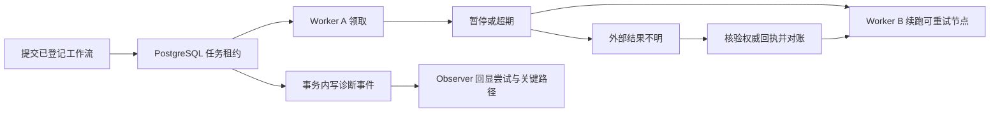

# Fleet P0 可靠性与发布验收

从 `v0.4-fleet` 的五个基线提交继续。原标签定位到已在容器实测的源码。本轮在 `feature/fleet-p0-hardening` 单独修复账本、PostgreSQL 工作流和发布门禁。 [基线发布与测试](../../releases/v0.4-fleet.md)

## 1. 工单容量、历史回执和 027

- 协调器只用排队中的工单计算准入。SQLite 的 `AUTOINCREMENT` 继续分配单调的 `epoch`。分页以实际游标读取全历史。终态记录保留，因此反馈重放和同任务重提交仍找到同一个工单。
- 边缘只限制未确认积压，使用待报告与活动任务的部分索引。已报告的终态记录仍可验证原命令身份。审批容量只计未过期的待审提案。历史任务和审批占用的磁盘随实际业务量增长，运行时按账本大小制定容量与备份计划。跨过旧工单号上限后，回退候选也需要支持高代次，否则旧程序仍会拒绝新单。
- Web 的 027 按 `processed_at` 查 14 天前的 Inbox 回执，每批先在对应 Outbox 留去重标记，再删除明细。定时任务按原间隔运行。新增验收先建 026 临时库、写入六条历史回执，再升级、清理和对照故障记录。 [027 事务说明](../../database/README.md)

## 2. Worker 自动领取和对账

在独立的工作流 PostgreSQL 数据库中，首次初始化按顺序执行这两份 SQL。已有 v1 工作流库先停旧 Worker，执行第二份增量脚本后统一更新进程。两份 SQL 与 Web 迁移的编号分开。

```bash
psql --set ON_ERROR_STOP=1 --file backend/systems/PostgresWorkflowQueue/schema.sql
psql --set ON_ERROR_STOP=1 --file backend/systems/PostgresWorkflowQueue/upgrade_v2.sql
```

先把 `NEBULA_WORKFLOW_DSN` 指向自己的测试库。在两个终端分别启动 Worker，再提交工单。

```bash
./nebula_workflow_worker serve worker-a 300
./nebula_workflow_worker serve worker-b 300
./nebula_workflow_worker submit sample-read read
./nebula_workflow_worker submit sample-renew slow
```

- 两个 Worker 都会发现它们已登记版本的就绪任务。短事务通过 `FOR UPDATE SKIP LOCKED` 领取节点。节点执行期间每约三分之一租期续租，续期上限仍由原尝试期限决定。
- 每次写入要匹配 `runId`、节点、领取者和尝试号。租约过期后，已知可重试的节点由其他 Worker 接管。外部操作超期进入 `uncertain`，下游停在依赖边界。
- 运维先从外部系统核对结果，再使用有授权的 `NEBULA_WORKFLOW_RECONCILE_DSN` 和不含敏感信息的证据编号执行 `reconcile RUN NODE ATTEMPT success EVIDENCE_ID VALUE`。核验身份与结果入审计表。同一核验重放幂等。仍在原运行时限内时，已证实成功的节点可释放因依赖跳过且从未执行的下游。原节点的执行次数保持不变。
- 在 Observer 节点上用 PostgreSQL 环境变量或服务配置选择工作流库，用现有的 `NEBULA_FLEET_OBSERVER_TOKEN` 启动 `workflow_observer.py --psql /absolute/path/to/psql --observer http://127.0.0.1:PORT --follow`。事件和状态在同一数据库提交。只有 Observer 接收后才标记发送，断线按原事件 ID 补送，遥测保留七天。

## 3. 一次联合演练



FleetAgent 的审批走同样的可靠性原则。读取真实工单后校验提案，在 SQLite 检查点登记审批交接，审批回执丢失时查询协调器账本。PostgreSQL 集群用共享租约重新分配可重试工作，FleetAgent 的人工确认沿用原独立角色。 [Agent 与 DAG 实操](../../learning/v04-fleet-agent-dag.md)

## 4. 干净检出和发布门禁

按原复现手册填入已有依赖路径，对候选版追加 `--bundled-runtime --tag fleet-p0-verify`，使用一个未占用的标签和新输出目录。脚本生成依赖清单、做带历史数据的 026→027 升级、跑回归并验 ZIP。Docker 将这次检查过的运行库放入镜像，先导出、移除本轮构建的标签，再导入执行 Web 与 Fleet。数据库仍使用独立临时实例。

源码 CI 继续运行基础矩阵。新的发布集成档供维护者推送 `v*-fleet` 或 `fleet-verify-*` 标签时执行，也支持显式运行，复用现有隔离 runner。该档产出升级、CTest、Worker 和容器证据。 [原复现参数](v04-fleet-reproduction.md)

## 5. 隔离实测结果

最终构建、升级与容器验收使用干净检出的 `6937f1f42fe1b3a0b0880b456b7c8d5fd3e45994`。前端版本校验发现旧基线里 89 个生成引用落后。仅刷新版本参数后，Linux 与 Windows 的资产校验均通过。

| 验证 | 结果 |
|---|---|
| 账本容量与回放 | 合约预置 50,000 条已确认边缘历史。下一个工单获得 `epoch=50001`，旧工单回放保留原结果，排队满仍拒绝额外请求。 [Windows Debug 5/5](../../../artifacts/fleet-p0/windows-cpp-systems.json) |
| 026→027 与 Web | 两批各删除一条，第三批为零，保留近期、待发布、未解决故障和未匹配来源四条回执。原 Outbox 两条保留持久去重标记。Web Release 122 项通过，无跳过。 [升级](../../../artifacts/fleet-p0/inbox-upgrade.json) · [Web 结果](../../../artifacts/fleet-p0/web-reproduction.json) |
| Agent 与 PostgreSQL DAG | CentOS Release 12 项通过，含原有 FleetAgent 审批回执丢失后对账。240 ms 租期下，健康节点通过续租在一次尝试中运行 712 ms。外部节点对账后原尝试仍只有一次。Observer HTTP 拒连后恢复并按原事件 ID 去重。 [C++ Release](../../../artifacts/fleet-p0/centos-cpp-systems.json) · [PostgreSQL Trace](../../../artifacts/fleet-p0/workflow-postgres.json) |
| 跨虚拟机接管 | 暂停 CentOS Worker 后，Ubuntu_ros Worker 自动发现并从 A 的第二次尝试接管，完成汇合。旧 Worker 的迟到结果被拒绝。共用隔离 PostgreSQL，连接经已认证的回环 SSH 转发。 [跨机证据](../../../artifacts/fleet-p0/cross-vm.json) |
| 并发与源码 | CentOS 原生 TSan 6 项通过，含 PostgreSQL Worker 和恢复用例。Windows 完整源码门禁通过，包含 106 项前端合约及 Observer HTTP。 [TSan](../../../artifacts/fleet-p0/centos-tsan-postgres.json) · [源码门禁](../../../artifacts/fleet-p0/windows-source.json) |
| Docker 与依赖 | 在移除本轮镜像标签后重新导入，Web 和 Fleet 启动通过，包括 WebSocket、SSE、工单去重和容器 Worker 自动发现。容器使用独立测试数据库，启动无需挂载宿主机动态库。 [Docker](../../../artifacts/fleet-p0/docker-delivery.json) · [依赖清单](../../../artifacts/fleet-p0/dependency-lock.json) |

容器验证在 CentOS 完成。GitHub 新发布档配置已加入候选分支，本次证据由隔离环境执行相同的发布入口生成。大规模跨机和协调器高可用仍需独立验证。
