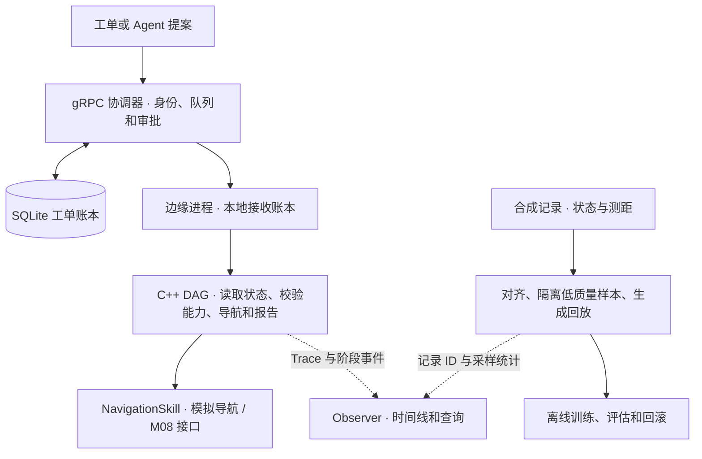

# M00–M07 软件系统交付与复验

本轮在 Function3.5 的 C++ 复现基线之后交付。验证范围是 C++ 后端 DAG、Agent 提案、技能契约、合成数据训练、gRPC 车队和 Observer。在 M08 的导航接口交接处收口。CentOS 运行隔离协调器和软件边缘，Windows 使用独立构建目录。旧版 Ubuntu_ros 的双虚拟机证据按原代码版本引用。 [双机历史报告](cpp-systems-cross-vm.md)

## 阶段结果

| 阶段 | 新增交付 | 验证方法 |
|---|---|---|
| M00 工程收口 | 每档明确要求注册的 CTest 用例，归档测试发现阶段、源码摘要与 JUnit | Linux 和 Windows 使用同一份源码复跑；要求一个故意缺失的测试时脚本必须在 `test-discovery` 退出 |
| M01 Agent | 规则规划器、模型候选核验、草稿审批和边缘交接继续复用 C++ DAG；增加现有 ONNX 模型的固定样本练习 | 模型候选经 C++ 用相同输入重新读取工单并核验技能和引用；缺少有效建议时，工单仍可按常规路径运行 |
| M02 Skill | 机器人声明三个 v1 能力，导航调用共享底盘互斥，旧版省略附加字段仍兼容 | 拒绝不完整或不受支持的能力声明、越权、站点错误、导航超时与取消；重复结果通过任务账本对账 |
| M03 训练与推理 | 生成两路合成记录，按会话划分训练和评估；两个 CPU 小策略、工件摘要、切换及回滚审计 | 三个固定种子，对照规则和两个模型；单个推理进程最多一个执行和一个等待，超时从提交开始计算 |
| M04 后端 DAG | 单调钟可注入，发布版提供可选 SQLite 检查点；节点动作按副作用类型恢复 | 中断进程后重启，验证逻辑键、结果恢复、外部动作待核实和人工确认；用 1/2/4 个 Worker 分别做三轮基准 |
| M05 车队调度 | 按机器人能力分配任务和记录占有代号；查询排队、活动、连接和拒绝计数 | 30 张工单分配、20 次接收回执中断、协调器重启、旧结果和故障后待对账状态 |
| M06 gRPC | `Load` 读快照和 `WatchLoad` 有界状态流；操作者和边缘身份分离 | 两个慢流连续 30 秒，第三条明确拒绝；期间提交 30 张工单并检查收束以及关闭后活动流归零 |
| M07 观测与回放 | 同一 Trace 关联 DAG、Agent 证据和设备记录引用；SQLite 配额时明确拒绝 | 通过真实隔离 HTTP 服务重复导入并查询，注入重复、迟到、缺样本与时钟偏差，重复回放同一动作摘要 |

## 调用关系



### 三种容易混淆的编号

- `taskId` 是一张工单的编号，`epoch` 记录这次派发的占有代号。重复请求沿用工单编号。协调器先验证代号，再更新工单终态。
- DAG 的逻辑 `runId` 是这份检查点作业的编号。重启打开同一 `runId` 和版本，执行节点仍得到同一个操作键。例如运行标识 `proof` 的 `action` 始终得到 `proof:action`。调用者应把这个键当作整体。同一份作业的链路沿用 `traceId`，每次打开后生成新的事件运行标识。
- `recordingId` 对应一份本地归档。Observer 通过录制 ID、版本和时间区间定位回放，设备样本保存在实验文件中。重复回放检查已对齐样本生成的动作摘要。

进程在「动作可能已经发生」和「结果已经落盘」之间退出时，外部节点进入待核实。幂等节点可在剩余尝试次数内重试，接收方须使用稳定操作键去重。检查点最多保存 128 个运行，每个节点输出最多 4 KiB。默认边缘路径继续使用独立工单和收件账本。 [检查点接口](../../../backend/workflow/WorkflowJournal/WorkflowJournal.h) · [恢复实现](../../../backend/workflow/DurableWorkflow/DurableWorkflow.cpp)

## 从干净目录复验

前置条件是已有 C++20、CMake、Python、SQLite 和可选 gRPC C++ SDK。Linux 在项目根目录执行，Windows 把 `python3` 换成 `python`。需要额外指出 gRPC 安装位置时使用 `--prefix`。Windows 下遇到 MinGW 或 protoc 的中文路径限制，可使用短 ASCII 路径的完整检出。 [环境、账户和手动启动](cpp-systems.md)

```bash
python3 -B scripts/project/check_boundaries.py
python3 -B scripts/project/cpp_systems.py --build-dir build/m07-debug --config Debug
python3 -B scripts/project/cpp_systems.py --build-dir build/m07-release --with-grpc --benchmarks
python3 -B scripts/project/cpp_systems.py --build-dir build/m07-tsan --config Debug --sanitizer tsan
python3 -B scripts/project/cpp_systems.py --build-dir build/m07-asan --config Debug --sanitizer asan-ubsan
python3 -B scripts/project/cpp_systems.py --build-dir build/m07-negative --require-test nebula_fixture_deliberately_absent
```

正向构建保留 `cpp-systems-evidence.json` 与 `ctest.xml`。最后一条是负向控制，预期退出码非零且 `phase` 为 `test-discovery`。用不同目录保存正反结果。自动化等价命令写在 `cpp-systems` 矩阵和显式 `run_fleet` 作业中。预装 SDK 的 gRPC 作业由隔离 Runner 执行。 [CI 配置](../../../.github/workflows/ci.yml)

只复验最有代表性的两处失败和恢复时使用以下命令。前一个用例在子进程直接退出后重开 SQLite。后一个用例同时运行协调器、边缘、监控慢读者和操作端。

```bash
ctest --test-dir build/m07-release -R '^nebula_workflow_recovery$' -V
ctest --test-dir build/m07-release -R '^nebula_fleet_backpressure$' -V
ctest --test-dir build/m07-release -R '^nebula_simulation_models_and_replay$' -V
```

Windows 需要按构建方式给 CTest 加 `-C Release`。Linux Release 也可以复跑完整的工单测试，使用 `ctest --test-dir build/m07-release -R '^nebula_fleet_process_contract$' --repeat until-fail:2 --output-on-failure`。

## 测量与结果定位

分开运行模型和两种基准，保留相同机器上的同配置结果。DAG 基准的每轮 200 个五节点图运行在同一进程。Fleet 每个样本从发起端提交开始，到查询看到持久化接收或后续阶段为止，包括轮询的等待。到站耗时单独查看工单终态。CPU 秒、RSS 和队列每秒采一次，短于采样周期的尖峰可能漏掉。

```bash
BUILD=build/m07-release
FLEET="$BUILD/fleet/transport/grpc/nebula_fleet"
"$BUILD/cpp_systems_benchmarks/nebula_workflow_bench" > "$BUILD/workflow.csv"
for nodes in 2 3; do
  rounds=1
  if [ "$nodes" -eq 2 ]; then rounds=3; fi
  python3 -B tests/cpp_systems/fleet_process.py \
    --coordinator "${FLEET}_coordinator" --edge "${FLEET}_edge" --ctl "${FLEET}_ctl" \
    --peer "$BUILD/cpp_systems_tests/nebula_fleet_test_peer" \
    --benchmark "$BUILD/cpp_systems_benchmarks/nebula_fleet_ack_bench" \
    --nodes "$nodes" --samples 1000 --rounds "$rounds" --report "$BUILD/fleet-$nodes.json"
done
```

同一工作流的 P99 抖动先看固定配置三次测量的跨度，再去解释 Worker 数的影响。参考的两边缘本机接收预算为 P99 ≤ 50 ms。两轮报告的脚本、SDK、存储和机器条件要一致才能判断趋势。

## 2026-11-23 实测记录

| 平台与档位 | 结果 | 覆盖说明 |
|---|---:|---|
| CentOS Release，gRPC | 9/9 | 含 Observer、Agent 审批、模型 HTTP 夹具、慢状态流和回放 |
| Windows Release，gRPC | 9/9 | 同一源码摘要，独立 MinGW 构建及进程 |
| CentOS / Windows 原生 Debug | 各 4/4 | DAG 状态、崩溃恢复、车队账本、Agent 合约 |
| CentOS 原生 TSan / ASan+UBSan | 各 4/4 | GCC 11.5；测试实际执行、零未处置报告 |
| CentOS 完整 gRPC TSan | 4/9 | 5 个跨进程用例失败；告警读写栈落在已安装的 gRPC 1.82.0 和 Abseil 20250512 的 EventEngine 路径 |
| Windows 故意缺用例 | 预期退出 1 | JSON 记录 `test-discovery`；远程 GitHub Actions 执行另待验证 |

gRPC TSan 保存了 `memcpy` 与 `absl::container_internal::GrowToNextCapacityAndPrepareInsert` 的告警。现有 gRPC 和 Abseil 是预先构建的依赖。该档继续记录为未通过，栈信息不足以判定真实竞态或不同插桩路径的影响。历史 Ubuntu_ros 联调的时钟、到站和取消证据仍按当时的提交查阅。

- **慢读。** 两个观察者各读取 65 次，分别合并 260 个中间快照。第三条流被拒一次，关闭后活动流归零。期间 30 张模拟工单全部到站。
- **合成数据。** 768 帧训练、384 帧评估，缺帧淘汰 2 条，时钟质量淘汰 9 条。两个 CPU 小模型对固定评估集的动作与规则一致，三个仿真种子各完成 24/24、24/24、23/24 张工单。90 秒测距流收到 899 条，去重后 898 条，识别 1 条迟到和 2 个缺口；同样的记录两次生成相同动作摘要。真实 HTTP 采集首次接受 3 条，再传只返回重复。关闭采集并占满推理槽后，14 张软件工单仍全部到站，样本量仅用于验证隔离行为。
- **ONNX 分类。** 本地 Qwen2.5-0.5B INT4 的 24 道固定分类题命中 13，规则命中 24。C++ 接受 8 个候选，模型 P50/P95 为 1.16/1.50 秒，规则保持默认。 [模型实验](../../learning/nebula-fleet-agent-and-skills.md#七用真实模型做对照)
- **DAG 三组基准及复测。** 1/2/4 个 Worker 每组每轮 200 个五节点图，实测活动峰值为 1/2/2，ready 峰值为 2。两次独立执行中，每个配置的 P99 范围分别为 76.45–83.87、46.49–66.11、47.45–66.05 ms。首轮进程峰值 RSS 为 3.63–3.75 MiB。2 和 4 个 Worker 的结果相互重叠，图中同时只有两项可执行。

| 软件边缘数 | 轮次 | ACK / 失败 | P50 | P95 | P99 |
|---|---:|---:|---:|---:|---:|
| 2 | 1 | 1,000 / 0 | 32.99 ms | 53.25 ms | 66.54 ms |
| 2 | 2 | 1,000 / 0 | 33.96 ms | 63.84 ms | 68.43 ms |
| 2 | 3 | 1,000 / 0 | 34.27 ms | 61.97 ms | 71.75 ms |
| 3 | 1 | 1,000 / 0 | 25.77 ms | 53.90 ms | 69.33 ms |

四轮共确认 4,000 次，实际约 9.3–9.5 次/秒。**各轮 P99 均超过 50 ms 的参考预算。** 2 边缘三轮的 P99 跨度约 5.21 ms，各组采样队列峰值为 1。坐标来自发起端单调钟，加上轮询和虚拟机调度，现有记录只能约束总体长尾，尚未量出客户端轮询、边缘接收事务和协调器提交各自的贡献。机器与配置、两次 DAG 明细、各进程 CPU 秒/RSS、样本分布和模型回滚审计一并保存。 [机器可读证据](../../evidence/cpp-systems/20261123/m00-m07.json)

## 排障与回退

1. 先看 `phase`、CTest 名称和退出码。缺少用例、编译链接失败、测试实际失败是三个不同状态。若原生通过但 gRPC TSan 报警，保留首条完整调用栈，核对二进制及线程是否来自同一套插桩工具链。
2. 慢状态消费者通过 `WatchLoad` 提交读取许可。每份许可返回当前快照，中间槽位合并，`watchRejections` 记录额外流被拒次数。控制命令的工单确认走独立路径。
3. 遥测容量达到 SQLite 上限时整批回滚，测试核对已提交条数。采集停掉后，用工单状态证明控制面继续工作。实验先检查权限、采集状态和 Trace，再按本地记录 ID 重放。
4. 每个测试使用单独的 SQLite、回环端口和临时凭据。当前源码标签为 `cpp-systems-m00-m07-lab-20261123`，旧基线为 `cpp-systems-pre-agent-20261123`。回退时把相应标签检出到另一目录并用新实验账本构建运行，留存完整检查点档案用于对账。

本轮采用单协调器与单机软件边缘，训练数据采用可重复的合成样本。真实采集、真机时钟、本体控制、生产部署和高可用协调不在这份验收内。

[阶段总览](../../roadmap/embodied-systems/README.md) · [母 Agent 与 Skill 教学](../../learning/nebula-fleet-agent-and-skills.md) · [LangGraph 学习实验](../../learning/langgraph-nebula-lab.md)
