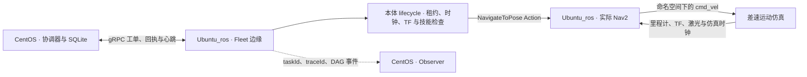

# M08 ROS 2 与 CentOS 端到端联调

CentOS 运行 NEBULA 车队协调器和工单账本。Ubuntu_ros 运行 ROS 2 Humble、两个命名空间下的 Nav2，以及各自带 SQLite 收件箱的 C++ 边缘进程。ROS 侧使用空白地图和可复位的差速运动仿真器，Nav2 的规划器、行为树、控制器和速度平滑器来自 Ubuntu 已安装的软件。



## 2026-11-23 实测结果

Ubuntu_ros 使用 Humble、Nav2 1.1.20 和 Fast DDS。原生 gRPC 连接从 Ubuntu 经 Windows 回环 SSH 转发到 CentOS。ROS 2 DDS 使用 Ubuntu 本机域 93。

| 验收 | 实测 |
| --- | --- |
| 生命周期与权限 | 未配置时工单无法发出 ROS Action。alpha 执行 10 次停用、清理、配置、激活，边缘 RSS 前后均为 42,204 KiB，无活动目标。 |
| 实际导航 | alpha 五次、beta 一次，到站均带 Action UUID、反馈和速度输出。恢复后 alpha 的新工单再成功一次。七次到站的最大位置误差为 0.0776 m。 |
| QoS 与回调 | best effort 扫描收到 10 帧，故意使用不兼容的可靠订阅收到 0 帧。五秒窗口内本体状态 10.00 Hz，51 条连续数据，无序号断档。550 ms 的回调拥塞对照中，单线程有效状态回调为 0 次，分组后为 7 次。 |
| 主动停用 | 同一 UUID 的 ROS Action 返回 `canceled`，仿真速度请求停止，协调器收敛到 `navigation_stopped`。 |
| 断线与恢复 | 断开 alpha 的 gRPC 流，约 3.004 秒进入降级并取消原 Action，beta 保持激活。恢复链路后约 455 ms 重新激活。同一任务 ID、epoch、traceId 对账，落库执行次数为 1，随后新任务成功。 |
| CentOS Observer | 从两台 ROS 边缘导入日志，按 9 个 traceId 回查 194 条匹配事件。重复导入后记录数量保持一致，证据附对应 Action UUID。 |
| 回归 | CentOS Release 9 项、Ubuntu ROS Release 11 项、Windows 原生 Debug 4 项通过。Ubuntu 单测另外验证 ROS 时间暂停时拒绝新目标，时钟恢复后再次就绪。调整回执夹具后，Ubuntu 定向复跑 3 项亦通过。 |
| 收口 | 实验结束后两台虚拟机的回环端口与 Windows SSH 转发已关闭，Ubuntu 当次 ROS 域进程数为零，临时凭据已移除。 |

[机读结果与二进制摘要](../../evidence/cpp-systems/20261123/m08-ros-cross-vm.json)

## 构建

沿用现有工具，给两台虚拟机各准备一个独立源码和构建目录。

```bash
# CentOS · 从源码根执行
export LD_LIBRARY_PATH="$HOME/.local/lib:$HOME/.local/lib64:${LD_LIBRARY_PATH:-}"
python3 -B scripts/project/cpp_systems.py --build-dir ../build-release \
  --with-grpc --prefix "$HOME/.local"
```

```bash
# Ubuntu_ros · 从源码根执行
source /opt/ros/humble/setup.bash
grpc_prefix="$HOME/phase11-deps/cpp-systems/humble-grpc-1.30.2/rootfs/usr"
export PATH="$grpc_prefix/bin:$PATH"
export LD_LIBRARY_PATH="$grpc_prefix/lib/x86_64-linux-gnu:${LD_LIBRARY_PATH:-}"
export PKG_CONFIG_PATH="$HOME/nebula-nav2-20261122.aExKhs/relocated-pkgconfig:${PKG_CONFIG_PATH:-}"
python3 -B scripts/project/cpp_systems.py --build-dir ../build-release \
  --with-grpc --with-nav2 --prefix "$grpc_prefix"
```

Ubuntu 构建显式启用 ROS 档时，CMake 会检查已安装的 lifecycle、Action、TF 与消息包。现有 `nav2` CLI 采用自动配置及可用后激活，`nav2-managed` 从未配置状态开始，可通过 ROS lifecycle 服务操作。两种方式都要求协调器租约和仿真状态就绪。

## 连接两台虚拟机

在独立实验目录生成三个不同的临时令牌 `operator.token`、`alpha.token`、`beta.token`，权限设为 0600。用现有已认证 SSH 会话把这三个实验令牌放到 Ubuntu_ros 对应实验目录。以下端口为示例，运行前确认未被占用。

```bash
# CentOS · 在临时令牌目录执行，BUILD 指向上一步的绝对构建路径
export NEBULA_FLEET_OPERATOR_TOKEN="$(cat operator.token)"
export M08_ALPHA_TOKEN="$(cat alpha.token)" M08_BETA_TOKEN="$(cat beta.token)"
"$BUILD/fleet/transport/grpc/nebula_fleet_coordinator" \
  127.0.0.1:17772 fleet.sqlite alpha 1 M08_ALPHA_TOKEN beta 2 M08_BETA_TOKEN
```

Windows 分别保持以下两个 PowerShell 终端运行。两个转发仅在回环地址上监听，SSH 继续检查已知的主机公钥。

```powershell
& "$env:WINDIR/System32/OpenSSH/ssh.exe" -NT -o ExitOnForwardFailure=yes -o StrictHostKeyChecking=yes -L 127.0.0.1:17773:127.0.0.1:17772 pikachu@192.168.239.135
```

```powershell
& "$env:WINDIR/System32/OpenSSH/ssh.exe" -NT -o ExitOnForwardFailure=yes -o StrictHostKeyChecking=yes -R 127.0.0.1:17774:127.0.0.1:17773 pikachu@192.168.239.128
```

Ubuntu_ros 中使用上面的 ROS 与 gRPC 库环境，并从实验源码根执行总验收脚本。每次复跑使用新协调器账本和新的结果目录，避免固定工单编号复用先前验收结果。

```bash
export ROS_LOCALHOST_ONLY=1 ROS_DOMAIN_ID=93 RMW_IMPLEMENTATION=rmw_fastrtps_cpp
python3 -B -m tools.body.verify_m08 --build ../build-release \
  --tokens /path/to/test-tokens --run-dir ../m08-evidence --upstream-port 17774
```

脚本自动启动两套 Nav2 和两个边缘，验证生命周期、QoS、Action、跨 VM 租约和 SQLite 对账。运行中可在相同 ROS 域检查 `/alpha/body_agent`、`/alpha/body/status`、`/alpha/scan` 与 `/alpha/cmd_vel`，beta 使用自己的命名空间。脚本保留进程日志、DAG JSONL 和结构化证据，退出时停止自己启动的仿真进程。运行完在三个前台终端结束协调器和 SSH 转发。

把 `m08-evidence.json`、`alpha.jsonl` 和 `beta.jsonl` 通过已认证 SSH 复制到 CentOS 的隔离目录，随后从源码根重跑 Observer 查询和去重检查。

```bash
python3 -B -m tools.body.replay_m08 ../m08-evidence --db ../m08-observer.sqlite
```

## 实验中的诊断点

- 双栈共用虚拟机时，日志曾出现规划应答超时和控制调度漏周期。Humble 组件容器试验又遇到子 Costmap 的命名空间 TF 发现问题，本轮保留各节点原有进程式启动。仿真静态地图由持久 QoS 保存首帧。Nav2 本地应答窗设为 1 秒、行为树步进设为 50 ms，DWB 控制频率设为 10 Hz，并减少采样量。ROS 嵌入端继续执行既定的租约和动作检查。
- 状态频率由发布端单调钟和连续序号计算。接收端在轮询 gRPC 后可能集中消费旧消息，接收间隔容易误读成更高的发布频率。Fast DDS 运行时未提供 endpoint 的队列深度，报告以空值表示，配置深度查源码。
- 边缘独占 SQLite 收件箱。先经 gRPC 和 ROS 核对在线结果，在边缘正常退出后读取持久化 `starts`、`epoch` 和 `trace_id`。
- CentOS 的旧回执故障夹具曾在等待持久化查询时先自行退出。夹具现在发送接收回执后只关闭上行，保留下行确认未消费的故障条件，由父进程在确认持久化后终止。使用同一账本重连的契约再次通过。
- 本次验证的停止证据为同一仿真 Action 已取消、仿真速度指令停止以及账本收敛。硬件实时、物理急停和实机准入各有后续阶段。

[ROS 和 C++ 生命周期学习](../../learning/m08-ros-lifecycle.md) · [历史 Action 夹具双机实验](cpp-systems-cross-vm.md)
