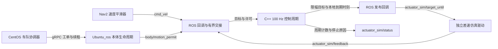

# M09 执行器仿真与 Linux 测时

2026-11-24。实验使用 C++ 固定周期、Ubuntu_ros 上已有的 ROS 2 Humble 与差速仿真体，以及 CentOS 已有的 GCC。组件和测试独立构建。三轮 CentOS 软实时门禁保留为未通过。

## 控制路径与数据合同



| 组件 | 输入和约束 |
|---|---|
| 本体生命周期 | `body/motion_permit` 在相同 Ubuntu 内核上使用三个单调钟整数，依次为任务授权、采样时间、租约到期。授权为 0 时表示撤销。新任务产生新授权。 |
| ROS 交接 | `cmd_vel` 为 Nav2 速度，队列深度为 1。速度序号和到达时刻在边缘赋值。仿真反馈也保持深度 1，其单调采样时间由仿真驱动提供。此协议限定在同一次 Linux 启动的仿真域。 |
| C++ 控制周期 | 命令 150 ms、许可心跳 300 ms、反馈 100 ms。周期使用绝对单调时钟，交接队列固定八槽。线速度与角速度上限为 0.35 m/s 与 1.3 rad/s。每拍按 1.0 m/s²、3.5 rad/s² 限制变化幅度。 |
| 软件驱动 | `target_until` 的私有 `TwistStamped` 用时间戳字段表示目标到期，额外将时效限制在本地 80 ms。即使控制进程暂停，仿真驱动仍能将目标归零。速度二次限幅为 0.4 m/s 与 1.5 rad/s。 |
| 急停与复位 | 急停事件与许可撤销绕过队列丢弃。异常锁存后，健康零速反馈和解除急停是复位条件。复位到待命，随后新任务许可和新目标才允许动作。周期线程长暂停或进程重启后，旧许可无法恢复运动。 |

仿真消息和操作使用明确的回环 ROS 域。跨机墙钟对齐需要单独测量，运动期限由同机单调时间求值。现场驱动的真实限幅、制动间隔、设备认证和电气急停由实机阶段定义。

## 实测汇总

CentOS 为 VMware 客体，内核 `5.14.0-631.el9.x86_64`，用普通调度运行在 vCPU 3，Linux 时钟源为 `tsc`、该 vCPU 的时钟事件设备为 `lapic`。每轮 30 分钟，同一二进制依次运行。前 15 分钟没有额外计算任务，后 15 分钟增加一个绑定同 vCPU 的计算进程。每轮比较两个分段时排除负载起点前后各 2 秒。

| 轮次 | 已采样周期 / 漏拍 | 全轮唤醒 P50 / P95 / P99 / 最大（ms） | 无额外负载 P99（ms） | 同核负载 P99（ms） |
|---:|---:|---|---:|---:|
| 1 | 148,986 / 31,014 | 1.525 / 14.146 / 15.567 / 295.089 | 16.153 | 2.123 |
| 2 | 149,022 / 30,978 | 1.500 / 14.139 / 15.455 / 63.327 | 15.974 | 2.096 |
| 3 | 149,019 / 30,981 | 1.507 / 14.147 / 15.409 / 150.461 | 15.911 | 2.091 |

- 每轮 180,000 个计划时间格，三轮合计漏拍 92,973 格，约 17.2%。样本的 P99 只能描述已经执行的周期，漏拍率另算。
- 全轮控制执行 P99 为 3.707–4.159 µs。唤醒 P99 在无额外负载段为 15.911–16.153 ms。两种口径相差约三个数量级，先查调度与虚拟时钟交付。
- 同核运行计算进程后，该客体的唤醒表现有所改善，仍出现长尾和漏拍。实验说明两种负载条件的结果不同。归因到空闲状态、宿主调度或时钟事件需要额外对照。 [Linux 实时文档](https://docs.kernel.org/core-api/real-time/index.html)
- 原始 CSV、各轮 JSON 和总表保存在 CentOS 的 `/home/pikachu/phase11-data/m09-20261123-actuator/timing-3x30m/`，约 27 MiB。仓库保存分位数、源码和二进制摘要以及三份 CSV 的校验值。 [机读计时记录](../../evidence/cpp-systems/20261124/m09-centos-timing.json)

## 故障与跨机验收

| 验收 | 结论与可核查的证据 |
|---|---|
| 仿真停更、反馈中断和急停 | Ubuntu_ros 独立 ROS 域实测。命令停更 244.2 ms、反馈中断 178.8 ms、急停 99.5 ms、许可停更 377.3 ms 时，探针已观察到对应故障及仿真零速。观察时间包含等候下一次状态采样和 ROS 消息到达的时间。 |
| 驱动看门狗与二次限幅 | 暂停 C++ 进程后约 97.4 ms 从里程计观察到零速。绕过暂停的控制器给仿真驱动发送过量目标，实际钳在 0.4 m/s 和 −1.5 rad/s。暂停恢复和进程重启后均需新许可才重新运动。 |
| 两台虚拟机、一个仿真体 | 真实 CentOS 协调器经 SSH 回环转发到 Ubuntu_ros 的 Nav2 和本地控制器。首单及重连后的新工单到站，位置偏差均为 0.0755 m。重复切换 lifecycle 10 次，边缘进程的 RSS 保持 38,980 KiB。 |
| 跨机断链及同键对账 | 故障期间保持测试仿真体不前进，并观察受保护的速度目标。约 3.019 s 降级，至 3.079 s 已观察到请求归零及原 Action 取消。恢复后约 370 ms 重新激活。同一工单的 traceId、epoch 和 Action UUID 保持一致，边缘账本记录执行 1 次。实际仿真速度归零由上面的分进程看门狗场景另行验证。 |
| CentOS Observer | 查询 4 条工单链路、84 条匹配的 DAG 事件，重复导入增加 0 条。证据关联工单 ID、traceId 和 Action UUID。控制周期的最近读数见 ROS 状态话题，完整周期分布见 CSV。 |
| 两个仿真体的压力验收 | 两个命名空间均有到站证据，完整连续操作仍未通过。在这台 2 vCPU 虚拟机上出现 `feedback_timeout` 和 `command_timeout`，触发保护停机。测试保留这两个时效阈值和失败记录。 |
| 回归与进程收尾 | Windows Debug 5 项、CentOS Release 10 项、Ubuntu_ros Release 12 项通过。CentOS 的执行器原生合约分别通过 ASan/UBSan 与 TSan。结束后确认实验服务、回环 SSH 转发和临时凭据清理完成。 |

本轮在 Ubuntu_ros 的 Release 回归中还发现，丢 ACK 夹具可能把上一单的待确认终态误当成当前单的接收回执。夹具改为先核对并回放待确认回执，再对指定工单注入丢 ACK。修正后两台虚拟机的完整 Release 回归通过。 [机读仿真和回归记录](../../evidence/cpp-systems/20261124/m09-ros-validation.json)

## 复跑操作

先在 CentOS 的隔离源码根构建。不需要 Web Server、数据库、ROS 或 gRPC。

```bash
cmake -S robotics/actuator_control -B ../m09-control-release -DCMAKE_BUILD_TYPE=Release
cmake --build ../m09-control-release -j2
ctest --test-dir ../m09-control-release --output-on-failure
taskset -pc $$
python3 -B -m tools.body.verify_m09 --probe ../m09-control-release/nebula_control_probe \
  --report-dir ../m09-timing-smoke --cpu 3 --seconds 6 --rounds 1
python3 -B -m tools.body.verify_m09 --probe ../m09-control-release/nebula_control_probe \
  --report-dir ../m09-timing-long --cpu 3
```

用当前允许的 CPU 编号替换上面的 `3`。每轮结束保存 CSV 与 JSON。长测默认顺序运行三轮、每轮 1,800 秒。用 `Ctrl+C` 正常退出时，工具停止它启动的测时和负载子进程。过程中不会修改调度策略或内核设置。

在 Ubuntu_ros 的隔离源码根复验断反馈、超时、急停和暂停控制进程。

```bash
source /opt/ros/humble/setup.bash
cmake -S robotics/actuator_ros_sim -B ../m09-ros-release -DCMAKE_BUILD_TYPE=Release
cmake --build ../m09-ros-release -j2
export ROS_LOCALHOST_ONLY=1 ROS_DOMAIN_ID=96 RMW_IMPLEMENTATION=rmw_fastrtps_cpp
python3 -B -m tools.body.verify_m09_ros \
  --actuator ../m09-ros-release/nebula_actuator_ros_sim --run-dir ../m09-ros-safety
```

两台虚拟机端到端复验沿用 M08 的独立协调器、实验凭据和两条回环 SSH 转发。在 Ubuntu_ros 执行 M08 复跑命令时加 `--actuator ../m09-ros-release/nebula_actuator_ros_sim`，切换到单独的 ROS 域（例如 97），使用新账本和新结果目录。构建使用源码中的现有 `cpp_systems.py --with-grpc --with-nav2`，也可直接引用总构建下的 `actuator_ros_sim/nebula_actuator_ros_sim`。加 `--single-body` 可单独验证一台仿真体的跨虚拟机链路。脚本校验仿真体只从保护后的话题收速度。 [双机端口、SSH 与启动步骤](m08-ros-cross-vm.md#连接两台虚拟机)

仿真运行时，可以从同一个 ROS 域查看以下证据。

```bash
ros2 topic echo /alpha/actuator_sim/status
ros2 topic info /alpha/actuator_sim/target_until --verbose
```

将验收生成的 `m09-cross-vm.json` 和 `alpha.jsonl` 拷贝到 CentOS 的隔离目录，从源码根运行下列命令。双仿真体成功生成证据时，再放入 `beta.jsonl`。

```bash
python3 -B -m tools.body.replay_m08 ../m09-cross-vm --db ../m09-observer.sqlite
```

## 日志解读

- `wakeLateNs` 和 `executeNs` 是最近一次已采样周期的纳秒值。`deadlineMisses`、`skippedSlots`、`watchdogTrips`、`handoffDrops` 是进程累计计数。区分当前状态和历史次数。
- `feedbackAgeNs` 从模拟驱动实际采样时刻算。故障后的读数可能已因反馈恢复而回落，锁存状态仍需要显式复位。用连续截图、ROS 日志与同次工单记录相互核对。
- 第一次跨机试验中 Nav2 失去进度。加入状态日志后观察到 `feedback_timeout` 安全停机。改用只取最新值的独立仿真反馈通道，让两台仿真体各自执行，并按小地图规模调整 Nav2 的采样与发布频率。双栈仍偶发调度长尾，单体跨机闭环已通过。

[学习讲义](../../learning/m09-actuator-control.md) · [组件与架构](../../architecture/overview/cpp-systems.md)
