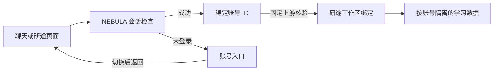

# Function3.3 · 研途账号与工作区切换

`Function3.3` 基于 `Function3.2` 之后的 Observer、研途及小研开发工作。面试主线是 Linux C++ 服务端和可观测性，聊天与社区给这条主线提供可重放的实际业务负载。[原版本记录](function3.2.md) · [后续路线](../roadmap/next-steps.md)

## 本轮变化

| 范围 | 行为与边界 |
|---|---|
| 缘续-聊天 | 页面先等权威会话结果。401 才展示登录，网络或服务异常显示重试。离开聊天只释放连接和任务。切页时继续使用原有 `/phase11/` 链接 |
| 缘生-广场 | `/phase11/tree/` 继续承载神树、故事广场与七日榜。滚轮在边界触发淡入淡出与轻微模糊，防止触控板惯性连翻。减少动效偏好开启时直接切换 |
| 研途账号 | 以当前 NEBULA 会话的 ID 获取稳定工作区。每个注册账号自带绑定，首次使用时创建目录，同账号的网页和客户端使用同一服务端学习空间 |
| Windows 客户端 | 切换账号经既有登录接口替换会话，再返回原模块。登录失败保留原会话。旧账号工作区的路由与写入仍需用当前会话验证 |
| 发布与复现 | 网关可使用 HTTPS 向 Windows Companion 提供一套账号与研途接口。通信核心沿用现有目录，运行数据、客户端私人目录和用户原研途文件留在各自设备 |



会话接口是工作区的通行证。浏览器只携带同源 Cookie，请求里的账号 ID 不参与选择工作区。已有工作区目录沿用原算法和密钥，换回原账号可继续使用此前记录。Windows Companion 只接受受信 HTTPS 上游，正式配置需指向开启研途路由的网关。[使用与端口](../ops/runtime/nebula-yantu-community.md) · [目录总图](../architecture/overview/project-layout.md)

## 回归入口

```powershell
node --test (Get-ChildItem tests/phase11/frontend,tests/function3/frontend -Filter '*.test.mjs').FullName
node tests/function3/frontend/account_navigation_browser.cjs
python -B tests/client/yantu_account_workspace_test.py
pwsh -File tests/client/run_yantu_companion_browser.ps1 -UseEdgeDevTools
python -B scripts/project/ci_checks.py source
python -B scripts/project/frontend_release.py --check
python -B scripts/project/sync_api_contracts.py --check
python -B scripts/project/check_doc_links.py
```

Windows 构建入口使用现有 MinGW 和获批的 Boost 头文件。浏览器脚本默认用 Edge，可用 `CHAT_TEST_BROWSER` 指定已安装的 Chromium 浏览器。临时 HTTPS 证书只用于本次客户端测试。[构建命令](../ops/runtime/phase36-41-local-preview.md)

## 本轮验证

| 验证 | 结果 |
|---|---|
| 前端与工程检查 | 90 项前端测试通过。依赖边界、资源版本、124 项 HTTP 路由与文档链接检查通过 |
| 网页 Edge | 会话请求延迟 600 ms 时，从广场进入聊天没有一帧显示登入表单。503 可重试，401 展示登入。桌面滚轮换页含模糊关键帧，390 px 屏幕按减少动效偏好直接换页 |
| 研途 HTTP | 真实账号工作区服务和临时存储验证 401、首次绑定、同账号数据与附件、作用域越权和分片重试。NEBULA 身份由两套合成会话提供 |
| Windows Companion | Release 构建及 5 项本机 C++ 契约通过。Edge 经原生客户端和固定指纹的临时 TLS 上游完成 A → B → A、错密码保留原会话、隔离笔记、403 拦截与附件范围读取 |

日常入口的部署版本单独记录。Envoy 真实运行、数据库演练和混合负载数值采用此前对应配置的原始证据。[日常发布与回退](../ops/runtime/nebula-yantu-community.md#日常发布与回退) · [真实监控验收](../observability/validation.md)
