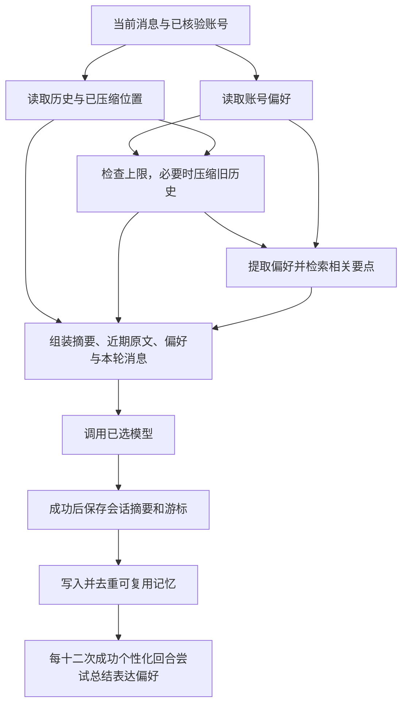

# 小研个性化记忆进度报告

2026-11-21 · Function3.3 工作区

小研可以按账号学习表达偏好，并把和本轮问题相关的要点带入回答。网页独立对话与侧栏共用网页记忆，Windows 独立对话与侧栏共用私人记忆。示例中的“以后回答简短一点，优先分点”会在这一轮生效，回答成功后写入档案，换个会话仍可使用。

## 怎么使用

1. 打开小研，在对话工具条点击「个性化记忆」，启用这项功能。网页还需要确认当前模型的接收范围，Windows 私人入口需要支持偏好推理的新版客户端。
2. 发送“以后优先分点，讲概念时少用公式”，等回答完成。重新打开设置，确认「当前表达偏好」出现对应项目。发“这次只给 JSON”可验证临时要求与长期偏好各自生效。
3. 发送“记住：我正在排查 PostgreSQL 的 ACK 事务等待”，或在设置里保存同一要点。新开对话问“PostgreSQL 的 ACK 事务等待怎么定位”，对应要点可参与回答。Windows 原有的「记忆」页仍接收客户端已有的「记住：」命令。需要每轮参考的约束可选「长期限制」，也可以发送“记住禁忌：菜品推荐中避开花生”。
4. 「保留最近问题要点」与「用公开故事的分类浏览次数辅助相关话题」分别授权。最近要点、学习到的表达标签、资料条目与阶段摘要都可以在设置中检查。关闭相应来源时，会清除该来源的记录。也可移除单个标签、资料或长期限制，或清空整个个性化档案。

## 每条消息经过哪些步骤

网页和 Windows 私人入口运行同一套应用层 DAG。节点声明依赖，运行器在启动时检查缺失节点与循环依赖。能独立执行的读取并行开始，共用前置节点在同一轮内只执行一次。用户停止或回答失败时，保存节点跳过。



### 长对话如何压缩

1. 近期历史的常规窗口最多十条，网页与 Windows 私人入口分别给近期原文 12 KiB 和 8 KiB 的预算。超过条数或体积时，把最旧部分压缩到最多 1,500 字节，并给后续回合留出空间。新问题完整加入调用。
2. 已启用模型辅助时，压缩与本轮偏好提取合用一次辅助推理。辅助请求最多 12,000 字节历史载荷，输出预算 320 token，等待预算 4.2 秒。超时、关闭模型辅助或模型输出格式错误时，按本机节选生成简要回顾。
3. 已压缩的历史位置随摘要保存，下次从该位置以后读取原文。网页继续使用当前标签页的会话存储，Windows 将摘要按上游站点、账号和会话保存到本机 IndexedDB，原始私人聊天仍在客户端 SQLite。
4. 打开「保留最近问题要点」后，最多保留三条来自用户原话的恢复片段。已经明确表达的历史偏好可以补记为「来自会话压缩」，已有选择、后来明确更改及手动遗忘优先。清空个性化档案后，从新的本轮输入重新学习。
5. 自带兼容 API 返回明确的上下文长度错误时，网页进一步收紧旧历史并尝试一次。不同模型的精确 token 窗口由各 Provider 决定，当前预判使用应用层字节预算。Windows 的单条用户消息上限为 8 KiB。

| 组件 | 已实现的行为 |
|---|---|
| 会话和隔离 | 已核验账号、浏览器来源和网页／私人空间组成存储边界。Windows 另以 Linux 上游站点标识区分同一个回环端口所连接的服务器。切换账号、清空或修改设置后，迟到的候选会被旧版本检查拦住。 |
| 偏好提取 | 支持回答长短、结构、公式、代码注释、示例语言和回答语言六类标签。明确选择本轮可用，单次模型推断先积累证据，同一标签至少两次才默认采用。 |
| 动态路由 | 按普通对话、技术问题或资料回忆组织提示，输出预算为 280、512 或 840 token。用户当前的明确要求优先。每轮沿用用户选定的模型和接口。 |
| 个人知识 | 支持主动保存的习惯及资料要点、可选的近期问题片段。中文双字词与英文词匹配，每轮最多带入三条。Windows 私人生成继续在本机检索已授权文件，最多使用四条相关片段。 |
| 广场兴趣 | 只记录面向已登录成员公开的故事分类。相同故事一天内重复打开只记一次。分类积累到阈值且与问题匹配时才参与回答。 |
| 更新与遗忘 | 一条生成编号只处理一次。相同内容合并，明确的新偏好替换同维度旧选择。自动权重每 30 天减半，最长观察期为 180 天。近期问题的召回窗口为 45 天。 |
| 周期摘要 | 开启模型提取后，每 12 次成功的个性化回合尝试生成摘要。模型接收白名单内的表达标签，摘要供本人查看，实际路由继续由结构化档案决定。 |

## 性能和数据范围

- 档案是按账号保存的 IndexedDB 键值记录。本轮采用有限词法检索，Linux 沿用原有 AI 推理服务。Redis 和 Milvus 未纳入本轮个人记忆链路。
- 每份档案最多含 24 个资料或习惯要点、4 条长期限制、48 个近期问题片段和 16 个浏览分类。命中的个性化提示受字节上限保护。一个页面同时至多执行一个辅助模型请求。
- 本机 Node 在填满上述条目数的合成档案上测试 200 次。档案序列化为 49,494 B，内存词法召回中位约 3.0 ms。该耗时仅覆盖检索计算，浏览器存储和模型推理有各自的时延。
- 默认关闭个性化。启用模型识别后，每次合适的对话可先发一条最多 420 字符、112 token 的识别请求，等待预算 3.2 秒。超时、额度受限或格式无效时继续使用本机明确偏好和已有档案。摘要在回答后单独尝试，等待预算 5 秒。
- 网页把允许使用的上下文交给当前选定的模型。Windows 原文和资料索引保留在本机，辅助推理只使用本轮问题片段或结构化表达标签，原有资料授权只作用于私人回答入口。截图、账号密码、密钥和 API 凭据不作为记忆材料；识别器会跳过具有常见敏感标记的输入。
- 记忆跟随当前浏览器来源、账号和模式。跨设备同步、向量语义召回、真实模型提取准确率和私人推理端到端延迟有待单独验收。

## 验证进度

| 验证 | 结论 |
|---|---|
| 前端回归 | 101 项通过，新增覆盖 DAG 循环、依赖汇合、单轮去重、长窗口压缩、偏好来源、失败不写和明确超限后的单次重试。 |
| Edge 真实页面与浏览器存储 | 通过。检查了两端长会话与正常回答的实际载荷、压缩位置保存、历史偏好可见来源及站点和账号隔离。推理结果由测试替身提供。 |
| Windows 客户端 | Release 构建及 5 项原生契约通过，覆盖 SQLite、资料授权及检索、本机会话保护、工具确认和语音。辅助推理组件已编译链接，真实 HTTPS 模型链路仍需验收。 |
| Windows 本机 HTTP 实测 | 两个隔离客户端均能引导和安全退出，绑定不同上游时返回不同站点标识。在仅完成本机引导、尚无 Linux 认证账号的情况下，调用偏好分析返回 401。 |
| 日常服务发布 | 当前交付为工作区候选版本，日常网页与客户端的更新需另行验收。 |

## 源码和复验

- [DAG 执行器](../../frontend/phase11/shared/PersonalAgent/AgentTurnDag.js) · [窗口预算与压缩](../../frontend/phase11/shared/PersonalAgent/ContextWindow.js) · [Agent 偏好服务](../../frontend/phase11/shared/PersonalAgent/PersonalAgent.js) · [本机键值存储](../../frontend/phase11/shared/PersonalAgent/PreferenceStore.js)
- [网页接入](../../frontend/phase11/shared/WebAssistantPanel/WebAssistantPanel.js) · [Windows 私人入口](../../frontend/phase11/shared/AssistantPanel/AssistantPanel.js) · [绑定账号的辅助推理入口](../../client/assistant/PreferenceInference/PreferenceInference.cpp)
- [规则与超时测试](../../tests/function3/frontend/personal_agent.test.mjs) · [Edge 浏览器旅程](../../tests/function3/frontend/personal_agent_browser.cjs)

```powershell
node --test tests/function3/frontend/personal_agent.test.mjs
node tests/function3/frontend/personal_agent_browser.cjs
```

## 11 月 21 日工作小结

- Observer 增加历史读取快路径、压缩传输、仪表盘增量更新及同表达式去重。七天合成数据的等值读取中位耗时从 536 ms 降至 167 ms，Edge 核对了自动刷新时的曲线、游标和面板身份。[监控验收](../observability/validation.md#查询速度与自动刷新)
- 小研完成按站点和账号隔离的个性化、个人词法召回、公开分类兴趣、动态提示和偏好摘要，本机档案支持查看、关闭和清空。
- 小研接入应用层 DAG 与长会话压缩，压缩位置、可复用要点和历史偏好各自保存。执行范围为一轮对话，节点调度在应用进程内完成。
