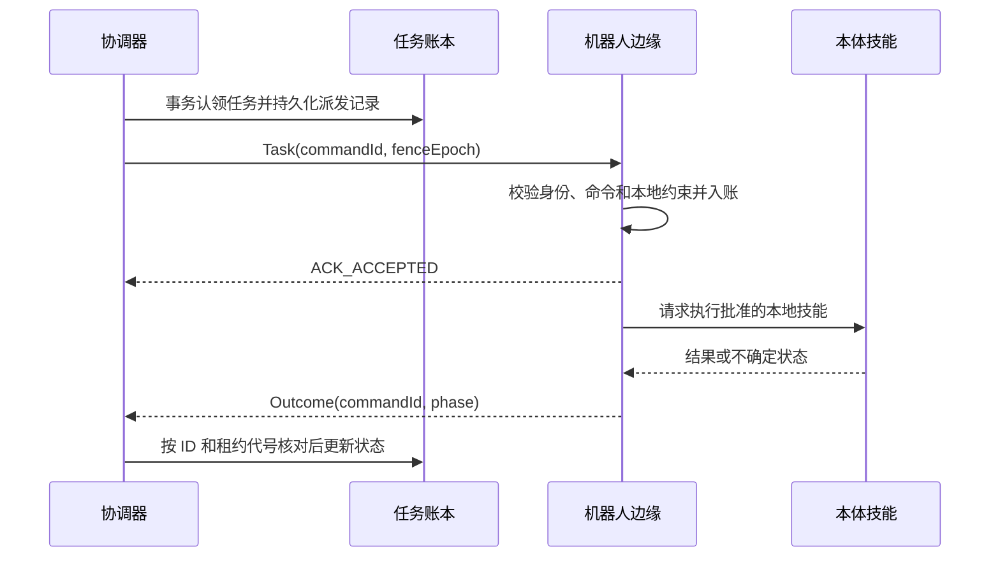

# NEBULA 车队系统目标架构与任务分工

范围先覆盖室内低速移动机器人。首个任务是「把工单分给一个具备该能力的机器人，到模拟站点，再回报结果」。导航子系统使用 ROS 2 Action，感知提供只读观测，执行器走本地控制路径。后续需要机械臂时另登记能力、资源和安全前置条件。

## 一、母 Agent、调度器和本体

母 Agent 像值班分析员，读取证据并写出处理建议。车队调度器像工单系统，掌握谁可以领单、哪张工单仍有效。子 Agent 像机器人上的任务主管，核对本地状态后把一项任务交给导航、感知或其他子系统。电机更新和停机由本体控制系统独立完成。

```mermaid
flowchart TD
    UI["NEBULA 页面 · 提交工单与查看进度"] --> API["车队入口 · 身份与审批"]
    Ev["Observer · 指标/日志/Trace/回放索引"] --> MA["母 Agent · 汇总与提案"]
    MA --> API
    API --> FC["C++ Coordinator · DAG 与调度"]
    FC --> Ledger[("任务账本 · 租约、尝试与命令 ID")]
    FC <-->|"gRPC 任务、回执、心跳与重连对账"| EdgeA["边缘 A · 子 Agent"]
    FC <-->|"gRPC 任务、回执、心跳与重连对账"| EdgeB["边缘 B · 子 Agent"]
    EdgeA --> Gate["本体安全门 · 身份、时效、白名单"]
    Gate --> Skill["rclcpp 技能适配 · Nav2 / 感知"]
    Skill --> Control["本地控制器 / 驱动"]
    Interlock["本地急停 / 看门狗"] --> Control
    EdgeA -.-> Ev
    EdgeB -.-> Ev
    FC -.-> Ev
    Skill -.-> Bag[("rosbag2 / MCAP · 原始数据")]
    Bag -.->|"记录引用"| Ev
```

同一个机器人内部的子 bot 可以建成技能适配器或可测试的 ROS 2 节点。先共享一个本地任务执行域，由资源锁或本体仲裁限制冲突动作。多个关节由同一个验证过的控制器协调，任务层以目标与状态表达意图。

部署先从单机上的独立进程扩展到两台 Linux 主机，实测身份、网络时延与断线恢复。有第二个站点时再加区域调度层。全局层发布任务意图，区域层持有本区机器人派发租约，每个机器人同时只有一个有效派发方。换区前由旧区域停止派发并完成对账，本体确认可接收任务后由新区取得新代号。控制权归属与移交流程单独记录，一区失联时其他区域仍可处理本区工单。

## 二、目录与依赖

| 位置 | 所有权与复用 |
|---|---|
| `backend/server/`（现有） | 冻结门禁保护自研通信核心。保留已有 HTTP/WS/SSE 和 gRPC 教学资产。[边界检查](../../../scripts/project/check_boundaries.py) |
| `backend/application/`、`frontend/phase11/`（现有） | 日常业务、账号和页面。车队接入后页面提交工单并订阅状态，小研会话继续使用自身会话逻辑。 |
| `backend/ai/`（现有） | 模型推理、注册、评测与 RAG 端口。Agent 通过适配层申请模型推理。 |
| `backend/workflow/`（现有） | 通用 C++ 图执行与 Worker 池，可独立链接。母 Agent 的证据读取和提案复核已复用该执行器。可选持久化接口的 SQLite 实现在 `backend/systems/`。 |
| `backend/fleet/domain/`、`backend/fleet/application/`、`backend/fleet/transport/`（现有） | 机器人身份、调度、租约、任务账本和对账的领域接口。传输适配器使用 Protobuf/gRPC，存储实现留在基础设施。 |
| `robotics/nav2_gateway/`（适配已接入） | 实现导航 Skill 的 ROS 2 仿真适配，仿真 bringup、URDF/SDF 与其他本体能力按后续环境落包。 |
| `backend/agent/`（M01） | `domain` 管提案验证和技能版本，`ports` 声明证据读取和 Provider，`application` 装配 DAG，`infrastructure` 连接 gRPC。CLI 按角色起草与审批，协调器同事务入队。Python 模型适配器可选。 [实现导读](../../learning/nebula-fleet-agent-and-skills.md) |
| `tools/observability/`、`frontend/observability/`（现有） | 复用事件与查询，负责汇聚证据。机器人原始数据独立保存，按记录 ID 和时间段定位。 |
| `tools/agent/`（实验） | Python 离线训练、策略评估、推理隔离和合成数据回放。使用固定样本和独立进程，保留摘要与评估记录。 |
| `tests/` 与 `docs/evidence/` | 保留合成场景、可复现配置、报告和摘要。大文件存放由 M0 的证据策略决定。 |

首版只需要协调器、边缘协议进程和现有 Observer。DAG、调度、持久化适配和 gRPC 服务可以装配在同一协调器进程中。边缘模拟程序和真实 ROS 节点实现同一边缘合同。领域层依赖自定义类型与端口，Protobuf、ROS 和模型 SDK 由适配层引入。Linux 发布、现场部署和 ROS 构建分别形成包和版本记录。

## 三、先固定四个接口

| 合同 | 必要字段或语义 | 负责验收的模块 |
|---|---|---|
| `SubmitTask` | 工单 ID、操作者、模板版本、限定参数和接收回执；业务幂等键在重试时保持稳定 | M4、M5 |
| 机器人会话与回执 | `robotId`、`bootId`、`sessionId`、协议版本、能力列表、`commandId`、`fenceEpoch` 与阶段；登录主体绑定机器人 | M5、M6、M11、M12 |
| `Skill` | 能力 ID/版本、输入输出、前置/后置条件、资源冲突、effects、取消和对账策略 | M2、M8 |
| 证据事件 | `traceId`、`runId`、`nodeId`、`attempt`、事件序号、来源/接收时间、时钟质量、错误和数据记录引用 | M7、M11、M13 |

`ACK_ACCEPTED` 在边缘验证并持久化接收记录后发送。启动、进度和结果由后续状态回报。协调器在事务内占有任务与派发记录，事务提交后发送；边缘收到重复命令先查账本。执行结果无法确认时进入待对账，查询现场结果或由操作者复核。新的租约代号用于拒收旧持有者的迟到写入；现场互斥资源需要本体核对安全可用后再转交。

## 四、任务分工和交接

| 角色 | 负责的工作 | 交给下游的东西 | 验收人关注的证据 |
|---|---|---|---|
| 工程发布 | M0 检出、依赖清单、CI 和证据归档 | SHA 与构建命令、测试报告、标签说明 | 干净检出、有效用例列表、运行环境 |
| C++ 运行时 | M4 图执行，和 M2 定失败语义 | 任务状态、取消/超时规则、单进程夹具 | 独立运行、并发限额、终态只能提交一次 |
| 车队平台 | M5、M6、M11 的本机时钟和协议 | Protobuf 版本、调度账本、边缘对账用例 | 同任务独占与恢复、旧结果隔离、传输断点 |
| Agent 与能力 | M1–M3 | 固定工具目录、样本、提案和模型证据 | 可验证输出和模型降级，避免权限与成功率混计 |
| ROS 本体与控制 | M8–M10 | ROS 工作区、驱动接口、状态与物理限制清单 | 与模拟器同合同，控制周期和本体停机证据 |
| 观测、验证与安全 | M7、M12、M13 | 断言矩阵、Trace 联结、录包和事故回放 | 注入故障后不变量成立、版本可追溯、真机准入逐级复核 |

单人项目用「我实现」与「我验收」两个独立步骤，后者从固定样本、配置和检出开始。真实设备进入实验室后按现场规定安排知情的复核人员，确认急停链路和测试区域。

## 五、主要故障归属

| 事件 | 第一处理方 | 恢复边界 |
|---|---|---|
| 模型超时、提案无效 | Agent 提案层 | 允许固定工单流程继续；把原因与证据交给操作者 |
| 旧租约、ACK 丢失、协调器重启 | 车队账本与边缘对账 | 比较 ID、代号与当前本体任务，确认状态后重新发任务 |
| 网络分区、时钟不可信 | 本体状态机与通信适配 | 当前任务按本地批准策略结束或暂停；新任务等同步和安全条件恢复 |
| 过期目标、传感器失效或急停 | 本地控制器和安全门 | 转到设备定义的安全态；操作者复核并按本地流程复位 |
| 指标或日志队列满 | 遥测适配器 | 有界积压、统计丢弃，保留关键事件索引 |

[总学习方案与阶段门槛](README.md) · [现有 C++ 实现](../../architecture/overview/cpp-systems.md) · [通信指导](m06-communication.md) · [安全指导](m12-safety.md)
