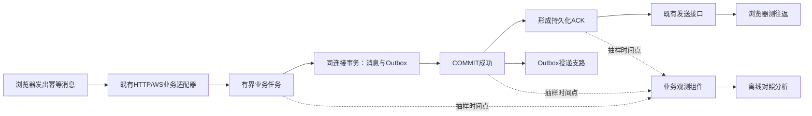

# 近期工程改进计划：先修使用问题，再让测量与交付可信

更新：2026-11-05。依据用户提供的 `overview.md`、`NEBULA工程可信度改造指导.md`，结合当前源码和本轮实测调整。两份外部文档作为参考，不直接执行其中的安装、系统调优、删除或回滚命令。

当前仍为 Phase49 加语音/神树修复；**Phase50-a 仅完成测量工具的首批防护与离线检查，完整十轮 A/A 和 Phase50 性能定位尚未完成**。本计划不把所有后续阶段标成已实现。

## 1. 先决条件与本轮事实

|项目|本轮结果|边界|
|---|---|---|
|个人语音入口|网页、Windows、站点范围分别可配置；新增顶部入口|个人设置不会改写全站公告；页面清楚说明范围|
|试听播放|真实 Linux 男女声 WAV、HTTP/1 与 H2 一致；约1.5 MiB音频分段重组通过|未提供真实云 Key，云可用性与主观自然度未验收|
|浏览器|真实解码31.6秒样本，手动播放/停止；三种视口检查|页面使用明确标识的本机夹具，接口权限另由隔离Linux验证|
|神树翻页|树底下滑进入广场，长列表读完后进入榜单；弹窗不误切|Alt+滚轮和按钮缩放；不改树形和已有渲染预算|
|日常实例|明确许可后恢复18090，程序cb18d796；最新语音/切页页面增量5ec4d82e，原68账号不变|其他并发源码未上线；Windows直连18443仍超时|
|数据与核心|原库未改、迁移仍024，通信152份文件冻结|不新建公共账号库，不安装新依赖|

详见[修复说明](../ops/runtime/speech-settings-and-playback.md)与[历史验收摘要](../ops/validation/function3.1.md#历史补丁)。

补充：[历史验收摘要](../ops/validation/function3.1.md#历史补丁)修复音色迟到结果，前端51项通过。其验证包已在明确许可后[历史验收摘要](../ops/validation/function3.1.md#历史补丁)，真实普通用户本地试听到结尾；[Azure自有Key目录补充](../ops/runtime/free-speech.md)是之后的本地改动。后续性能阶段不据此提前放行。

## 2. 参考文档需要修正的判断

|参考建议|核对结果|采用方式|
|---|---|---|
|ObjectPool、BufferPool是未使用代码，可以移走|[Router.h](../../backend/server/Route/Router.h)引用并使用ObjectPoll；[StringBody.h](../../backend/server/response/StringBody.h)申请BufferPoll|保留；名称沿用现状，不移动冻结核心|
|三轮极差2.03倍等于“方差103%”|极差比不是方差；少量A/B样本也不能建立A/A噪声分布|保留历史事实，补独立A/A测量；不重写旧失败记录|
|两个历史JSON方向不同，所以自相矛盾|完整三轮与另一次中断的进度记录不等价，不能拼成同一实验|保留各自运行身份、参数、完整性与结果|
|超过噪声底才认定退化，连续两轮代替旧门禁|样本P95不是置信边界，也不能单独证明因果|原 /fast回退≤10%、三轮配对ACK P99增幅≤20%继续保留；噪声大则先改善实验|
|清缓存、设置全机CPU governor后测试|影响同VM上的日常服务，且未获准|仅只读记录环境；不自动sudo、停服务或写内核参数|
|CMake预设等于完整环境已可复现|预设识别不等于配置、编译和运行通过；最小Release不含PG/凭据适配|标明功能开关和输出目录，逐矩阵验证，不拿通信构建做聊天对照|
|Docker两条命令、五分钟即可复现|现有Dockerfile尚未实际构建，完整驱动也不齐全|保留为待审查草案；获准镜像/依赖下载后再验证，不承诺耗时|
|按行数拆完构建、清理未跟踪文件|行数不代表耦合；未跟踪成果不一定无用|先核对目标依赖与文件用途；不删除历史源码或phase41/42原始成果|

## 3. 阶段安排与放行条件

顺序比日期重要。下面是约两至三周的工作量估计，不是保证完成时间；依赖审批、部署许可与失败修复另计。

|阶段|主要工作|交付与放行条件|当前状态|
|---|---|---|---|
|收尾 / 使用修复|语音设置、试听、H2长音频、神树下滑|功能/权限/浏览器证据；回退程序；部署需确认|修复包已获准恢复18090；云Key验收单列|
|Phase50-a / 测量校准|核实同一二进制、配置、夹具与负载，十轮交错A/A；固定资源和样本|原始轮次、摘要、环境、样本数；噪声过大先改善隔离，不放宽门槛|脚本防护和离线测试完成；完整实测待执行|
|Phase50-b / 单消息定位|给同一消息关联任务排队、数据库等待、SQL、COMMIT、ACK形成与客户端往返|有界抽样追踪、隐私检查、开启/关闭开销对照；说明未观测的网络阶段|计划|
|Phase50-c / 定点修复|按证据一次修一处，不改变消息/Outbox原子性、同步持久化或权限|契约/真实PG/故障测试与同配置三轮；错误0、原门槛通过|计划|
|Phase50-d / 构建与交付|现有依赖清单、显式预设、离线失败提示、配置矩阵、容器草案审查|配置/实际编译/实际测试分别记账；无测试不能变绿；容器需另行审批|预设语义修正，Linux识别通过；各预设完整构建待验收|
|Phase51 / 真实使用与稳定性|多用户、多端、离线、故障恢复、备份演练|真实场景证据和资源上限，修复交叉功能缺陷|承接原计划|
|Phase52–53 / AI治理与试运行|真实模型/语音Key、质量评估、资源预算、有限容量发布|质量、功能、性能分别通过，部署/回退获准|后续；不因本轮工具通过自动放行|

## 4. 已落实的首批工程修改

### 4.1 测量工具

- [phase47_benchmark.py](../../scripts/function3/validation/phase47_benchmark.py)：显式 `--calibration`，label仅用于命名，不再凭`aa-`前缀跳过门槛；支持明确当前程序路径，不覆盖已保存基线。
- 在重置测试数据前取得跨阶段独占锁并检查测试端口；占用直接失败，不自动调用停止脚本。只允许既有的两个可重置测试库，不触及日常库和`function3_runtime_test`夹具库。
- A/A两侧复用同一个可重置基准库，记录保留种子、列结构的摘要；每轮记录程序/配置/负载/夹具摘要、PID启动身份、ACK样本数。使用原有同步提交与功能配置。
- [aa_noise_test.sh](../../scripts/function3/validation/aa_noise_test.sh)：默认10轮、每变体12000混合操作；不sudo、不清缓存、不设置全机频率、不安装工具。不再显示“重新标注历史结果”的指引。
- [measurement_noise.py](../../scripts/function3/validation/measurement_noise.py)：检查完整轮次、有限正数指标、错误数、相同摘要与至少1000个ACK样本；不剔除≥100%的极端值；旧A/B报告只能描述，不能冒充A/A校准。
- 统计结果写入新的独立分析目录，拒绝覆盖原文件和既有报告。校准成功也只叫“描述性结果”，不代表新旧版本验收通过。

这像先校准尺子：发现尺子抖动需要把测量环境稳定下来，不能把尺子刻度改宽，然后宣称零件合格。样本P95描述本批数据，不是下一批数据95%必然落入的范围。

**限制**：首批脚本仍沿用现有混合基准，不宣称其短突发已经足以证明稳定尾延迟。下一次实测前固定持续时间、数据规模和ACK样本目标；如调整负载，建立新基线，不能与Phase49旧负载混算。日常服务共享VM时的干扰必须记录，必要时另约窗口，不能私自停掉服务。

### 4.2 构建入口

[CMakePresets.json](../../CMakePresets.json)只面向Linux服务器，Windows继续使用[既有客户端脚本](../../scripts/client/build_windows.py)。基础预设明确各可选驱动和Sanitizer开关，测试预设遇到零测试即失败。

预设输出是`build/<预设名>`；现有运行/测试脚本默认的`build-release`没有更改，不能混用。完整聊天对照必须使用已验证PG/凭据能力的程序，最小`release`不具备该等价条件。`release-full`也不自动包含ONNX、MQ或gRPC。

Linux已执行预设列表解析与脚本语法检查；这不等于所有预设已经完成编译。`.clang-format`、`.clang-tidy`、Dockerfile等原有未跟踪候选文件仍留待验证；不全仓格式化、不移动冻结池、不安装容器或clang工具。

### 4.3 测试与退出码

[9项工程契约](../../tests/project/test_measurement_evidence.py)覆盖：摘要一致性、异常样本保留、缺失/重复轮次、无效指标、配置/夹具/负载变化、ACK样本不足、label不能绕门槛、报告不覆盖，以及预设不隐式变绿。Windows与Linux分别运行通过；已纳入[源码检查入口](../../scripts/project/ci_checks.py)。

这些是工具行为验证；**没有把替身生成的十轮数据当成真实VM十轮压力结果**。校准分析器对历史A/B、样本不足或观测噪声偏大返回非零提示；原正式验收仍按自身门槛返回失败。

## 5. 后续怎样定位，怎样保持当前架构

1. 追踪只增加在业务适配器、执行器、事务与ACK形成边界。保留Linux共享业务/AI、Windows私人数据、浏览器交互三端方向，冻结通信核心。
2. 同进程用单调时钟；Windows与Linux不能直接相减时钟值。发送队列接收任务不等于socket/TLS发完，无法观测处明确留空。
3. 追踪不记正文、SQL参数、Token或Key；低采样、有界缓冲，满了丢观察样本并计数，不影响业务消息。
4. 业务与数据库仍按现有Service/Port/驱动分层；哪个领域出现证据，才改哪个领域。不得拆散消息与Outbox事务，或在数据库提交前ACK。
5. 先核实SQL/锁/WAL、连接等待和排队，再决定索引、批量查询或调度改进；不预设必须增加Redis、MQ或微服务才能提速。

## 6. 验收、发布与回退

- 功能修复证据见本轮报告；历史Phase49三种115项矩阵及+78.47%失败记录保持原样。本轮没有宣称重跑全部历史矩阵。
- 工程工具进入真实A/A前，检查端口空闲、程序能力、同步提交、夹具摘要与足够磁盘。记录完整原始结果，不挑轮次或删除极端值。
- 正式性能修复完成后，按同硬件、配置、数据与负载做三轮新旧对照。A/A用于评价测量，不替代A/B放行。
- 日常部署需用户确认；先保存当前程序、静态页面和可恢复配置，不把含密钥的环境导出到公开报告；使用原库，无迁移时不额外写库。按程序身份停止/重启，验证健康、版本和关键页面。
- 回退本轮时恢复对应代码与程序/静态快照；不使用参考文档中的全局`git checkout`或批量删除，避免覆盖已有未提交成果。工程候选脚本原件另存于被忽略的本地构建目录。

关联：[完整架构](../architecture/overview/ARCHITECTURE.md) · [端到端调用](../architecture/business/flows/current-end-to-end.md) · [Phase50–53原路线](next-steps.md) · [当前状态](../../STATUS.md)。
