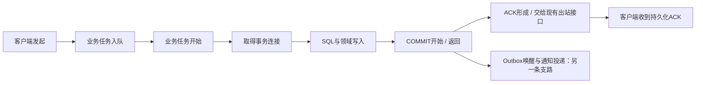

# NEBULA 下一阶段计划

Function3.3 之后的主线是把 NEBULA 做成可复现、可观测、可复盘的 C++ 服务端项目。缘续-聊天提供持续实时负载，缘生-广场提供带数据库和权限的读写负载，研途提供跨端账号场景。把这些用例固化为可重跑的实验，形成招聘时能打开报告逐段解释的证据。[本版范围](../releases/function3.3.md) · [当前状态](../../STATUS.md)

1. **先把 ACK 长尾定位讲通。** 固定同一套构建、临时库、夹具和负载，复跑 A/A。选一条慢消息，从客户端往返追到业务队列、数据库取连接和 COMMIT，再用只改一项的对照验证。交付可复现命令、分位图和负面结果。
2. **再跑 Envoy 故障演练。** 先测单上游新增开销，再分开验证双上游健康摘除、排空和断线恢复，最后把两个业务实例放到不同主机。用 Observer 对齐入口、应用和数据库事件，按原幂等键核实已确认消息。[Envoy 健康检查](https://www.envoyproxy.io/docs/envoy/latest/intro/arch_overview/upstream/health_checking) · [OpenTelemetry 上下文传播](https://opentelemetry.io/zh/docs/concepts/context-propagation/)
3. **跑通一个真实 DAG，再接设备遥测。** 先选择固定的并行和汇合任务，用状态机记录执行尝试、持有期限、失败和重试。用同一 Trace 关联调度端与两个工作进程。设备从模拟的只读观测和回放开始，按来源、序号与时间戳区分丢样、晚到与重复。[既有扩展与模拟证据](nebula-cpp-dag-robotics-evaluation.md)

## 1. 当前判断

- **业务与冗余**。Linux 通信档和 PostgreSQL 业务档已验证从空目录复现。11 月 20 日同一虚拟机上的 A/B 两个进程完成 25 条跨实例消息、ACK 后强杀、历史恢复和同键去重。Prometheus、Collector、Tempo 和本机 Alertmanager 完成实机验收。真实跨主机网络、共享数据库故障切换和完整档 24 小时长稳等待验证。[两档复现](../ops/validation/reproduce.md) · [双实例结果](../observability/validation.md#双实例实时投递与告警验收)
- **性能**。Phase49 的 `/fast` 中位吞吐下降 3.89%，第三轮聊天 ACK P99 从 8.710 ms 增至 15.545 ms（+78.47%），超过 20% 门槛。之后完成十对同版本 A/A 和逐消息分段，较近的一组 A/A 仍判为 `NOISY`，各配对 P99 变化绝对值的 P95 为 19.51%。先复核波动来源，再做新旧版本放行对照。[Phase49 原始结果](../../artifacts/function3/phase49/linux/benchmarks-resume-after-interruption/summary.json) · [后续测量记录](../observability/validation.md)
- **入口**。Envoy 的配置、隔离运行入口、协议检查和 C++ 计时策略已有代码。真实代理运行、双上游配置、Envoy span 与业务 span 串联、Wasm 构建与加载各需运行证据。[网关验收](../observability/validation.md#envoy-入口网关隔离验收)

## 2. 顺序与交付

| 顺序 | 要做的事 | 验收时看什么 |
|---|---|---|
| 1 · Phase50 ACK 长尾与基线 | 固定程序、迁移、夹具、并发、时长和采样配置。用已有 1、4、16 工作端档位复查尾段，对齐业务排队、数据库等待、COMMIT、ACK 就绪与客户端往返。每次只改一处有样本支持的瓶颈。 | 三组同配置直连 A/B，`/fast` 中位吞吐回退 ≤10%，每组持久化 ACK P99 增幅 ≤20%，容量内业务错误为零。波动过高记为证据不足。 |
| 2 · Envoy 原生单上游 | 同一隔离上游比较直连与代理。覆盖登录、HTTP/1.1、HTTPS + HTTP/2、WS、SSE 补发、文件与上游超时，复验入口日志关联。 | 黑盒报告保留协议、HTTP 状态、持久化 ACK、请求 ID、上游超时与恢复。用第 1 步的性能门槛衡量增加一跳的开销。 |
| 3 · Phase51 双上游、长稳与异机 | 先在单 VM 接入两条上游，演练就绪摘除、计划排空、意外退出、客户端重连。在资源有界的条件下完成 24 小时隔离运行，再把两个应用进程移到独立主机，演练网络中断。 | A/B 都有真实流量。A 退出后新连接到 B，客户端按原序号恢复，已确认消息可读，同键仍只一行。记录恢复时长、错误、RSS、积压和磁盘，验证清理。异机演练单独记录实际拓扑和故障。 |
| 4 · 按需搭建 C++ Wasm 与扩展生产者 | 原生代理稳定后比较插件开关。优先选一个真实 DAG 工作流，让两个 Worker 运行有汇合和重试的任务。Agent 或 ROS 2 选一个真实生产者接入现有协议。 | 插件采到 WS/SSE 建连直方图，失败时代理仍能处理请求，报告开销。工作流可按 Trace 回读每次尝试、依赖与最终结果，模拟夹具继续有来源标记。 |
| 5 · Phase52–53 业务治理与受控试运行 | 继续真实用户交叉场景、AI 取消与资源释放、真实语音试听、恢复与发布回退。 | 分别保存功能、性能、AI 质量和音色证据。数据库高可用先确定可接受的数据损失与恢复时间，再做备份恢复和故障切换。日常切换待单独授权。 |

Phase50 的测量工具和 Phase51 的直连双实例已有阶段证据。正式放行以对应场景的原始报告为准。[技术版本与接入台账](../observability/sources.md) · [DAG、Agent 与具身练习](nebula-cpp-dag-robotics-evaluation.md)

## 3. 最推荐先做的 Phase50

### 3.1 沿一条慢消息定位

追踪像查快递单。先从压测报告选一条慢 ACK，再按 Trace ID 看它在哪个处理阶段耗时最长。业务侧按同一任务的排队、事务和提交边界测量，压测端用发送到收到 ACK 的往返时间配对。重复发送使用原幂等键。[一次真实慢 ACK 的操作步骤](../observability/ack-diagnosis.md)

每个进程用自己的单调时钟计算本地耗时。客户端往返和服务端阶段按同一消息配对，统计各段 P99 时分别使用各自的样本分布。ACK 就绪是业务交给出站接口的边界，网络侧以客户端实际收到 ACK 的时间为准。Outbox 实时投递另有游标和延迟口径。

### 3.2 在已有业务边界采样，继续冻结通信核心

|既有文件|读取的边界|
|---|---|
|[Phase11Realtime.cpp](../../backend/application/modules/chat/transport/Phase11Realtime/Phase11Realtime.cpp)|`chat.send`关联、ACK形成与业务异步完成|
|[ChatService.cpp](../../backend/application/modules/chat/application/ChatService/ChatService.cpp)|事务、幂等、消息和Outbox写入|
|[BoundedExecutor.cpp](../../backend/application/runtime/BoundedExecutor/BoundedExecutor.cpp)|同一个任务的入队与开始，不只看总平均|
|[PostgresStore.cpp](../../backend/application/storage/postgres/PostgresStore/PostgresStore.cpp)|同连接事务、COMMIT开始/返回、异常回滚|
|[BusinessMetrics.h](../../backend/application/observability/metrics/BusinessMetrics.h)|沿用聚合指标，与抽样追踪分开呈现|
|[ChatAckTrace.h](../../backend/application/observability/tracing/ChatAckTrace.h)|同一条消息的服务端分段记录|
|[混合基准](../../benchmarks/function3_mixed.py)|客户端ACK分位数、错误、资源与追踪样本关联|
|[三轮编排](../../scripts/function3/validation/phase47_benchmark.py)|相同参数、轮次、二进制摘要与失败记录|

复用现有业务埋点和任务生命周期，继续执行 `backend/server/` 的冻结门禁。连接关闭、超时、fd 复用或 HTTP/2 Stream 重置时，业务完成仍走现有身份校验。

### 3.3 让测量本身足够轻

1. 抽样、缓冲和保留时间有上限；后台批量输出，缓冲满时丢弃追踪样本并计数，不阻塞消息提交或丢业务数据。
2. 记录阶段、耗时、结果和必要关联ID；不记录正文、密码、Token、Key或SQL绑定参数。
3. 用户/消息/会话ID只放抽样日志，不放指标标签，避免每条消息制造一组常驻计数器。
4. 比较同一构建关闭/开启追踪的开销；不能把新日志锁竞争当成原业务瓶颈。
5. 先用已有工具只读观察SQL等待、磁盘/WAL和VM资源；需要新的工具、扩展、下载或运行参数改动时仍走原审批规则。

### 3.4 固定实验再修复

先写下数据规模、预热、持续时间、并发、持久化样本数与资源隔离；避免仅用约一秒的小突发判定稳定P99。保留原Phase49测量，新负载下另建基线，不把两种负载混算。每一组新实验开始前固定参数，不因成绩不利临时换参数或挑较好轮次。

已存 A/A 用于判断同版本波动。机器配额、后台任务、采样窗口或负载改变时，用同一二进制重新校准。候选变更做独立 A/B，同步保存 UTC 窗口、程序/配置/夹具摘要、每组成功 ACK 样本数和原始报告。[容量、开销与校准入口](../observability/setup.md#分项验证)

若最慢样本集中在执行器排队，先对照任务类别、入队速率、活跃工作线程和 PostgreSQL 连接等待，再调整并发。若集中在 COMMIT，匹配数据库进程和实际提交区间查 `wait_event`、WAL 和块设备。曾采到 `IO:WalSync` 的提交只解释对应样本，其他尖峰按各自证据判断。保持同步提交、消息与 Outbox 原子性、权限检查，修复后再跑契约、真实数据库及故障回归。[提交等待关联方法](../observability/resources.md#关联-commit-和数据库等待)

## 4. Phase51之后怎样完善已有功能

- **真实用户场景**：双人私聊、一人离线、多端已读、ACK丢失重试、管理员撤回、群权限变化、历史搜索定位、树故事/好友动态/仅自己可见内容、群AI与私人助手隔离。现有能力不用重写，重点补足交叉场景与运行证据。
- **接口契约**：119项方法/路径检查不能替代字段Schema。按用例补足输入、输出、状态码、取消、分页和WS/SSE事件顺序；保留旧字段兼容，新增ID继续使用十进制字符串。
- **数据库分层**：只在实际修改对应领域时继续收窄Port和迁走兼容门面；不为了少几行代码拆散同一事务、再建一份账号库或复制五套空壳对象。
- **AI治理**：复用现有Worker隔离，先做好预算、取消、切换、引用与质量评估。Windows当前负责本机资料和检索，不把“本机保存资料”说成“推理全部离线”；真正的本地模型运行属于另一个需要单独确认的范围。
- **语音和外观**：真实Key可用时才验收云调用；用同一文案试听，不能以生成了声音判定御姐/磁性音色或自然度合格。外观按用户反馈做小范围调整，不挤占本轮性能定位。

## 5. 运行边界与后续范围

Linux 承担通信、共享业务和 AI，Windows 承担私人客户端，浏览器承担交互。验收使用临时库和独立端口，遵守依赖审批、迁移只追加和原库升级先备份的约定。远端 CI runner 和容器复现各自保存真实运行日志。

先验证现有服务的冗余与恢复。更大规模的服务拆分、分布式缓存和动态控制面待拓扑及配置更新需求明确后单列。通知收件箱、消息编辑、邮件找回、中文语义向量检索、E2EE 与语音视频也各自有独立业务验收范围。

当前架构：[全局总览](../architecture/overview/ARCHITECTURE.md) · [完整调用图](../architecture/business/flows/current-end-to-end.md) · [功能与限制](../../STATUS.md)。
