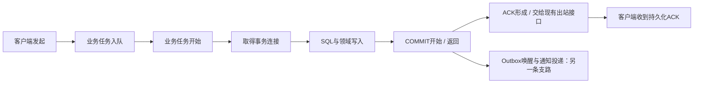

# 后续演进建议：先完成性能闭环，再验收已有能力

以 Phase49 性能证据和当前社区拆分后的复现结果为基线。下文列出 Phase50–53 的待办与过关标准。[当前状态](../../STATUS.md)

## 1. 当前判断

[近期工程计划](engineering-credibility.md)将 Phase50 分为校准、追踪、定点修复和构建交付。社区拆分和 Linux 通信/业务两档已验证。完整十轮 A/A、正式性能修复、Docker 镜像和远端业务 CI 仍待验收。[复现记录](../ops/validation/reproduce.md)

现在适合继续完善，但优先事项是“把已有系统做到可测、稳定、可维护”，暂时不新增微服务、集群或大模型数量。

- 现有账号、聊天、社区、三形态助手、模型/语音适配已有工程实现与阶段验证，通信核心和业务边界已经明确。
- Phase49 三轮 `/fast` 中位吞吐下降3.89%，仍在≤10%的约束内；第三轮聊天ACK P99从8.710ms升至15.545ms（+78.47%），超过≤20%门槛。混合吞吐中位约下降16.93%，业务错误为0。
- 当前SQL、排队、提交唤醒与Outbox统计是聚合数据，不能回答“这条消息具体慢在哪里”。也不能仅凭这些平均值判断装配重构或某条SQL是根因。
- 真实云语音/外部模型Key、主观语音自然度、远程CI与正式容量仍有验证限制；教学训练闭环不等于模型质量已改善。

证据入口：[Phase49结论](../architecture/business/engineering/phase49.md)、[完整三轮](../../artifacts/function3/phase49/linux/benchmarks-resume-after-interruption/summary.json)、[聚合分析](../../artifacts/function3/phase49/linux/benchmark-analysis.json)。旧失败记录保持原样。

## 2. 顺序与交付

|优先级 / 建议阶段|现有基础|下一步做什么|过关标准|
|---|---|---|---|
|P0 / Phase50：逐消息定位与性能修复|真实ACK、聚合指标、三轮基准|先固定负载与A/A噪声诊断，再建立有界追踪，定位SQL/事务/调度/输出各段；一次只改有证据的瓶颈|相同配置三轮：/fast中位回退≤10%，每轮配对ACK P99增幅≤20%，容量内业务错误0；没有通过就继续本阶段|
|P1 / Phase51：真实用户闭环与稳定性|幂等、恢复、权限、前端控制器和接口绑定|按实际多用户/多端场景验证聊天、社区、助手和管理；完善字段/错误/事件契约与恢复演练|重复不重写、不越权、不泄露隐藏内容；队列和缓存有界；约定时长的稳定性及备份恢复有记录|
|P2 / Phase52：AI与语音的治理验收|三条模型Provider、RAG、记忆、评测门禁、取消与回退|验证超时/取消回收、模型驻留与切换、授权知识隔离、评估集和真实音色试听|普通聊天不受推理故障阻塞；私人/群知识隔离；质量与听感有独立结论，不以接口返回/WAV生成替代|
|P3 / Phase53：受控试运行|健康、指标、迁移、监督、隔离环境|固定配置和容量预算，验证优雅停机、启动依赖、备份恢复、资源/磁盘及回退|功能与性能均通过，并完成部署审批、回退演练和限定规模试用；仍不凭单次测试宣称通用生产就绪|

这不是按日期赶工的四张通行证。前一阶段的关键失败未解决，不把它带到下一阶段并改标为完成。阶段时间线只收录已经形成实现/验收记录的阶段。

## 3. 最推荐先做的 Phase50

### 3.1 给消息贴一张贯穿处理过程的工单

追踪像快递单：快递站的“平均处理时间”不能说明你这一件在哪里停留，必须把同一件的入站、装车、发出时刻串起来。

建议关联 `client_message_id`、提交后得到的 `message_id`、`conversation_id` 与当前请求/连接身份。HTTP/2还需核对Stream身份；重试沿用原幂等键，不能借“重新追踪”重新创建消息。

在同一进程中使用单调时钟计算耗时；Windows和Linux的单调时钟起点不同，不能直接相减。客户端单独测往返，服务器单独测各段；不能把不同样本的累计平均值相加，冒充某条消息的总延迟。

### 3.2 在已有业务边界采样，继续冻结通信核心

|既有文件|计划关注的边界|
|---|---|
|[Phase11Realtime.cpp](../../backend/application/transport/realtime/Phase11Realtime/Phase11Realtime.cpp)|`chat.send`关联、ACK形成与业务异步完成|
|[ChatService.cpp](../../backend/application/modules/chat/application/ChatService/ChatService.cpp)|事务、幂等、消息和Outbox写入|
|[BoundedExecutor.cpp](../../backend/application/runtime/BoundedExecutor/BoundedExecutor.cpp)|同一个任务的入队与开始，不只看总平均|
|[PostgresStore.cpp](../../backend/application/storage/postgres/PostgresStore/PostgresStore.cpp)|同连接事务、COMMIT开始/返回、异常回滚|
|[BusinessMetrics.h](../../backend/application/observability/BusinessMetrics/BusinessMetrics.h)|沿用聚合指标，与抽样追踪分开呈现|
|[混合基准](../../benchmarks/function3_mixed.py)|客户端ACK分位数、错误、资源与追踪样本关联|
|[三轮编排](../../scripts/function3/validation/phase47_benchmark.py)|相同参数、轮次、二进制摘要与失败记录|

新组件若确有必要，建议放在 `backend/application/observability/MessageTrace/`，遵循同名目录与文件规则；**这是候选位置，目前不创建空目录或占位代码**。追踪上下文由任务拥有，关闭、超时、fd复用或Stream重置后仍按既有身份校验，不能让迟到回调写入新连接。

“ACK已交给发送队列”不等于“socket/TLS已发完”。只有既有出站完成回执确实可关联时，才标为完成；没有可用观察点就明确标记未观测。不能为了补齐一张图，擅自改动冻结的 `backend/server/`。是否需要最小观察接口，应由测量证明必要后另行讨论。

### 3.3 让测量本身足够轻

1. 抽样、缓冲和保留时间有上限；后台批量输出，缓冲满时丢弃追踪样本并计数，不阻塞消息提交或丢业务数据。
2. 记录阶段、耗时、结果和必要关联ID；不记录正文、密码、Token、Key或SQL绑定参数。
3. 用户/消息/会话ID只放抽样日志，不放指标标签，避免每条消息制造一组常驻计数器。
4. 比较同一构建关闭/开启追踪的开销；不能把新日志锁竞争当成原业务瓶颈。
5. 先用已有工具只读观察SQL等待、磁盘/WAL和VM资源；需要新的工具、扩展、下载或运行参数改动时仍走原审批规则。

### 3.4 固定实验再修复

先写下数据规模、预热、持续时间、并发、持久化样本数与资源隔离；避免仅用约一秒的小突发判定稳定P99。保留原Phase49测量，新负载下另建基线，不把两种负载混算。每一组新实验开始前固定参数，不因成绩不利临时换参数或挑较好轮次。

先用同一份二进制做A/A噪声诊断，估计VM本身的波动；它只能说明测量稳定性，不是新旧版本A/B验收。若同版本噪声已很大，应先改善实验隔离与样本量，不能顺势放宽验收阈值。工作区中的未提交实验脚本也不能仅凭存在就算完成了这一步。

根据证据选择SQL索引/执行计划、重复查询、连接等待、事务往返或Outbox调度中的具体一项。保持同步提交和消息/Outbox原子性；不通过提前ACK、关闭WAL持久化或跳过权限检查换取速度。修复后执行对应契约/真实PG/故障用例，再完成同配置三轮及适用的Release/Debug/Sanitizer检查。

## 4. Phase51之后怎样完善已有功能

- **真实用户场景**：双人私聊、一人离线、多端已读、ACK丢失重试、管理员撤回、群权限变化、历史搜索定位、树故事/好友动态/仅自己可见内容、群AI与私人助手隔离。现有能力不用重写，重点补足交叉场景与运行证据。
- **接口契约**：119项方法/路径检查不能替代字段Schema。按用例补足输入、输出、状态码、取消、分页和WS/SSE事件顺序；保留旧字段兼容，新增ID继续使用十进制字符串。
- **数据库分层**：只在实际修改对应领域时继续收窄Port和迁走兼容门面；不为了少几行代码拆散同一事务、再建一份账号库或复制五套空壳对象。
- **AI治理**：复用现有Worker隔离，先做好预算、取消、切换、引用与质量评估。Windows当前负责本机资料和检索，不把“本机保存资料”说成“推理全部离线”；真正的本地模型运行属于另一个需要单独确认的范围。
- **语音和外观**：真实Key可用时才验收云调用；用同一文案试听，不能以生成了声音判定御姐/磁性音色或自然度合格。外观按用户反馈做小范围调整，不挤占本轮性能定位。

## 5. 保持的边界与暂缓范围

保留Linux通信/共享业务/AI、Windows私人客户端、浏览器交互三端方向；不做新一轮整体目录搬迁。继续冻结152份通信文件、复用现有数据库与依赖、迁移只追加、原库升级先备份。本次不启动新服务、安装依赖、写数据库或替换日常实例。

微服务、分布式数据库/缓存集群、通知收件箱、消息编辑、邮件找回、中文语义向量检索、E2EE与语音视频通话继续作为后续独立范围。现在没有证据说明“增加一个分布式组件”能解决这次尾延迟问题。

当前架构：[全局总览](../architecture/overview/ARCHITECTURE.md) · [完整调用图](../architecture/business/flows/current-end-to-end.md) · [功能与限制](../../STATUS.md)。
