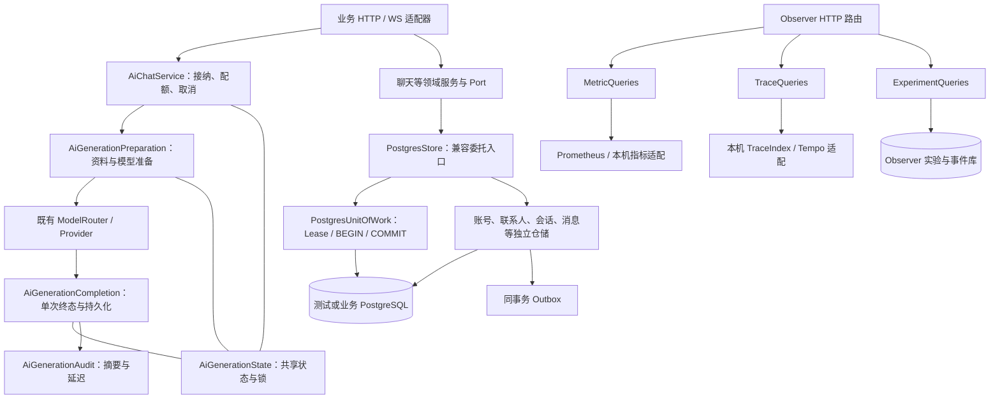

# 全项目改进意见：本轮实施与验收

日期：2026-11-19。依据[改进意见 R1–R12](project-review-2026-11-19.md)。保留 Linux 共享业务、Windows 私人客户端、浏览器展示的分工。通信核心继续冻结；本轮不迁移原库、不更新日常 18090、不自动推送。

## 1. 本轮落点

| 编号 | 实施内容 | 验收范围与剩余条件 |
|---|---|---|
| R1 | 原生档构建清单、Worker/外部库摘要、解包预检与启动器 | 原生 Release、真实 PG/OTLP 和解包启动分别验证。模型目录检查、实际预热、生成质量分开记录；模型和外部库不偷偷打入包中。详见[原生交付](../ops/validation/native-delivery.md)。 |
| R2 | 通信/内存、业务、原生预设；Tree、AI、Speech 独立链接测试；CI 增加原生档显式入口 | 缺模块和意外跳过均失败；远端 runner 未在本轮触发，不能凭工作流文件宣称远端通过。 |
| R3 | 私有凭据文件检查；隔离监控启动时核对匿名 401、普通身份 403、ops 200 | 保持本机监听与 SSH 访问。现有网段、保留地址、重定向和凭据边界继续测试；公开多用户 RBAC 未列为已实现。 |
| R4 | 真实数据库行锁造成慢 ACK；同窗标记、Trace、恢复样本及同键重试回读 | 使用一次性数据库和合成账号，既有数据库与真实用户内容排除。小样本用于定位与恢复，不能当容量提升证明。[操作讲义](../observability/ack-diagnosis.md)。 |
| R5 | `AiChatService` 拆准备、终态、审计与共享状态 | 公开接口不变；配额、取消、超时和迟到回调仍经过同一个状态。Provider 替身验证生命周期，不能证明模型质量。 |
| R6 | `PostgresUnitOfWork` 管理连接与同线程事务，原 Store 继续向领域仓储委托 | 嵌套事务在取第二条连接前拒绝，增加单连接池回归；数据与 Outbox 保持同事务。兼容门面仍存在，不声称已经删除所有旧入口。 |
| R7 | Observer 的指标、Trace、实验查询从 HTTP 路由抽离 | Prometheus 固定面板增加有界批量查询；Explore 使用真实瞬时/范围接口；多实例展示文字不再作为实例过滤条件。单项失败单列，真实零值不改为空值。保留页面取消与旧响应隔离。 |
| R8 | 获批安装 Prometheus 3.13.5、Node Exporter 1.12.1；新增 `metrics` 运行档 | 使用真实进程、官方摘要和真实函数直方图；跨进程 Probe → NEBULA → PG 继续回读。Collector、Tempo、Loki、Pyroscope 实机联调仍分别待授权/部署。 |
| R9 | CI 产物统一七天；活动遥测七天；不活动实验的临时数据按所有权标记清理 | 原库、用户文件、未标记目录和主动导出文件排除。老实验清理由监控启动及显式命令执行，未安装系统定时任务。 |
| R10 | 延续真实服务与浏览器用户旅程，补真实 Prometheus 档刷新测试 | 三尺寸、函数/调用链、日志、导出、查询失败与迟到响应分别记录。Windows 私人客户端没有因目录不变而被视为本轮全面复测。 |
| R11 | 保持已有评测门禁及私人内容边界，报告区分替身与真实模型 | 缺授权质量评估集、真实云 Key 或模型实测的部分继续待验收，不收集私人对话补齐数据。 |
| R12 | 保持 DAG/Agent/设备生产者契约与模拟标记 | 当前没有新增真实集群、机器人或 DAG 引擎，不能把模拟联调改名为真实接入。 |

本轮状态：R1/R2/R4/R5/R6/R7/R9 的下述交付已验证；R3 当前验证本机与 SSH 边界，公开多用户治理仍待实施；R8 完成真实指标后端，其他后端待接入；R10 完成监控界面旅程，原业务与 Windows 客户端全旅程继续单列；R11/R12 需要真实数据集或运行对象。

具体数量、摘要与失败记录以[本轮验证](../observability/validation.md#2026-11-19-全项目改进意见落地)和归档报告为准。

## 2. 组件与责任

### AI：像接力赛，交接任务，不交接“最终裁判权”

1. 入口接纳请求、检查并发配额，并把生成任务登记到共享状态。
2. 准备组件检查可见消息、RAG 与模型，异步 Provider 接收拥有自身输入的任务。
3. 成功、失败、主动取消、超时和停机都回到同一状态。先取得终态的路径负责移除活动任务；迟到的回调不能再次完成。
4. 指标和 Trace 随真实任务结束，数据库审计与通知仍走原有队列。模块拆分不改变业务线程、模型线程和数据库线程的边界。

### 事务：同一张工作票，共用一条数据库连接

1. 工作单元借一条连接执行 `BEGIN`，当前线程访问领域仓储时复用它。
2. 消息和 Outbox 都在这张工作票内写入；成功提交后才唤醒投递。
3. 失败回滚并归还连接。工作单元在获取第二条连接前拒绝嵌套事务，防止单连接池自己等待自己。
4. 事务不能跨线程完成；跨线程业务继续把整个事务放在同一数据库任务内。应用服务不持有 `PGconn*`。

### Observer：把窗口、询价和送货分开

1. HTTP 层只处理请求边界、输入、状态码与响应。
2. 查询服务负责时间窗、筛选和投影；后端适配器负责 Prometheus、Trace 或本地存储的具体协议。
3. Prometheus 固定面板共用四个工作线程、八个待处理槽，每批最多二十四个面板，总等待预算三秒；超出预算和失败面板保留“不可用”。
4. 指标刷新与健康、告警、版本、标注独立。页面销毁后取消请求，旧页面的结果不重新写入当前页面。

## 3. 如何复核与回退

1. 先跑[原生交付检查](../ops/validation/native-delivery.md)，确认“编译支持”“运行配置”“真实就绪”“质量评估”四种状态。
2. 按[慢 ACK 教学](../observability/ack-diagnosis.md)建立独立实验，用 Trace 找到数据库等待，再查恢复与幂等结果。
3. 读[最新测试记录](../observability/validation.md)，保留已有 A/A 高噪声、历史 ACK 尾延迟超标和 TSan 工具链限制。
4. 回退代码以本地源码检查点和原始改动为准；测试环境只停止其拥有的实验进程。日常程序没有由本轮替换。

下一步应依据这轮证据选择一个实际瓶颈，先做单变量对照。公开多用户监控治理、真实质量评估集与真实设备接入需要各自的运行对象和验收条件。
